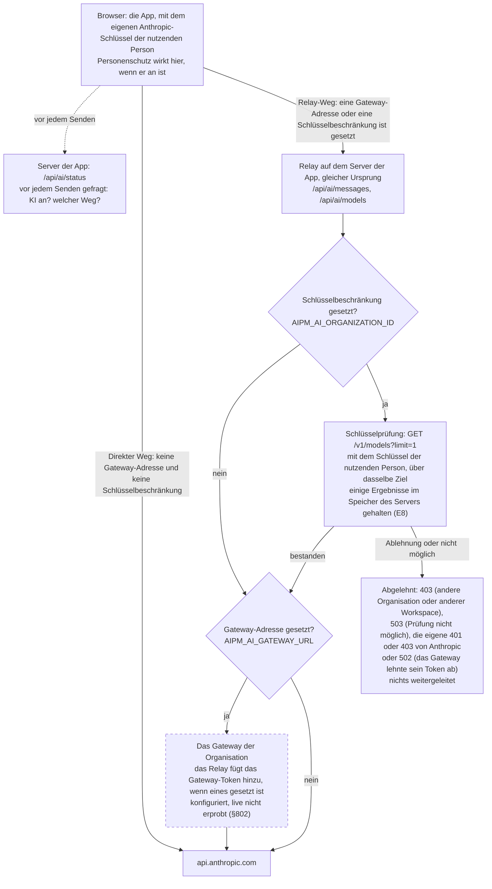

# Anhang: die Fakten hinter den Kurzinformationen

## So lesen Sie diesen Anhang

Die sieben Kurzinformationen umfassen je eine Seite. Jede Tatsachenaussage trägt dort eine Kennzeichnung und eine
Belegnummer (E1, E2, …); dieser Anhang sagt, woher sie stammt. Er besteht aus vier Teilen:

- den Belegarten, die angeben, wie weit eine Aussage geprüft ist;
- einem Diagramm der beiden Wege, die eine KI-Anfrage nehmen kann;
- der Belegtabelle, eine Zeile je Nummer, mit Datei und Symbol, Test, erzeugtem Block oder gemessenem Wert;
- den erzeugten Tabellen. Alles zwischen zwei `PACK:`-Markierungen schreibt `npm run compliance:generate` aus dem
  Code und den Texten der App selbst, und `npm run compliance:check` schlägt fehl, sobald eine Tabelle nicht mehr
  passt.

Der Text beschreibt den Code im Commit 57335a5ba, außer den Zeilen E47, E54, E59, E69, E71 und E72, die ihn im
Commit 1d2ed4812 beschreiben. Die Zahlen wurden am 2026-11-14 im Demoprojekt mit dem Commit
e63693393 gemessen und nicht erneut gemessen. Zwischen beiden änderten sich, abgesehen von den Werkzeugen der
Kurzinformationen selbst, die Gültigkeitsdauer einer bestandenen Schlüsselprüfung und deren Beschreibung, was keine
gemessene Anfrage und keine Kosten verändert, und die App änderte sich auf fünf Arten, die die Zahlen nicht
abbilden: Bei aktivem Personenschutz wird keiner Anfrage an die KI mehr ein Insight über eine einzelne Person
hinzugefügt (E67), der Eintrag im Aktivitätsprotokoll zu einem übernommenen Projektstrukturplan nennt die
angelegten Aufgaben (E68),
„Mit KI planen“ zeigt, was seine Anfrage weggelassen hat (E60), das Relay und die Diktat-Route lehnen mehr Aufrufe
ab und begrenzen jeden Aufrufer (E69, E70), was einen Aufruf ablehnen kann, aber keinen verändert, der durchgeht,
und die KI-Offenlegung hat sich geändert, sodass jede nutzende Person ihr erneut zustimmt. Die ersten beiden
ändern, was eine Anfrage enthält; bei der zweiten nennt der Aktivitätstext, den der Chat durchsuchen kann, bis zu
20 der angelegten Aufgaben (E68). Vier spätere Änderungen bilden die Zahlen ebenfalls nicht ab: Die
Anfragegrenze vertraut keinem Header mehr, den der Aufrufer setzt (E54), ein Projekt, das seine
Ressourcen-Funktion ausblendet, gibt der KI deren Personen-Werkzeuge und die Liste, wer abwesend ist, nicht mehr
(E59), und zwei Projekteinstellungen können jede Änderung des Chats zur Prüfung schicken (E71) oder Stundensätze
aus „Mit KI planen“ heraushalten (E72). Solange beide Einstellungen aus sind, wie bis zum Setzen, und die
Ressourcen-Funktion eingeblendet ist, ändert keine der vier, was eine Anfrage enthält, abgesehen von einem
hinzugefügten Satz über eine ausgeblendete Ressourcen-Funktion in dem Betriebsleitfaden, der in den Chat
eingebaut ist. Offene Lücken werden mit ihrer Nummer im Register offener Punkte des Projekts
(`docs/open-followups.md`, englisch) zitiert, zum Beispiel §802; die Tabelle unter „Offene Lücken“ führt jede auf, die
die Kurzinformationen zitieren.

## Belegarten

| Belegart | Bedeutung |
|---|---|
| *gemessen* | Beobachtet in bezahlten Läufen im Demoprojekt am 2026-11-14, mit der App im Commit e63693393. Die zusammengefassten Werte stehen in `docs/briefs/figures.json`. Eine kleine Stichprobe, keine Zusage für andere Daten. |
| *getestet (Unit)* | Ein automatischer Unit-Test im Repository prüft es; die Tabelle nennt den Test. Unit-Tests ersetzen Netz, Modell und Datenbank durch Attrappen. |
| *getestet (Live-Datenbank)* | Ein automatischer Test prüft es gegen eine echte Turso-Datenbank (libSQL); die Tabelle sagt, was der Test nicht abdeckt. |
| *im Code gelesen* | Jemand hat den Code gelesen, und er tut das. Diese Kurzinformationen nennen keinen Test und keinen Lauf für die Aussage, wie sie dasteht. |
| *geschätzt* | Aus gemessenen Werten und genannten Annahmen errechnet; die Annahmen stehen daneben. |
| *nicht belegt* | Niemand hat es in die eine oder andere Richtung gezeigt. Der Registereintrag sagt, was es bräuchte. |

„Im Code gelesen“ wiegt weniger als „getestet“: Eine spätere Änderung kann es brechen, ohne dass eine Prüfung
fehlschlägt.

## Zwei Wege zum Modell

Alle Nutzenden bringen ihren eigenen Anthropic-API-Schlüssel mit. Wohin eine Anfrage geht, bestimmen zwei
Server-Einstellungen der Installation: eine Gateway-Adresse (`AIPM_AI_GATEWAY_URL`) und eine Beschränkung auf
die Anthropic-Schlüssel der eigenen Organisation (`AIPM_AI_ORGANIZATION_ID`, wahlweise mit
`AIPM_AI_WORKSPACE_IDS`). Ist keine von beiden gesetzt, ruft der Browser Anthropic selbst auf (der direkte Weg).
Ist eine gesetzt, ruft der Browser den Server der App auf, der die Anfrage weiterleitet (E4, E5). Ist der
Personenschutz an, wirkt er im Browser, vor beiden Wegen (E15).

Was das Diagramm zeigt, mit dem Beleg für jeden Schritt:

- Vor jedem Senden fragt der Browser den Server der App, ob die KI noch an ist und welcher Weg gilt. Er sendet
  nichts, wenn keine Antwort kommt, die Antwort „KI aus“ lautet, eine ungültige Einstellung meldet oder einen
  anderen Weg nennt (E3).
- Direkter Weg: Der Browser sendet an api.anthropic.com. Nur in diesem Fall darf der Browser Anthropic überhaupt
  erreichen (E4, E34).
- Relay-Weg: Der Browser sendet an `/api/ai/messages` auf dem Ursprung der App. Das Relay leitet die Anfrage an
  das Gateway weiter, wenn eine Gateway-Adresse gesetzt ist, sonst direkt an api.anthropic.com. Ist keine von
  beiden Einstellungen gesetzt, antwortet das Relay mit 404; jede ungültige Einstellung lehnt jeden Aufruf ab
  (E5).
- Ist eine Schlüsselbeschränkung gesetzt, wird nichts weitergeleitet, bevor der Schlüssel der nutzenden
  Person die Schlüsselprüfung bestanden hat. Sie fragt Anthropic über dasselbe Ziel, zu welcher Organisation und welchem
  Workspace der Schlüssel gehört (E7). Einige ihrer Ergebnisse hält der Server in seinem Speicher, eine bestandene Prüfung
  höchstens 15 Minuten (E8, E9). Ein Gateway ohne Schlüsselbeschränkung führt keine Schlüsselprüfung aus.
- Das Gateway ist jede https-Adresse, die der Betreiber setzt; die App fügt sein Token hinzu, wenn eines gesetzt ist,
  und wurde noch nie gegen ein echtes Gateway betrieben (E11, E12, E13).

## Belegtabelle

Testnamen stehen genau so da wie in der Testdatei (auf Englisch). `_relay.ts`, `_key-check.ts` und ihre Tests
liegen in `src/app/api/ai/`.

| Id | Aussage | Belegart | Quelle |
|---|---|---|---|
| E1 | Für jede KI-Funktion: was sie sendet, welche Zustimmung sie braucht und was sich bei aktivem Personenschutz ändert. | *im Code gelesen* | Blöcke `ai-paths` und `ai-paths-people`, erzeugt aus `AI_DATA_PATHS` in `src/app/ai-disclosure.ts` |
| E2 | Jede KI-Anfrage trägt den eigenen Anthropic-API-Schlüssel der nutzenden Person. Das Relay leitet diesen Schlüssel weiter, fügt keinen eigenen hinzu und lehnt einen Aufruf ohne Schlüssel ab (400). | *getestet (Unit)* | `relay` und `forwardHeaders` in `_relay.ts`; Tests `models without a key → 400 missing-api-key without calling send` und `a call without a key of its own is still refused with 400` in `_relay.test.ts` |
| E3 | Vor jedem Senden fragt der Browser den Server der App (`/api/ai/status`), ob die KI an ist und welcher Weg gilt. Ist die KI aus, die Einstellung ungültig, der Weg geändert oder kommt keine gültige Antwort, wird nichts gesendet. | *getestet (Unit)* | `confirmAiDeployment` in `src/app/ai-transport.ts`; Tests `page state direct, status answers relay: route-changed, and Anthropic is never called` und `an answer that says AI is off is off even without the people lock` in `src/app/ai-transport.test.ts` |
| E4 | Direkter Weg: Ohne Gateway-Adresse und ohne Schlüsselbeschränkung sendet der Browser KI-Anfragen direkt an api.anthropic.com. Relay-Weg: Ist eine von beiden gesetzt, sendet der Browser sie an das Relay auf dem Server der App (gleicher Ursprung) und nicht an Anthropic. | *getestet (Unit)* | `postAiMessages` und `usesRelay` in `src/app/ai-transport.ts`; Tests `direct: checks the status, then posts to Anthropic with today's four headers`, `gateway: posts to the same-origin relay without the browser-access header` und `relay: posts to the same-origin relay, never to Anthropic, without the browser-access header` in `src/app/ai-transport.test.ts` |
| E5 | Das Relay sendet an das Gateway, wenn `AIPM_AI_GATEWAY_URL` gesetzt ist, sonst an api.anthropic.com, wenn die Schlüssel auf eine Organisation beschränkt sind; ist keines von beiden gesetzt, antwortet es mit 404. Jede ungültige Einstellung lehnt jeden Aufruf mit 503 ab. | *getestet (Unit)* | `upstreamFor` in `_relay.ts`; Tests `direct deployment → 404, no relay`, `a Messages call goes to api.anthropic.com with the four forwarded headers and no gateway token`, `a gateway wins over the restriction: the check and the call both go to it with its token, like the real request` und `an invalid restriction → 503 ai-gateway-invalid, nothing sent` in `_relay.test.ts` |
| E6 | Das Relay lehnt Browser-Aufrufe von fremden Websites ab, leitet nur vier Anthropic-Header weiter (dazu das Gateway-Token, wenn eines gesetzt ist) und keine Cookies, und es protokolliert weder Schlüssel noch Token, Inhalt oder URL. Es authentifiziert seine Aufrufer nicht (siehe E13). | *getestet (Unit)* | `relay`, `isSameOrigin` und `forwardHeaders` in `_relay.ts`; Tests `Sec-Fetch-Site: cross-site → 403 not-same-origin`, `forwards exactly the four Anthropic headers plus the gateway token` und `no console or diagnostics output carries the key, token, body or URL` in `_relay.test.ts` |
| E7 | Schlüsselprüfung: Ist `AIPM_AI_ORGANIZATION_ID` gesetzt, sendet das Relay zuerst eine Anfrage nach einer Modellliste mit einem Eintrag (`GET /v1/models?limit=1`), mit dem Schlüssel der nutzenden Person und über dasselbe Ziel wie die eigentliche Anfrage, und liest die Organisation (und mit `AIPM_AI_WORKSPACE_IDS` den Workspace) aus den Antwort-Headern von Anthropic. Ein Schlüssel einer anderen Organisation oder eines anderen Workspaces wird mit 403 abgelehnt, eine Prüfung, die nicht laufen kann, antwortet mit 503. Die eigene 401- oder 403-Antwort von Anthropic auf die Prüfung wird unverändert zurückgegeben, und lehnt ein Gateway sein Token ab, lautet die Antwort 502. In jedem dieser Fälle wird nichts weitergeleitet. | *getestet (Unit)* | `createKeyChecker` in `_key-check.ts` und `refusalFor` in `_relay.ts`; Tests `sends GET <base>/v1/models?limit=1 with the caller's key and version; a matching org passes`, `through a gateway, a 401 that is not Anthropic-shaped is the gateway's refusal (502 ai-gateway-rejected)` und die Gruppe `createKeyChecker — Anthropic's own 403 is passed through, not cached` in `_key-check.test.ts`; Tests `another organisation → 403 ai-key-wrong-organization; no Messages call, no body read upstream` und `the check unavailable → 503 ai-key-check-unavailable; no Messages call` in `_relay.test.ts` |
| E8 | Die Schlüsselprüfung hält ihre Ergebnisse nur im Speicher des Servers, unter einem mit einem Geheimnis gebildeten Hashwert des Schlüssels. Eine bestandene Prüfung gilt 15 Minuten, eine Ablehnung (andere Organisation oder anderer Workspace) 5 Minuten und die eigene 401-Antwort von Anthropic 60 Sekunden. Jede Frist zählt ab der Antwort auf die Prüfung, nicht ab der letzten Nutzung des Schlüssels, und läuft ab, sobald die Systemzeit oder die Prozess-Uhr den Ablauf anzeigt. Ein Neustart, eine Änderung der Beschränkung oder die Verdrängung bei über 1.000 Schlüsseln (der am längsten ungenutzte zuerst) verwirft ein Ergebnis früher. Eine Prüfung, die nicht laufen konnte, die 403-Antwort von Anthropic und die Ablehnung durch ein Gateway werden nie gehalten. Dass der Hashwert mit einem Geheimnis gebildet wird und dass ein Neustart die Ergebnisse verwirft, ist im Code gelesen, nicht getestet. | *getestet (Unit)* | `createKeyChecker`, `rememberable`, `KEY_CHECK_DEFAULT_PASS_TTL_MS`, `KEY_CHECK_DEFAULT_REFUSAL_TTL_MS`, `KEY_CHECK_DEFAULT_REJECTED_TTL_MS` und `KEY_CHECK_DEFAULT_MAX_ENTRIES` in `_key-check.ts`; Tests `a different signature (the restriction changed) clears the cache`, `eviction keeps size() <= maxEntries, oldest first` und die Gruppe `createKeyChecker — least-recently-used eviction`, `the default pass lifetime is fifteen minutes`, `a pass used often is still re-checked after the pass TTL`, `the wall clock jumping forward past the TTL expires a pass whose monotonic age is small`, `the monotonic clock running while the wall clock steps back also expires a pass`, `a pass outlives the refusal lifetime`, `the default refusal lifetime is five minutes`, `remembers the 401 for 60 seconds, then sends a second pre-flight`, `a gateway's own 401 (not Anthropic-shaped) is not remembered`, `the default cap is 1000 entries` und die Gruppe `createKeyChecker — Anthropic's own 403 is passed through, not cached` in `_key-check.test.ts` |
| E9 | Weil eine bestandene Prüfung gehalten wird (E8), wird ein Schlüssel, der die Prüfung nicht mehr bestehen würde, etwa weil er in einen anderen Workspace verschoben wurde, auf diesem Server noch bis zu 15 Minuten nach seiner letzten Prüfung angenommen. Ist diese Frist abgelaufen, wird die nächste Anfrage erneut geprüft und abgelehnt. | *getestet (Unit)* | `createKeyChecker` in `_key-check.ts`; Tests `a cached pass is re-checked after the pass TTL` und `a re-check that now refuses replaces the pass` in `_key-check.test.ts` sowie `a passed key is not checked again on the next call` in `_relay.test.ts` |
| E10 | Die Schlüsselprüfung verlängerte die erste weitergeleitete Chat-Anfrage mit einem neuen Schlüssel um 724 ms und die erste weitergeleitete Inline-Bearbeitung um 344 ms, je ein Lauf. Die Zusatzzeit, sobald eine bestandene Prüfung gehalten wird, wurde nicht gemessen. | *gemessen* | `figures.json relayKeyCheck.runs`; `figures.json relayKeyCheck.warmExtraMs` (leer) |
| E11 | Das Gateway ist die https-Adresse, die der Betreiber in `AIPM_AI_GATEWAY_URL` setzt. Ist `AIPM_AI_GATEWAY_TOKEN` gesetzt, fügt das Relay es jedem weitergeleiteten Aufruf als Header `cf-aig-authorization` hinzu (der Header von Cloudflare AI Gateway, das das Betriebshandbuch beschreibt). Adresse und Token werden nicht an den Browser gesendet. | *im Code gelesen* | `parseAiGatewayConfig` und `aiDeploymentStateFrom` in `src/app/ai-gateway-config.ts`; `forwardHeaders` in `_relay.ts`; `docs/RUNBOOK.md` |
| E12 | Der Gateway-Weg wurde noch nie gegen ein echtes Gateway betrieben; seine Tests nutzen ein nachgebildetes Ziel und einen lokalen TLS-Server. Ein Live-Nachweis gegen ein echtes Gateway ist geschrieben, lief aber noch nie. | *nicht belegt* | Registereintrag §802; `src/app/api/ai/_relay.https.test.ts`; `src/app/api/ai/_relay.live.test.ts`, nur von Hand über `.github/workflows/ai-live.yml` gestartet |
| E13 | Die Server-Routen der App authentifizieren ihre Aufrufer nicht, und das Relay fügt jedem weitergeleiteten Aufruf das Gateway-Token hinzu. Eine Installation, die die KI über ein Gateway leitet, muss den Server der App deshalb hinter ihre eigene Zugangskontrolle stellen; das Betriebshandbuch schreibt das vor. | *im Code gelesen* | `forwardHeaders` in `_relay.ts`; `docs/RUNBOOK.md` „Routing AI through a gateway“ |
| E14 | Der Personenschutz ersetzt vor dem Senden die Namen der Personen, die das Projekt kennt, durch Platzhalter wie `[Person 1]`, mit oder ohne Umlaute und mit oder ohne Genitivendung. Ein Name aus mehreren Wörtern wird in jeder Groß- und Kleinschreibung ersetzt. Ein einzelnes Wort, also ein einwortiger Name oder ein Wort eines längeren Namens, wird nur dort ersetzt, wo der Text es großgeschrieben oder in Großbuchstaben schreibt, es sei denn, das Projekt selbst speichert es kleingeschrieben; ein Wort eines längeren Namens braucht außerdem mindestens 3 Buchstaben und darf kein gängiges Wort der Stoppliste der App sein. Er ersetzt außerdem jede E-Mail-Adresse; jede IBAN, die aus zwei Großbuchstaben, zwei Ziffern und dann 11 bis 30 Großbuchstaben oder Ziffern besteht, zusammengeschrieben oder in Vierergruppen mit einzelnen Leerzeichen, und deren Mod-97-Prüfsumme stimmt (die Längengrenzen sind im Code gelesen; kein Test legt sie fest); die Telefonnummer einer bekannten Person mit beliebigen Trennzeichen und jede andere Telefonnummer, die mit + oder 0 beginnt (auch in einer Klammer), mindestens 7 Ziffern hat, nur Leerzeichen, Bindestriche, Punkte, Schrägstriche und Klammern als Trennzeichen nutzt und nicht wie ein Datum aussieht. Platzhalter in der Antwort werden auf dem Gerät wieder in den ursprünglichen Text zurückverwandelt. | *getestet (Unit)* | `redactJsonBody` und `restoreJsonText` in `src/app/ai-people-redact.ts`; Tests `diacritics, case, ue-transliteration and possessive all map to one placeholder`, `a one-word entry stored in lower case is redacted in any case; a capitalised one stays case-gated`, `the case gate still holds for lone tokens of a multi-word name`, `emails, phones and IBANs get their own placeholders and counts`, `a known phone is matched by its digits even without a leading + or 0`, `phone-shaped: these ARE phones`, `dates, times, integers, money, versions and ids are NOT phones`, `an IBAN-shaped string with a bad checksum is left alone, phone pattern included` und `restore(redact(t)) === t when every match is a full known spelling` in `src/app/ai-people-redact.test.ts` |
| E15 | Der Personenschutz wirkt im Browser-Code der App, bevor eine Anfrage das Gerät verlässt; weder das Relay noch eine andere Server-Route wendet ihn an. Er gilt für diese App, wie sie ausgeliefert wird: Eine veränderte Kopie der App oder ein anderer Client mit demselben Schlüssel kann ohne ihn senden. | *im Code gelesen* | `redactForSend` und `postAiMessages` in `src/app/ai-transport.ts`; `relay` in `_relay.ts`; Test `calls fetch with an Anthropic URL only in the transport` in `src/app/ai-transport-sites.test.ts` |
| E16 | Bei aktivem Personenschutz erreicht keine Person der Testdaten den Inhalt einer Anfrage, auf keinem KI-Pfad, der sendet; ohne Personenschutz senden dieselben Pfade Personen, der Test kann sie also sehen. Die Ausnahme ist der Vorschlag für ein neues Projekt: Ein neues Projekt kennt keine Personen, die Testdaten enthalten also keine, die es senden könnte, und seine Namen lassen sich nicht schützen (E20, E35). | *getestet (Unit)* | Gruppen `with protection on, no fixture person reaches a request body` und `anti-vacuity: with protection off, the same drivers send people` in `src/app/ai-people-protection.wire.test.ts` |
| E17 | Bei aktivem Personenschutz übernimmt die App aus einer KI-Antwort, die eine Person betrifft (eine zuständige Person, eine Ressource, einen Stakeholder), nichts Personenbezogenes; der Rest der Änderung wird übernommen. | *getestet (Unit)* | Test `protection on: the assignee, the resource and the stakeholder are untouched; the rest of the task write applies` in `src/app/ai-people-protection.wire.test.ts` |
| E18 | Bei aktivem Personenschutz sind der Vorschlag für die Ressourcenplanung und der RACI-Vorschlag ausgeblendet, und das Diktat ist abgeschaltet. | *getestet (Unit)* | `figures.json hiddenWhenProtected`; Block `ai-paths`; die Fälle `is not offered` der Gruppe `with protection on, no fixture person reaches a request body` in `src/app/ai-people-protection.wire.test.ts` |
| E19 | Eine Installation kann die KI abschalten (`ai` in `AIPM_DISABLED_INTEGRATIONS`; das Relay lehnt dann jeden Aufruf ab) oder den Personenschutz in jedem Projekt erzwingen (`ai-people`), gleich was ein Projekt gespeichert hat. Den erzwungenen Schutz wendet die App im Browser an (E15). | *getestet (Unit)* | Block `deployment-switches`; Test `switched off → 503 integration-disabled` in `_relay.test.ts`; Gruppe `the deployment lock` in `src/app/ai-people-protection.wire.test.ts` |
| E20 | Bei aktivem Personenschutz enthielten die gemessenen Anfragen 0 Namen und 0 E-Mail-Adressen der Personen des Demoprojekts, bis auf 1 Namen im Vorschlag für ein neues Projekt, die dokumentierte Ausnahme (ein neues Projekt kennt noch keine Personen, daher werden Namen in seiner Beschreibung gesendet). | *gemessen* | `figures.json behaviour.protectedNameHitsOn`, `figures.json behaviour.emailHitsOn`, `figures.json behaviour.documentedExceptionHitsOn` |
| E21 | Positivkontrolle: Ohne Personenschutz fand dieselbe Prüfung die Namen der Personen des Demoprojekts 72-mal, sie kann sie also sehen. | *gemessen* | `figures.json behaviour.positiveControlHitsOff` |
| E22 | Alle 96 gemessenen Anfragen (47 ohne Personenschutz, 41 mit, 8 über das Relay) meldeten für inference_geo den Wert `global`. | *gemessen* | `figures.json behaviour.inferenceGeo`, `figures.json behaviour.requests` |
| E23 | Die Relay-Zeilen liefen mit eingeschalteter Schlüsselprüfung der Organisation: Das Relay antwortet mit 404, wenn weder ein Gateway noch eine Schlüsselbeschränkung gesetzt ist, und es wurde kein Gateway genutzt (§802), also war eine Schlüsselbeschränkung gesetzt; die Zusatzzeit der Schlüsselprüfung wurde für beide Zeilen festgehalten. | *im Code gelesen* | `upstreamFor` in `_relay.ts`; Registereintrag §802; `figures.json paths[protection=relay]`; `figures.json relayKeyCheck.runs` |
| E24 | Kosten je Aufruf mit dem gemessenen Modell claude-sonnet-5, zu den am 2026-11-14 abgerufenen Listenpreisen: der Chat 0,0668 $ mit Personenschutz und 0,0711 $ ohne; die anderen gemessenen Funktionen 0,0034 $ bis 0,0314 $. Eine als „nicht bestätigt“ markierte Zeile ist eine, deren Anfragen den Schutzzustand nicht zeigten. | *gemessen* | Block `figures`; `figures.json paths[].usdPerCall`; `figures.json rates` |
| E25 | Für ein Team von fünf Personen kommen die monatlichen KI-Kosten auf etwa 25 $ (leichte Nutzung), 67 $ (typisch) oder 165 $ (intensiv), also etwa 5 $, 13 $ oder 33 $ je nutzender Person; die Aufrufe je nutzender Person und Tag sind Annahmen. Die Schätzung umfasst nur die Modellkosten, nicht Betrieb, Administration oder Schulung. | *geschätzt* | Block `team-month` |
| E26 | Die Zeit, die die KI-Funktionen sparen, wurde nicht gemessen. | *nicht belegt* | Registereintrag §811 |
| E27 | Ob „Arbeitspakete mit KI optimieren“ bei wiederholten Läufen dasselbe Ergebnis liefert, wurde nicht gemessen. | *nicht belegt* | Registereintrag §812 |
| E28 | Gespeicherte Chats werden nur aufbewahrt, wenn das Projekt eine Turso-Datenbank nutzt, und zwar so verschlüsselt, dass nur die Person, die sie geschrieben hat, und der Betreiber mit dem Wiederherstellungsschlüssel sie lesen können, außer Chats, die eine frühere Version der App gespeichert hat, bevor Chats privat wurden; diese können andere im Projekt lesen, bis sie ablaufen (E57). Solange der Wiederherstellungsschlüssel fehlt oder unbrauchbar ist, wird kein Chat gespeichert. | *im Code gelesen* | `chatTursoMode` in `src/app/workspace-section.tsx`; `src/app/chat-crypto.ts`; Blöcke `ai-paths` und `deployment-switches` |
| E29 | Ein gespeicherter Chat wird gelöscht, sobald die Aufbewahrungsfrist (30 Tage, sofern der Betreiber nicht einen Wert von 1 bis 3650 setzt) seit seiner letzten Änderung abgelaufen ist: von der App im Browser und vom Server einmal beim Start und danach alle 24 Stunden, wo die Löschung auf dem Server eingerichtet ist. Eine ungültige Einstellung setzt das Löschen nach Alter aus. | *im Code gelesen* | `DEFAULT_CHAT_RETENTION_DAYS` und `MAX_CHAT_RETENTION_DAYS` in `src/app/ai-chat-retention-config.ts`; `CHAT_SWEEP_INTERVAL_MS` in `src/app/api/ai/_chat-sweep.ts`; `src/app/use-chat-retention-sweep.ts`; Block `deployment-switches` |
| E30 | Auf einer echten libSQL-Datenbank entfernen die Lösch- und Aufbewahrungsanweisungen genau die erwarteten Zeilen: einen Chat, alle Chats einer Person über Projekte hinweg, alles über der Obergrenze von 50 Chats je Person, abgelaufene Chats und die Chats eines gelöschten Projekts; und die Abfrage je Person, mit der sich die Chats einer Person finden und löschen lassen, liefert die erwarteten Zeilen. Nicht abgedeckt: die Oberflächen, die beiden Löschläufe mit echten Zugangsdaten, die Sicherungen des Datenbankanbieters und was der Modellanbieter aufbewahrt (§813). Der Test läuft bei Pull Requests auf main und bei Pushes auf main nur, solange die Repository-Geheimnisse `TURSO_THROWAWAY_*` gesetzt sind, und wird sonst übersprungen (etwa beim Pull Request eines Forks oder von Dependabot); ein wartender Lauf kann durch einen neueren ersetzt werden, und der Test ist keine Pflichtprüfung. | *getestet (Live-Datenbank)* | `.github/workflows/live-turso.yml`; Tests `deleting one thread removes only that owner's row`, `delete all my chats removes every thread of one owner across projects`, `prune keeps the newest 50 threads per owner`, `retention expiry deletes threads older than the cutoff`, `the project hard-delete sweep removes the project's chat threads` und `an owner's threads are selectable for find and erase` in `e2e/chat-threads-erasure-live.spec.ts`; Registereintrag §813 |
| E31 | Interaktive KI läuft nur, solange der KI-Hauptschalter an ist und die nutzende Person den aktuellen Datenhinweis zur KI auf diesem Gerät akzeptiert hat. Die Zustimmung wird erneut erfragt, wenn sich der Hinweistext ändert, wenn sich der Weg ändert und wenn die Schlüsselbeschränkung ein- oder ausgeschaltet wird. | *getestet (Unit)* | `isInteractiveAiAllowed`, `isConsentCurrent` und `AI_DISCLOSURE_VERSION` in `src/app/ai-consent.ts`; Tests `throws while AI is switched off, the consent kept (AI-01)`, `is false for another disclosure version`, `a direct or gateway record is stale under relay; a new consent records relay and is current` und `a gateway consent given without the key restriction is stale once the restriction is on, and a new one is current` in `src/app/ai-consent.test.ts` |
| E32 | Hintergrund-KI (die Analyse durch geplante Aufträge, die automatischen Insight-Empfehlungen, die geplante Zusammenfassung) braucht zusätzlich eine eigene Hintergrund-Zustimmung, die einmal gegeben wird und nicht Lauf für Lauf (§795). Die wöchentliche harte Obergrenze hält nur die Hintergrund-KI an. | *getestet (Unit)* | `assertBackgroundConsentLive` und `AiConsentLevel` in `src/app/ai-consent.ts`; Tests `a withdrawn background consent leaves the interactive level live` und `blocks the background level with AiWeeklyCapReachedError and leaves the interactive level live` in `src/app/ai-consent.test.ts`; Registereintrag §795 |
| E33 | Das Modell, mit dem die Zahlen gemessen wurden, war claude-sonnet-5. | *gemessen* | `figures.json model` |
| E34 | Die Hosts, die der Browser erreichen darf, und die Dienste, an die der Server der App sendet, jeweils mit dem, was sie erhalten, und wann. | *im Code gelesen* | Blöcke `browser-hosts` und `server-destinations` |
| E35 | Der Personenschutz kennt nur die Personen, die das Projekt kennt: Ein Name, der nicht dazugehört, wird so gesendet, wie er dasteht. Ein Vorschlag für ein neues Projekt kennt keine Personen, daher werden die Namen in seiner Beschreibung und seinen Dateien gesendet. | *im Code gelesen* | `redactionSessionFor` in `src/app/ai-people-redact.ts`; `aiPrivacyForNewProject` in `src/app/ai-privacy.ts`; Block `ai-paths` |
| E36 | Für die Relay-Zeilen war der Personenschutz an. Das war eine Laufbedingung der Messung; `figures.json` hält sie nicht fest. | *nicht belegt* | `figures.json paths[protection=relay]` |
| E37 | Die mittlere Zeit bis zur Antwort (Median) je gemessener Funktion lag auf dem direkten Weg zwischen 2,0 s (Text der Zusammenfassung) und 18,3 s (Chat mit aktivem Personenschutz) und betrug 24,1 s für den Chat über das Relay; jede Zeile beruht auf 2 bis 6 Aufrufen. | *gemessen* | Block `figures`; `figures.json paths[].medianLatencyMs` |
| E38 | Die App zählt die KI-Nutzung jeder nutzenden Person je Funktion nur in deren eigenem Browser. Ihre Token-Limits sind persönliche Einstellungen jeder nutzenden Person: Die Limits je Sitzung und je Woche benachrichtigen nur, und die optionale wöchentliche harte Obergrenze hält nur die Hintergrund-KI an. Keine Einstellung der App und kein Betriebsschalter hält interaktive KI bei einem Ausgabenlimit an. | *im Code gelesen* | `AiUsageProvider` in `src/app/ai-usage-context.tsx`; `sessionTokenCap`, `weeklyTokenCap` und `weeklyHardCap` in `src/app/settings-types.ts`; `AiWeeklyCapReachedError` in `src/app/ai-consent.ts`; Block `deployment-switches` |
| E39 | Sechs Pfade haben weder erfasste Kosten noch beobachtetes Verhalten aus einem gemessenen Lauf: die Ablehnung von Bildern und PDFs bei aktivem Personenschutz, Diktat und Sprachbefehle, Stunden aus anderen Projekten in „Mit KI planen“, ein Schlüssel, den das Relay ablehnt oder nicht prüfen kann, ein Projekt mit abgeschalteter Ressourcen-Funktion und die wöchentliche harte Obergrenze für Hintergrund-KI. | *nicht belegt* | Registereintrag §814 |
| E40 | Nur zwei KI-Aufrufe setzen ein eigenes Zeitlimit: der auf Anfrage erstellte Text der Zusammenfassung (20 s) und der Schlüsseltest im Browser beim Start und beim Speichern eines Schlüssels (15 s), nicht mit der Schlüsselprüfung der Organisation (E7) zu verwechseln. Auf dem Relay-Weg setzt der Server ein Leerlauf-Zeitlimit von 15 Minuten: Eine Antwort des Ziels, die 15 Minuten lang nichts sendet, wird abgebrochen. Eine Antwort, die ein Ratenlimit oder eine Überlastung meldet, wird der nutzenden Person als solche angezeigt und nicht wiederholt. | *im Code gelesen* | `AI_TIMEOUT_MS` in `src/app/use-digest.ts`; `AI_KEY_CHECK_TIMEOUT_MS` in `src/app/use-ai-key-check.ts`; `RELAY_TIMEOUT_MS` in `_relay.ts`; `classifyAiError` in `src/app/ai-errors.ts`; Registereintrag §798 |
| E41 | Der Personenschutz ist in jedem Projekt an, sofern das Projekt Personen nicht ausdrücklich zulässt; solange die Installation ihn erzwingt (`ai-people`), bleibt er an, gleich was ein Projekt gespeichert hat. | *getestet (Unit)* | `isPeopleProtected`, `isPeopleAiAllowedRaw` und `isPeopleProtectionForced` in `src/app/ai-people-protection.ts`; Tests `is true by default`, `is false once the project allows it` und `stays true when the deployment forces protection, whatever is stored` in `src/app/ai-people-protection.test.ts` |
| E42 | `AIPM_DISABLED_INTEGRATIONS` nimmt nur jira, confluence, timelog, ecb, stt, ai und ai-people an. Keiner dieser Werte schaltet eine einzelne KI-Funktion ab, etwa den Vorschlag für ein neues Projekt: `ai` schaltet die ganze KI ab, und `ai-people` erzwingt den Personenschutz. Dass keiner davon eine einzelne KI-Funktion abschaltet, ist im Code gelesen. | *getestet (Unit)* | `INTEGRATION_IDS` und `parseDisabledIntegrations` in `src/app/integration-switches.ts`; Tests `names the seven integrations and the setting` und `ignores unknown names and empty items` in `src/app/integration-switches.test.ts`; Block `deployment-switches` |
| E43 | Die Sperre der Installation lässt die gespeicherte Wahl jedes Projekts unverändert. Wird sie aufgehoben, gilt für jedes Projekt wieder seine eigene gespeicherte Einstellung: geschützt, außer das Projekt hatte Personen zugelassen. | *im Code gelesen* | `isPeopleProtected` in `src/app/ai-people-protection.ts`; `src/app/settings-sections/ai-people-protection-control.tsx` |
| E44 | Projektdaten liegen dort, wo die nutzende Person oder die Installation es wählt: in der eigenen Datenbank des Browsers (IndexedDB), in einer JSON-, CSV- oder Markdown-Datei auf dem Gerät, in einer JSON- oder CSV-Datei auf einer SharePoint-Website oder in einer Turso-Datenbank, die mit ihrer eigenen Adresse und ihrem eigenen Token erreicht wird. Der Server der App hält keine eigenen Projektdaten; er läuft dort, wo die Organisation ihn betreibt, und in der Desktop-App auf dem Gerät der nutzenden Person. Wo die Löschung von Chats auf dem Server eingerichtet ist, hält der Server eine Turso-Adresse und ein Token und löscht gespeicherte Chats nach Ablauf ihrer Aufbewahrungsfrist (E29). | *im Code gelesen* | `createBackend` in `src/app/storage.ts`; `startChatSweepSchedule` und `sweepCredentialsFrom` in `src/app/api/ai/_chat-sweep.ts`; `spawnServer` in `desktop/src/server-child.ts` |
| E45 | Jede nutzende Person wählt das Modell in ihren eigenen KI-Einstellungen, aus den Modellen, die Anthropic für ihren Schlüssel auflistet; ohne Auswahl ist es Claude Sonnet 5. Lässt sich diese Liste nicht abrufen, bietet die Auswahl nur das bereits gewählte Modell an, und Einstellungen → KI zeigt einen Hinweis. Kein Betriebsschalter legt das Modell fest oder schränkt es ein. Getestet ist nur der Rückfall auf das gewählte Modell; der Rest ist im Code gelesen. | *getestet (Unit)* | `CHAT_MODELS`, `defaultAiConfig` und `sanitizeAiConfig` in `src/app/settings-types.ts`; `useChatModels` in `src/app/use-chat-models.ts`; `buildModelOptions` in `src/app/chat-models.ts`, Test `registryAsBase:false — returns ONLY the current selection when live is empty (no pre-fill)` in `src/app/chat-models.test.ts`; `src/app/settings-sections/ai-section.tsx`; Block `deployment-switches` |
| E46 | Der Anthropic-Schlüssel jeder nutzenden Person wird in ihrem Browser nur verschlüsselt gespeichert, unter einem Geräteschlüssel, den die Seite nicht exportieren kann, oder unter einer Passphrase, die sie festlegt, und in den gespeicherten Einstellungen geleert; ein verändertes Chiffrat lässt sich nicht öffnen. Das Verfahren, AES-256-GCM, ist im Code gelesen, nicht getestet. Zur Nutzung geladen, liegt der Schlüssel im Klartext im Speicher der Seite; bietet der Browser keine IndexedDB, liegt er nur dort. | *getestet (Unit)* | `sealDevice` und `sealPassphrase` in `src/app/secrets.ts`; `writeSettings` und `hydrateSecretsInto` in `src/app/use-settings.ts`; Tests `round-trips a secret through the device key`, `round-trips a secret through a passphrase` und `openDevice rejects tampered ciphertext with SecretUnlockError` in `src/app/secrets.test.ts`, `never persists apiKey, turso authToken, or jira apiToken into aipm-cockpit:settings` in `src/app/use-settings.secrets.test.ts` und `hydrates when IndexedDB is unavailable, falling back to the in-memory plaintext secret` in `src/app/use-settings.hydration.test.ts` |
| E47 | Im Browser-Code der App hält der Chat die Änderungen, die das Modell vorschlägt, auf einer Prüfkarte fest, wenn sie einen Aufruf mit Löschwirkung enthalten, einen Kalendereintrag, der Teilnehmende anschreibt, ein Werkzeug, das immer zur Prüfung geht, eine Datumsänderung, die auf die Abwesenheit einer Person fällt, oder mehr als eine Änderung an Projektdaten in einem einzigen Absenden. Solange eine angehängte Datei oder E-Mail im Gespräch ist, geht jeder Aufruf, der nicht nur liest, zur Prüfkarte, auch allein, außer der Optimierung der Arbeitspakete (`optimize_wbs`), die stattdessen ihre eigene Vorschau öffnet; ein gespeicherter Chat behält keinen Anhang, ein wieder geöffneter zählt also nicht, und in eine Nachricht eingefügter Text zählt ebenfalls nicht. Außerhalb dieser Fälle wird eine einzelne Änderung an Projektdaten sofort angewendet, sofern nicht das Projekt oder die Bereitstellung jede KI-Änderung prüfen lässt (E71); dass das Aktivitätsprotokoll sie als Änderung der KI zeigt, ist eine eigene Aussage, im Code gelesen (E55). | *getestet (Unit)* | `shouldStage` in `src/app/chat-proposal.ts`; `openSendRecord` und `stagesWhenUntrusted` in `src/app/chat-send-record.ts`; Tests `a lone write with nothing applied before it does not stage`, `a write after one already applied in this send stages`, `a lone create stages in an untrusted send` und `stages a lone event write that would send invitations` in `src/app/chat-proposal.test.ts`; Tests `a document block makes the send untrusted`, `plain text history is trusted` und `every live tool that is not a read stages, optimize_wbs aside` in `src/app/chat-send-record.test.ts` |
| E48 | Fremder Text, den der Chat über seine Werkzeuge liest, löst die Prüfpflicht aus, wenn er eine Kennzeichnung seiner Herkunft trägt: eine aus Jira synchronisierte Aufgabe (in der App schreibgeschützt, Name und Beschreibung aus dem Jira-Vorgang übernommen) oder ein Eintrag, den eine Synchronisierung in den Aktivitätsverlauf geschrieben hat. Nach einem solchen Lesen wartet jede spätere Änderung der Unterhaltung auf der Karte, wie bei einer angehängten Datei (E47); eine Änderung, die das Modell im selben Schritt wie das Lesen gesendet hat, folgt den gewöhnlichen Regeln aus E47. In eine Nachricht eingefügter Text löst die Prüfpflicht nicht aus (E47), ebenso wenig fremder Text ohne eine solche Kennzeichnung: aus einer importierten Datei oder E-Mail angelegte Einträge, aus Outlook übernommene Abwesenheitsnotizen, eine Aufgabe, deren Jira-Verknüpfung entfernt wurde, die eigenen Zusammenfassungen der App zum Projekt (`get_app_state`), mit `search_chats` gefundene frühere Chats und Text, den die App selbst in den Prompt schreibt. Getestet sind die beiden Kennzeichnungen, das Zurückhalten für den Rest der Unterhaltung und das Durchsuchen früherer Nachrichten; die Regel für denselben Schritt und die Liste der nicht gekennzeichneten Quellen sind im Code gelesen. | *getestet (Unit)* | `resultCarriesExternalText`, `markUntrustedByResults` und `openSendRecord` in `src/app/chat-send-record.ts`, aufgerufen in `src/app/chat-panel.tsx`; `issueToTaskFields` in `src/app/jira-api.ts`; Tests `a tool result that carried a Jira-linked task, from an earlier send, makes the send untrusted`, `a tool result with no Jira-linked row keeps the send trusted`, `a result holding a row with a Jira key carries external text`, `the field name quoted inside a text value is not a Jira-linked row`, `a search_history result with an entry an integration wrote carries external text`, `a real list_tasks result for a Jira-linked task carries external text` in `src/app/chat-send-record.test.ts`; Tests `a read that returned a Jira-linked task stages a lone create in a later turn of the send` and `a Jira-linked task read in an earlier send stages a lone create` in `src/app/chat-panel.test.tsx` |
| E49 | Der Vorschlag für ein neues Projekt, erstellt aus einer getippten Beschreibung, angehängten Dateien und E-Mails, SharePoint-Dateien oder Confluence-Seiten, füllt das Formular, die Funktionen und die Startinhalte des Projektassistenten aus. Angelegt wird nichts, bevor die nutzende Person den Assistenten abschließt; dort lassen sich die Startinhalte weglassen. | *im Code gelesen* | `runIngest` in `src/app/create-project-wizard.tsx` |
| E50 | Jede Desktop-Version wird mit einer CycloneDX-Softwarestückliste (SBOM) neben der Installationsdatei veröffentlicht und, solange das Repository öffentlich ist, mit Herkunftsnachweisen (Attestierungen) von GitHub zum Build und zur SBOM. Jeder Pull Request führt außerdem eine SBOM-Prüfung des Web-Builds aus. Dass die SBOM neben der Installationsdatei veröffentlicht wird, ist im Code gelesen. | *getestet (Unit)* | Jobs `build` und `publish` in `.github/workflows/release.yml`; `sbomName` und `checkSbom` in `scripts/release-publish-lib.mjs`; Job `sbom` in `.github/workflows/ci.yml`; Tests `attests only on a public repository` und `checks the SBOM scan in its own job on a mapped standalone build, needing nothing and uploading nothing` in `scripts/ci-workflow.test.mjs` |
| E51 | Die Windows-Installationsdatei ist nicht codesigniert: Die Signierschritte des Release-Workflows laufen erst, wenn die Repository-Einstellung `SIGNPATH_ENABLED` eingeschaltet ist, und die ausführbare Datei der App wird nur signiert, wenn zusätzlich `SIGNPATH_SIGN_APP_EXE` eingeschaltet ist. Dass sie noch aus ist, steht nicht im Code, sondern stützt sich auf den offenen Registereintrag §487, der es festhält. Daher erscheint bei jedem Installieren eine Warnung vor einem unbekannten Herausgeber. Auch mit eingeschalteter Signierung bliebe das Deinstallationsprogramm unsigniert; dieser Teil ist im Code gelesen. | *getestet (Unit)* | Jobs `sign-app` und `sign-installer` in `.github/workflows/release.yml`; Tests `submits to SignPath only through the pinned action, in the two token jobs, behind the switch`, `every finalize step that needs signing switched on carries the switch, and the rest run on every release` und `the app's signed tree reaches repackage by artifact, and the setup is repackaged before it is signed` in `scripts/ci-workflow.test.mjs`; Registereinträge §487 und §793 |
| E52 | Die Betriebsschalter der Installation und ihre Schlüsselbeschränkung wirken auf Anfragen, die über diese Installation der App laufen. Der Server hat keine eigenen Anthropic-Zugangsdaten und kann den Schlüssel einer Person daher weder widerrufen noch begrenzen; mit jedem anderen Client funktioniert er weiter. | *im Code gelesen* | `forwardHeaders` in `_relay.ts`; Block `deployment-switches` |
| E53 | Die Browser-Hosts sind die Content Security Policy, die der Server der App mit den Seiten sendet, die er ausliefert; der Browser setzt sie für diese Seiten durch. api.anthropic.com steht nur auf dem direkten Weg und bei nicht abgeschalteter KI darin; auf dem Relay-Weg oder bei abgeschalteter KI fehlt es. | *getestet (Unit)* | `proxy` und `CSP_CONNECT_HOSTS` in `src/proxy.ts`; Tests `drops api.anthropic.com when the ai switch is off, and nothing else changes`, `drops api.anthropic.com on the relay route, without naming the ids` und `CSP_CONNECT_HOSTS lists api.anthropic.com only under ai-direct` in `src/proxy.test.ts` |
| E54 | Anfragen an Jira, Confluence, Timelog, die Wechselkurs-Route, das KI-Relay und die Diktat-Route sind je Route begrenzt, und die Grenze vertraut keinem Header, den ein Aufrufer setzt. Standardmäßig teilen sich alle Aufrufer einer Route eine Zählung, sodass ein Aufrufer sie für alle anderen aufbrauchen kann. Nur wenn der Betreiber `AIPM_TRUSTED_PROXY_HOPS` auf N setzt, die Zahl der Reverse-Proxys vor der App, die jeweils die Adresse des Aufrufers an `x-forwarded-for` anhängen, wird jeder Aufrufer getrennt gezählt, nach dem Eintrag, der N Stellen von rechts steht; die Einträge links davon, die der Aufrufer schreiben kann, werden nicht beachtet, ebenso wenig `x-real-ip`. Die Zählung liegt im Speicher eines Serverprozesses, beginnt also nach einem Neustart des Servers bei null, und mehrere Serverprozesse zählen jeder für sich (im Code gelesen). | *getestet (Unit)* | `clientKey` und `rateLimit` in `src/app/api/jira/_rate-limit.ts`; Tests `hops 0 (unset): different x-forwarded-for values share one bucket`, `hops 0: x-real-ip is ignored`, `hops 1: keys on the rightmost entry`, `hops 2: second from the right` und `fewer entries than hops gives the shared key` in `src/app/api/jira/_rate-limit.test.ts` |
| E55 | Die App benennt die KI auf ihren Oberflächen: Der Chat ist der „KI-Assistent“, die Bearbeitung einer Zeile und andere Einstiegspunkte heißen „Claude fragen“, die Analyse der nächsten Schritte trägt den Hinweis „KI-generiert – vor dem Handeln prüfen.“, der Projektassistent bietet die Option „Von der KI erstellte Startinhalte einbeziehen“ an, und das Aktivitätsprotokoll zeigt die Änderungen des Chats mit dem Akteur „KI-Assistent“. Text, den die KI in Aufgaben, Dokumente, Berichte und Exporte schreibt, trägt keine maschinenlesbare Kennzeichnung (§801). Ein Eintrag im Aktivitätsprotokoll verweist nicht auf die Chat-Nachricht, die ihn ausgelöst hat (§799). | *im Code gelesen* | `tabChat`, `aiAskClaude`, `inlineAiEdit`, `actionAiDisclaimer`, `aiCreateIncludeContent` und `activityActorAi` in `src/app/i18n.ts`; `src/app/ask-claude-menu.tsx`, `src/app/actions-panel.tsx`, `src/app/create-project-wizard.tsx` und `src/app/activity-log-panel.tsx`; `ActivityActor` und `ActivityEntry` in `src/app/activity-log.ts`; Registereinträge §801 und §799 |
| E56 | Außerhalb des Chats wenden die KI-Funktionen, die Änderungen vorschlagen, nichts an, bevor eine Person es tut. Der Vorschlag für die Ressourcenplanung (geplante Stunden von Personen je Zeitraum und Verschiebungen offener Aufgaben zwischen Personen) und der RACI-Vorschlag (eine Rolle je Person und Meilenstein) zeigen jede Änderung mit ihrem bisherigen und dem vorgeschlagenen Wert; bei ihnen, beim Vorschlag für den Projektstrukturplan und bei der Prüfung auf doppelte Aufgaben lässt sich jeder Punkt abwählen, bevor die nutzende Person bestätigt. Die Bearbeitung einer Zeile, der Prognose-Import, der Gewichtungsvorschlag und die Insight-Empfehlungen ändern das Projekt erst bei Übernehmen, Annehmen oder Bestätigen; der Gewichtungsvorschlag bietet neben „Alle übernehmen“ ein „Übernehmen“ für jede einzelne Gewichtung. Die Analyse durch geplante Aufträge und die Zusammenfassungen erzeugen Text und ändern keinen Projektdatensatz. Bei ausgeschaltetem Personenschutz können die Werkzeuge des Chats die zuständige Person einer Aufgabe und die verantwortliche Person eines RAID-Eintrags setzen. Aufgaben, die ein übernommener Projektstrukturplan anlegt, lassen sich nicht rückgängig machen (§796). | *im Code gelesen* | `src/app/alloc-plan-modal.tsx`, `src/app/raci-suggest-modal.tsx`, `src/app/wbs-plan-modal.tsx`, `src/app/task-dedup-modal.tsx` und `src/app/forecast-import-modal.tsx`; `inlineAiEditApply`, `weightSuggestAccept` und `weightSuggestAcceptAll` in `src/app/i18n.ts`; `src/app/settings-sections/next-actions-section.tsx`; `confirmInsightRecommendation` in `src/app/use-insight-recommendations.ts`; `runScheduledJob` in `src/app/scheduled-job-run.ts`; `PERSON_FIELDS_BY_TOOL` in `src/app/ai-person-fields.ts`; Registereintrag §796 |
| E57 | Wo gespeicherte Chats existieren (E28), kann eine nutzende Person alle ihre eigenen Chats in jedem Projekt der Datenbank löschen („Alle meine Chats löschen“); ihre eigenen Chats aus der Zeit vor der Umstellung auf private Chats gehören niemandem und bleiben, bis sie ablaufen, außer sie werden einzeln oder über die Suche gelöscht. Die Suche („Chats finden, die eine Person erwähnen“) durchsucht die eigenen Chats der nutzenden Person in jedem Projekt der Datenbank nach einem Namen oder einer E-Mail-Adresse und außerdem die älteren gemeinsamen Chats dieses Projekts, die gespeichert wurden, bevor Chats privat wurden, und die Gespräche anderer Personen enthalten können; sie kann die Treffer löschen, auch diese älteren gemeinsamen Chats. Die eigenen privaten Chats von Kolleginnen und Kollegen werden nicht durchsucht. Der Betreiber kann mit `npm run chats:erase` und dem privaten Wiederherstellungsschlüssel in der ganzen Datenbank suchen und löschen sowie abgelaufene Chats löschen. | *im Code gelesen* | `chatDeleteAllButton`, `chatDeleteAllMessage`, `chatFindButton` und `chatFindHint` in `src/app/i18n.ts`; `src/app/chat-erase-dialog.tsx`; `scripts/chat-erasure.mjs` und `scripts/chat-erasure-lib.mjs`; `chats:erase` in `package.json` |
| E58 | Die App setzt in ihren KI-Anfragen keinen Parameter `inference_geo`. | *im Code gelesen* | keine Verwendung von `inference_geo` in `src/`; `postAiMessages` in `src/app/ai-transport.ts` |
| E59 | Solange ein Projekt seine Ressourcen-Funktion ausblendet, erreicht die KI weder deren Personen noch die Angabe, wer abwesend ist, mit und ohne Personenschutz. Dem Chat, der Bearbeitung einer Zeile und den Insight-Empfehlungen wird kein Werkzeug angeboten, das Personen, Abwesenheiten oder Zuteilungen liest oder ändert, und der Chat lehnt einen solchen Aufruf ab, ohne Daten anzufassen; die Prompts des Chats und der Bearbeitung einer Zeile kündigen das Ressourcenverzeichnis nicht an, und keine Werkzeugbeschreibung, die der Chat sendet, verweist auf ein zurückgehaltenes Werkzeug oder verspricht Abwesenheitskonflikte. Eine Änderung im Chat, die ein Datum einer Aufgabe oder eines Meilensteins auf die Abwesenheit einer Person legt, gibt dem Modell keine Angaben zum Konflikt zurück. Die fünf Funktionen, die senden, wer in den kommenden Wochen abwesend ist (der Entwurf des Lenkungsausschuss-Berichts, Nächste Schritte mit KI analysieren, die Analyse durch geplante Aufträge, die Insight-Empfehlungen und der Vorschlag für den Projektstrukturplan), lassen diese Zeilen weg. Zweierlei bleibt. Eine solche Datumsänderung wird weiterhin auf der Prüfkarte zurückgehalten, die die nutzende Person warnt; das Modell kann also erkennen, dass die Änderung zurückgehalten wurde, erfährt aber nichts darüber, wer wann abwesend ist. Und das Ausblenden nimmt keine Namen von Personen aus Aufgaben, RAID-Einträgen und anderen Einträgen heraus; das ist Aufgabe des Personenschutzes (E14). | *getestet (Unit)* | `peopleToolsOffered` und `RESOURCES_HIDDEN_DEFS` in `src/app/chat-tool-defs.ts`; `buildAiAwaySummary` in `src/app/absence-clash.ts`; Tests `the executor refuses every people tool while Resources is hidden and touches no state`, `the system prompt does not advertise the resource tools while Resources is hidden` und `no tool text a Resources-hidden request advertises names a withheld people tool or promises absenceClashes` in `src/app/chat-tool-defs.people.test.ts`; `sends no people tool while the project hides Resources` in `src/app/chat-panel.resources-hidden.test.tsx`; `offers no people tool, sends the hidden flag and does not advertise the directory` in `src/app/inline-ai-edit-call.test.ts`; `offers no people tool while Resources is hidden` in `src/app/insights/recommend-people.test.ts`; `create_task due on the owner's absence carries no absenceClashes` in `src/app/use-chat-dispatcher.absence-clashes.test.tsx`; `the staged tool result carries no absenceClashes, and the card still warns the user` in `src/app/chat-panel.absence-clash.test.tsx`; `generate passes no away lines while the project hides Resources` in `src/app/use-meeting-report-actions.test.ts`; `lists who is away when Resources is on and not when it is off` in `src/app/project-digest.test.ts`; `the away line is there with Resources on and gone with it off` in `src/app/project-analysis-input.test.ts`; `lists who is away with Resources on and not with it off` in `src/app/insights/recommend-context.test.ts`; `adds nothing while the project hides Resources` in `src/app/wbs-plan/wbs-plan.parse.test.ts` |
| E60 | Der Vorschlag für die Ressourcenplanung sieht die Stunden anderer Projekte nur, solange das offene Projekt auf einer Turso-Datenbank liegt, die es mit anderen Projekten teilt; sonst, oder wenn sie sich nicht laden ließen, sagt seine Anfrage das. Eine Person in einem anderen Projekt gilt nur dann als dieselbe Person, wenn jemand die Zuordnung bestätigt hat oder beide eine nutzbare E-Mail-Adresse teilen; gleiche Vor- und Nachnamen, bei denen mindestens auf einer Seite eine Adresse fehlt, sind nur ein Vorschlag, dessen Stunden dort erst zählen, wenn eine nutzende Person ihn bestätigt. Aus einem anderen Projekt zählt er die geplanten Stunden der Person, verteilt auf die Zeiträume dieses Plans, sowie Anzahl und Reststunden ihrer offenen Aufgaben dort, nicht die Aufgaben selbst; Projekte, die ihre Personen schützen, bleiben außen vor, und Projekte, die sich nicht lesen ließen, werden genannt. Vom offenen Projekt beschreibt er höchstens 120 Personen, 26 Zeiträume, 150 offene Aufgaben und 40 Meilensteine. Der Rest fehlt in der Anfrage, die dem Modell sagt, wie viele fehlen: die Personen und Zeiträume nach den ersten 120 und 26, die offenen Aufgaben mit dem niedrigsten Rang (nach Bezug zur Anfrage, dann nach Fälligkeit) und die Meilensteine nach den ersten 40 (offene zuerst, nach Datum). „Mit KI planen“ zeigt dieselben Zahlen in einem Hinweis, vor dem Senden der Anfrage („Die KI wird nicht den ganzen Plan sehen“) und mit dem Vorschlag („Die KI hat nicht den ganzen Plan gesehen“), und nennt nur die Arten, die gekürzt wurden; der andere Hinweis, den der Vorschlag zeigen kann, betrifft einen Vorschlag, der zu groß zum Anzeigen ist. Getestet sind die Hinweise zu anderen Projekten, das Kürzen von Personen und Zeiträumen und der Hinweis; die Zuordnung von Personen, die gezählten Stunden und welche Aufgaben und Meilensteine gekürzt werden, sind im Code gelesen. | *getestet (Unit)* | `buildAllocContext`, `allocContextOmissions` und `ALLOC_CONTEXT_MAX_RESOURCES`, `ALLOC_CONTEXT_MAX_PERIODS` in `src/app/alloc-plan/alloc-plan.ts`; Tests `words a load failure differently from a plain not-loaded`, `says other projects cannot be seen in this storage mode, in one line`, `truncates past ALLOC_CONTEXT_MAX_RESOURCES and reports how many were dropped` und `truncates past ALLOC_CONTEXT_MAX_PERIODS and reports how many were dropped` in `src/app/alloc-plan/alloc-plan.test.ts`; Test `counts what each cap left out, the same numbers the request tells the model` in `src/app/alloc-plan/alloc-context-omissions.test.ts`; Tests `before the request says the AI will not see it, after says it did not` und `names only the kinds that were cut` in `src/app/alloc-plan-modal.test.tsx`; Test `unavailable: one ELSEWHERE line and Run is not blocked` in `src/app/use-alloc-plan.test.tsx`; `allocPlanTruncated`, `allocPlanOmittedInput` und `allocPlanOmitted` in `src/app/i18n.ts`; `ALLOC_CONTEXT_MAX_TASKS` und `ALLOC_CONTEXT_MAX_MILESTONES` in `src/app/alloc-plan/alloc-project-digest.ts`; `matchPeople` in `src/app/cross-project/person-match.ts`; `elsewhereFor` in `src/app/cross-project/elsewhere-hours.ts`; `src/app/use-cross-project-people.ts`; `src/app/alloc-elsewhere-suggestions.tsx` |
| E61 | Die App setzt in ihren KI-Anfragen weder `temperature` noch `top_p`: Nichts in der App sorgt dafür, dass dieselbe Anfrage dieselbe Antwort ergibt. | *im Code gelesen* | keine Verwendung von `temperature` oder `top_p` in `src/app` außerhalb der Tests |
| E62 | Der Entwurf des Lenkungsausschuss-Berichts wird je Sitzung unter „KI-Entwurf – Abschnitte in den Bericht übernehmen“ gehalten; in den Bericht gelangt nichts, bevor die nutzende Person einen Abschnitt („Übernehmen“) oder alle („Alle übernehmen“) übernimmt. Ein Speichervorgang, der von der KI entworfenen Text enthält, wird mit der KI als Akteur protokolliert („KI hat den Bericht zur Sitzung am … entworfen“). Der Berichtstext selbst trägt keine Kennzeichnung, dass die KI ihn geschrieben hat (§801). | *im Code gelesen* | `ReportProposal` in `src/app/use-meeting-report-actions.ts`; `src/app/meeting-report-proposal.tsx`; `reportProposalHeading`, `reportProposalTake`, `reportProposalTakeAll` und `activityAiReportDraft` in `src/app/i18n.ts`; Registereintrag §801 |
| E63 | Die Abwesenheitsliste des Chats gibt jeder Abwesenheit den Typ „absent“, ohne ihren gespeicherten Typ und ihre Notiz. Der Timelog-Insight zu Zeit, die an einem Abwesenheitstag gebucht wurde, sagt, dass eine namentlich genannte Person an einer Zahl von Tagen Zeit gebucht hat, an denen sie abwesend war „(vacation, sick or training)“, ohne zu sagen, welcher der drei Typen galt. | *getestet (Unit)* | `toAbsenceSummary` in `src/app/chat-tool-summaries.ts`; `buildInsightsPromptBlock` in `src/app/insights/insight-prompt.ts`; Gruppe `no withheld value reaches the model (guard)` in `src/app/ai-withheld-guard.test.ts`; Test `` renders the ${type} fact line with each number in its own slot `` (dessen Fall `timelogAbsenceDay`) in `src/app/insights/insight-prompt.test.ts` |
| E64 | Die Timelog-Insights erreichen die KI nur, solange Timelog an ist. Mit `timelog` in `AIPM_DISABLED_INTEGRATIONS` oder bei im Projekt ausgeblendeter Timelog-Funktion stellt die App die Timelog-Prüfungen ein, und die Insight-Zeilen des Chats (die auch die Bearbeitung einer Zeile erhält), die Insights, die das Chat-Werkzeug `get_app_state` zurückgibt, und beide Insight-Empfehlungen lassen jeden Timelog-Insight weg, auch einen, auf den früher reagiert wurde. Zum Personenschutz siehe E67. Unabhängig von Insights können die Werkzeuge des Chats auf Bitte der nutzenden Person eine Abwesenheit mit Typ anlegen, etwa „krank“; ein Typ, den sie schreibt, erreicht das Modell also so, wie er dasteht. | *im Code gelesen* | `isModuleEnabled` und `isModuleSwitchedOff` in `src/app/feature-modules.ts`; `buildTurnContext` in `src/app/chat-api.ts`; `buildInsightsPromptBlock` in `src/app/insights/insight-prompt.ts`, dessen Filter der Test `drops both TimeLog rows, the acted outcome included, while Timelog is off` in `src/app/insights/insight-prompt.test.ts` ohne den Schalter prüft; `insightReachesAi` in `src/app/insights/insight-prompt.ts`; der Fall `get_app_state` von `runTool` in `src/app/chat-tools.ts`; `src/app/use-insight-recommendations.ts`; `src/app/use-insight-lifecycle.ts`; `create_absence` in `src/app/chat-tool-defs.ts` |
| E65 | Das KI-Relay und seine Schlüsselprüfung schreiben keine eigene Protokollzeile; der Server der App hält also nicht fest, wer welche KI-Anfrage gesendet hat. Die einzige Konsolenausgabe unter den KI-Routen ist der Stand der Löschung gespeicherter Chats (nicht eingerichtet, ausgesetzt, wie viele gelöscht, fehlgeschlagen), abgesehen von einer Warnung, einmal je Serverprozess und Grund, dass die Gateway-, Schlüsselbeschränkungs- oder Chat-Einstellung ungültig ist (nur der Grund). Die Nutzung je Person wird nur im Browser jeder nutzenden Person gezählt (E38). Getestet sind die Warnungen; dass Relay und Schlüsselprüfung sonst nichts schreiben, ist im Code gelesen. | *getestet (Unit)* | `relay` in `_relay.ts`; `createKeyChecker` in `_key-check.ts`; `src/app/api/ai/_chat-sweep.ts`; `src/app/ai-gateway-config.ts`, `src/app/ai-key-restriction-config.ts` und `src/app/ai-chat-retention-config.ts`; Tests `warns once per reason per process, naming only the reason code` in `src/app/ai-gateway-config.test.ts`, `logs an invalid setting once per reason, by code only` in `src/app/ai-key-restriction-config.test.ts` und `warns once per process per problem and never prints the value` in `src/app/ai-chat-retention-config.test.ts` |
| E66 | Das Übernehmen eines Vorschlags für den Projektstrukturplan schreibt einen Eintrag ins Aktivitätsprotokoll, mit der KI als Akteur; was er nennt, steht in E68. Die angelegten Aufgaben tragen kein Kennzeichen, dass die KI sie vorgeschlagen hat. Seine Änderungen an bestehenden Aufgaben lassen sich rückgängig machen, die angelegten Aufgaben nicht (§796). | *im Code gelesen* | `useWbsPlan` in `src/app/use-wbs-plan.tsx`; `applyWbsProposal` in `src/app/wbs-plan/wbs-plan.ts`; `activityAiWbsPlan` in `src/app/i18n.ts`; Registereintrag §796 |
| E67 | Bei aktivem Personenschutz wird keiner Anfrage an die KI ein Insight über eine einzelne Person (einer, dessen Zahlen eine Person nennen, wie es jeder Timelog-Insight tut) hinzugefügt: Die Insight-Zeilen des Chats, die auch die Bearbeitung einer Zeile erhält, die Insights, die das Chat-Werkzeug `get_app_state` zurückgibt, die Insight-Empfehlung auf Anfrage und die automatischen Empfehlungen lassen ihn alle weg. Der automatische Lauf prüft vor jeder Anfrage erneut, sodass ein während eines Laufs eingeschalteter Personenschutz einen solchen Insight nach der laufenden Anfrage zurückhält. Wo die Schaltfläche stünde, die eine Empfehlung erzeugt, zeigt ein solcher Insight stattdessen einen Hinweis („Keine KI-Empfehlung zu einem Insight über eine einzelne Person, solange der Personenschutz eingeschaltet ist.“). Eine Empfehlungsanfrage unter Personenschutz lässt außerdem Stellenbezeichnung, Abteilung und Firma einer Person weg, mit der der Insight verknüpft ist. Bei ausgeschaltetem Personenschutz kann jeder dieser Pfade einen solchen Insight senden, soweit der Timelog-Schalter es zulässt (E64). Getestet sind die Empfehlungspfade, `get_app_state`, der Hinweis und die gemeinsame Regel; dass die Insight-Zeilen des Chats und die Bearbeitung einer Zeile dieselbe Regel anwenden, ist im Code gelesen. Der Chat sendet mit jeder Nachricht das ganze Gespräch erneut, sodass, was ein Werkzeug vor dem Einschalten des Schutzes zurückgegeben hat, unverändert erneut gesendet wird (im Code gelesen). Der Offenlegungstext, dem eine nutzende Person zustimmt, sagt für den Chat, die Bearbeitung einer Zeile und beide Empfehlungspfade, dass ein Insight über eine einzelne Person weggelassen wird, und ein Test prüft in beiden Sprachen, dass jeder dieser Texte einen solchen Insight erwähnt; dass der Text des Chats außerdem sagt, frühere Nachrichten würden unverändert erneut gesendet, ist in `aiProtectedChat` in `src/app/i18n.ts` gelesen. | *getestet (Unit)* | Test `%s: the protected text says an insight about one person is not sent` in `src/app/ai-disclosure.test.ts`; `insightReachesAi` und `isPersonScopedInsight` in `src/app/insights/insight-prompt.ts`; `buildTurnContext` und `buildSystemPrompt` in `src/app/chat-api.ts`; `callInlineEdit` in `src/app/inline-ai-edit-call.ts`; der Fall `get_app_state` von `runTool` in `src/app/chat-tools.ts`; `src/app/use-insight-recommendations.ts`; `useInsightRecommendRunner` in `src/app/use-insight-recommend-runner.ts`; `buildRecommendContext` in `src/app/insights/recommend-context.ts`; `insightRecommendationPeopleProtected` in `src/app/i18n.ts`; Test `drops an insight about one person only under people protection` in `src/app/insights/insight-prompt.test.ts`; Test `protected: no insight about one person` in `src/app/chat-tools.test.ts`; Tests `protected: an insight about one person (#%s) is not sent`, `protected: only the project-level insight is sent, and no request carries a person's profile or number` und `protection switched on during the first call holds back the person's insight after it` in `src/app/use-insight-recommendations.people-scope.test.tsx`; Test `an insight about one person shows the note, not Generate` in `src/app/insight-recommendation-controls.people.test.tsx`; Test `drops the resources entity when protected` in `src/app/insights/recommend-context.test.ts` |
| E68 | Der Eintrag im Aktivitätsprotokoll zu einem übernommenen Projektstrukturplan nennt die Zahl der Änderungen, dann Nummer und Titel jeder Aufgabe, die er angelegt hat, jeden Titel auf einer Zeile und nach 120 Zeichen abgeschnitten; ältere Einträge nennen keine Aufgaben. Die Ansicht „Aktivität“ und der interne Download des Aktivitätsprotokolls in den Einstellungen führen jede angelegte Aufgabe auf; der Text, den das Modell liest, wenn der Chat den Verlauf durchsucht, nennt die ersten 20 und wie viele weitere. | *getestet (Unit)* | `wbsPlanActivityArgs` und `WBS_ACTIVITY_TITLE_MAX` in `src/app/activity-log.ts`; `WBS_DETAIL_MAX_TASKS` in `src/app/activity-message.ts`; `renderActivityEntry` in `src/app/activity-prompt.ts`; Tests `stores the applied count, then each created task's id and title`, `caps a long title and puts the whole title on one line`, `reads the created tasks back, and none from a count-only entry written before` und `the panel row names all 25, while the model path names 20 and how many more` in `src/app/activity-wbs-plan.test.ts`; Test `button → input → propose → preview → apply writes a split: piece 1 keeps its id, piece 2 gets a fresh id` in `src/app/use-wbs-plan.test.tsx`; Test `names every task a work-breakdown apply created, past the 20 the model sees` in `src/app/activity-audit.test.ts`; Test `names 20 tasks of a work-breakdown entry, then how many more` in `src/app/activity-prompt.test.ts` |
| E69 | Das Relay lehnt einen Aufruf, der weder `Sec-Fetch-Site` noch `Origin` sendet, mit 403 ab. Es nimmt von einem Aufrufer höchstens 120 Aufrufe je Minute an, die Diktat-Route 60, sofern der Betreiber keine andere ganze Zahl von 1 bis 100000 setzt (`AIPM_AI_RELAY_MAX_REQUESTS`, `AIPM_STT_MAX_REQUESTS`); ein gesetzter, aber unbrauchbarer Wert behält den Standard bei und wird je Serverprozess einmal protokolliert, mit dem Namen der Einstellung, nicht ihrem Wert; ein Aufruf über der Grenze wird mit 429 beantwortet, und nichts wird weitergeleitet. Beim Relay zählen abgelehnte Aufrufe von fremden Websites und Aufrufe ohne Schlüssel nicht mit, und bei eingeschalteter Schlüsselbeschränkung erreicht ein Aufruf über der Grenze die Schlüsselprüfung nie; beim Diktat zählen Aufrufe ohne Schlüssel nicht mit. Beide Herkunfts-Header lassen sich fälschen. Die Grenze vertraut keinem Header, den ein Aufrufer setzt: Standardmäßig teilen sich alle Aufrufer einer Route eine Zählung, und nur wenn der Betreiber `AIPM_TRUSTED_PROXY_HOPS` setzt (eine ganze Zahl von 1 bis 10, für so viele Proxys, die an `x-forwarded-for` anhängen), wird jeder Aufrufer getrennt gezählt, nach dem Eintrag, der so viele Stellen von rechts steht; die Zählung gilt je Serverprozess (im Code gelesen; E54). | *getestet (Unit)* | `clientKey` in `src/app/api/jira/_rate-limit.ts`; `readRequestLimit` und `MAX_REQUEST_LIMIT` in `src/app/api/_shared/request-limit-config.ts`; Tests `unset or blank → the route's default, not invalid`, `a whole number in range (%j) is the limit`, `%j is invalid and keeps the default` und `an invalid setting is logged once per process, naming the setting and never its value` in `src/app/api/_shared/request-limit-config.test.ts`; Tests `AIPM_AI_RELAY_MAX_REQUESTS sets the relay's per-caller limit` und `an invalid AIPM_AI_RELAY_MAX_REQUESTS keeps the default limit` in `_relay.test.ts`; Tests `AIPM_STT_MAX_REQUESTS sets dictation's per-caller limit` und `an invalid AIPM_STT_MAX_REQUESTS keeps the default limit` in `src/app/api/stt/route.test.ts`; `isSameOrigin` und `RELAY_MAX_REQUESTS` in `_relay.ts`; `STT_MAX_REQUESTS` in `src/app/api/stt/_helpers.ts`; Tests `neither Sec-Fetch-Site nor Origin → 403 not-same-origin, nothing sent`, `a burst over RELAY_MAX_REQUESTS from one caller → 429, and the refused call sends nothing`, `refused cross-site and key-less calls do not count against the caller's limit` und `with the restriction on, a call over RELAY_MAX_REQUESTS never reaches the key check` in `_relay.test.ts`; `a burst over STT_MAX_REQUESTS from one caller → 429, and the refused call sends nothing upstream` und `key-less calls do not count against the caller's limit` in `src/app/api/stt/route.test.ts` |
| E70 | Vor dem Weiterleiten löst die Diktat-Route den Hostnamen des Endpunkts auf und lehnt mit 400 ab, wenn eine der aufgelösten Adressen privat ist; ein Name, der sich nicht auflösen lässt, wird mit 502 beantwortet. In beiden Fällen wird nichts gesendet. Eine als IP geschriebene Adresse wird so beurteilt, wie sie geschrieben ist. Als privat gelten Loopback, die RFC-1918- und Link-Local-Bereiche (darunter die Metadaten-Adresse der Cloud), 0.0.0.0/8, der gemeinsam genutzte Adressraum 100.64.0.0/10, `localhost`, die unspezifizierte Adresse `::`, IPv6-Unique-Local- und Link-Local-Adressen, das ganze NAT64-Präfix 64:ff9b::/96 sowie gemappte oder kompatible IPv6-Formen einer privaten IPv4-Adresse (eine solche Form, die sich nicht entschlüsseln lässt, gilt als privat). Es bleibt DNS-Rebinding, weil beim Verbindungsaufbau der Name erneut aufgelöst wird (in `docs/security.md` festgehalten, nicht getestet). | *getestet (Unit)* | `parseSttRequest` in `src/app/api/stt/_helpers.ts`; Tests `blocks a host name that resolves to %s, calling nothing upstream`, `a host name that does not resolve → 502, calling nothing upstream`, `blocks a private-IP baseUrl (SSRF)`, `a public IP literal is forwarded without a lookup` und `a host name that resolves into the shared address space 100.64.0.0/10 is blocked` in `src/app/api/stt/route.test.ts`; `isPrivateHost` in `src/app/api/_shared/proxy-ssrf.ts`; Test `flags %s as private` in `src/app/api/_shared/proxy-ssrf.test.ts` |
| E71 | Ein Projekt kann jede Änderung an Projektdaten, die der Chat vorschlägt, auf die Prüfkarte schicken, auch eine einzelne: „Jede KI-Änderung prüfen“ in Einstellungen → KI, aus, bis es gesetzt wird, und mit dem Projekt gespeichert. Ist es eingeschaltet, schickt jede Änderung an Projektdaten in einem Schritt diesen Schritt auf die Prüfkarte; ein Lesezugriff oder ein Aufruf, der keine Projektdaten ändert, geht durch, und ein Schritt, der nur liest, wartet nie, auch wenn ein früherer Schritt desselben Absendens schon eine Änderung angewendet hat. Ein Betreiber kann es mit `ai-direct-writes` in `AIPM_DISABLED_INTEGRATIONS` für jedes Projekt erzwingen; die Einstellung erscheint dann eingeschaltet und gesperrt, mit dem Grund, und die gespeicherte Wahl des Projekts bleibt, wie sie war. Ist es aus, wird eine einzelne Änderung an Projektdaten sofort angewendet (E47). | *getestet (Unit)* | `shouldStage` in `src/app/chat-proposal.ts`; `isReviewAllWrites` in `src/app/ai-project-switches.ts`; `AiReviewWritesControl` in `src/app/settings-sections/ai-review-writes-control.tsx`; Tests `a lone entity write stages when the project reviews every write`, `without the flag, or with it false, a lone write still applies at once`, `a read, or a call that is not an entity write, does not stage under the flag` und `a read-only turn never stages under the flag, even after an earlier turn applied a write` in `src/app/chat-proposal.test.ts`; Tests `lands on the review card and is not written` und `the deployment lock does the same with nothing stored` in `src/app/chat-panel.review-all-writes.test.tsx`; Tests `reads off by default, with the hint, and its accessible name is the visible label` und `with the deployment lock it is on, disabled and says why; a click changes nothing` in `src/app/settings-sections/ai-review-writes-control.test.tsx` |
| E72 | Ein Projekt kann Stundensätze aus „Mit KI planen“ heraushalten: „Stundensätze aus Mit KI planen heraushalten“ in Einstellungen → KI, aus, bis es gesetzt wird, mit dem Projekt gespeichert und beim Senden der Anfrage gelesen. Ist es eingeschaltet, trägt keine Zeile der Anfrage von „Mit KI planen“ einen Satz; die Personen, ihre Rollen und ihre Stunden werden weiterhin gesendet, und der Datenhinweis der Funktion sagt, dass der Satz weggelassen wird. Ein Betreiber kann es mit `ai-rates` in `AIPM_DISABLED_INTEGRATIONS` für jedes Projekt erzwingen. Es deckt nur „Mit KI planen“ ab: Liest der Chat eine Prognose, meldet ein Was-wäre-wenn-Szenario, das eine Person hinzufügt, den internen Stundensatz dieser Person, gleich wie die Einstellung steht (im Code gelesen). | *getestet (Unit)* | `buildAllocContext` in `src/app/alloc-plan/alloc-plan.ts`; `isRatesWithheld` in `src/app/ai-project-switches.ts`; `AiRatesControl` in `src/app/settings-sections/ai-rates-control.tsx`; Tests `carries no rate on any line when rates are withheld, and still lists the person and role` und `says the internal hourly rate is left out when the project keeps rates out, in English` in `src/app/alloc-plan/alloc-plan.test.ts`; Test `a deployment that forces ai-rates keeps every rate out of the request` in `src/app/use-alloc-plan.test.tsx`; Test `off at mount, switched on later: the next send withholds rates` in `src/app/ai-privacy-context.test.tsx`; Test `with the deployment lock it is on, disabled and says why; a click changes nothing` in `src/app/settings-sections/ai-rates-control.test.tsx`; der Stundensatz in der Prognose: `ratePerHour` in `src/app/forecast-ai-report.ts` |

## KI-Pfade und Personendaten

Die KI-Funktionen, die Personen betreffen: die vollständige Liste unter „KI-Pfade“ ohne die beiden
Zusammenfassungen. Neben dem Betriebsleitfaden der nutzenden Person und Statuszahlen (Gesamtstatus, Zahl der überfälligen
Aufgaben und der offenen und hoch eingestuften RAID-Einträge) senden sie als einzigen Projekttext Namen und Termine bald
fälliger Meilensteine; sie enthalten den Namen einer Person also nur dort, wo jemand einen in einen
Meilensteinnamen geschrieben hat (E1).

<!-- PACK:ai-paths-people:BEGIN -->
| Funktion | Zustimmung | Was gesendet wird | Bei aktivem Personenschutz |
|---|---|---|---|
| Chat mit dem KI-Assistenten | Wird auf jedem Gerät vor der ersten Nutzung abgefragt und erneut, wenn sich die Offenlegung, die KI-Route oder die Schlüsselbeschränkung ändert | Ihre Nachrichten; die Dateien und E-Mails, die Sie anhängen (eine E-Mail mit ihrem Text sowie Namen und Adressen von Absender und Empfängern); Ihre Betriebsleitfäden; und die Projektdaten, die der Assistent zum Antworten liest: Aufgaben mit Beschreibungen und Notizverläufen, Meilensteine, RAID-Einträge, Änderungen, Stakeholder, Personen im Ressourcenverzeichnis, Abwesenheiten (nur als „absent“, mit Person und Datum), Budgetzahlen, Kalendertermine, Dokumente und Projektangaben sowie, wenn er darin sucht, den Aktivitätsverlauf und Ihre anderen Chats in diesem Projekt. Mit jeder Nachricht erhält er außerdem die Anzahl Ihrer anderen Chats in diesem Projekt sowie Titel und Zeitpunkt der letzten Aktivität von bis zu drei der zuletzt geführten (ein unbenannter Chat erhält den Anfang seiner ersten Nachricht als Titel; Chats werden nur mit einer Turso-Datenbank gespeichert) und die offenen Insights des Projekts: bis zu zehn aktuelle und bis zu fünf, auf die Sie reagiert haben, mit ihrem gemessenen Ergebnis, je eine Zeile. Ein Insight aus Timelog nennt eine Person (oder ihre Timelog-Benutzernummer, wenn keine Person im Ressourcenverzeichnis verknüpft ist) mit ihrer erfassten Arbeitszeit: an wie vielen Tagen ein einzelner Eintrag oder die Tagessumme über einem Grenzwert lag, sie mehr als ihre festgelegten Stunden erfasst hat, sie Zeit an einem arbeitsfreien Tag oder an einem Tag ihrer Abwesenheit (Urlaub, Krankheit oder Schulung) erfasst hat oder Zeit in einem abgeschlossenen Monat geändert wurde, mit den höchsten Stunden, dem Grenzwert, sofern es einen gibt, und bei einem abgeschlossenen Monat der Nettoänderung. Namen von Personen sind enthalten. Listenergebnisse enthalten keine E-Mail-Adressen: Der Assistent liest jeweils eine Adresse und nur, wenn er sie braucht; in Anhängen, Dokumenten und protokollierten Änderungen können Adressen dennoch vorkommen. Bei jeder neuen Nachricht wird die gesamte Unterhaltung erneut gesendet. Gespeicherte Chats sind verschlüsselt, sodass nur die Person, die sie geschrieben hat, und der Administrator mit dem Wiederherstellungsschlüssel sie lesen können; jeder Chat wird gelöscht, wenn seit seiner letzten Änderung die Aufbewahrungsfrist vergangen ist (30 Tage, sofern der Administrator nichts anderes festlegt). Ausnahmen: Chats aus einer früheren Version der App, die andere im Projekt bis zu ihrem Ablauf lesen können, sowie die eigenen Protokolle des KI-Gateways, sofern Ihre Organisation eines nutzt. | Namen, E-Mail-Adressen und Telefonnummern von Personen, die das Projekt kennt, werden vor dem Senden durch Platzhalter ersetzt, und der Assistent kann niemanden zuweisen, verschieben oder bewerten. Solange der Schutz eingeschaltet ist, liest der Assistent keine Insights über eine einzelne Person, etwa einen Arbeitszeit-Insight aus Timelog; frühere Nachrichten des Gesprächs werden unverändert erneut gesendet. Bilder und PDFs werden abgelehnt, solange der Schutz eingeschaltet ist. Namen, die das Projekt nicht kennt und die im Freitext oder in Textanhängen stehen, können weiterhin gesendet werden. |
| KI-Bearbeitung einer Zeile | Wird auf jedem Gerät vor der ersten Nutzung abgefragt und erneut, wenn sich die Offenlegung, die KI-Route oder die Schlüsselbeschränkung ändert | Ihre Anweisung, die eine Zeile, die Sie bearbeiten, und ein kurzer Projektkontext (heutiges Datum, Anzahl der Aufgaben, Gruppen und Labels sowie dieselben Zeilen zu offenen Insights, die der Chat erhält, sodass ein Timelog-Insight eine Person mit ihrer erfassten Arbeitszeit nennen kann), dazu Ihr Betriebsleitfaden für die KI-Bearbeitung, falls vorhanden. Die Zeile enthält Namen, Datumsangaben und Beschreibungen, bei einer Aufgabe ihr Blockerprotokoll mit dem Namen der Person, die den jeweiligen Eintrag erfasst hat; bei einer Person im Ressourcenverzeichnis Name, Berufsbezeichnung, Abteilung, Firma, Rolle, ob sie extern ist, ob sie aktiv ist, sowie ihre geplante Auslastung je Periode und ob diese in Prozent oder in Stunden geplant ist. Nie gesendet: E-Mail-Adressen, Notizverläufe, Telefonnummer, Standort, Geburtstag, Notizen und Abwesenheitsstunden einer Person, Notizen, Einfluss und Interesse eines Stakeholders sowie Art und Notiz einer Abwesenheit. | Namen, E-Mail-Adressen und Telefonnummern von Personen, die das Projekt kennt, werden vor dem Senden durch Platzhalter ersetzt. Insights über eine einzelne Person, etwa ein Arbeitszeit-Insight aus Timelog, werden nicht gesendet. Namen, die das Projekt nicht kennt und die im Freitext stehen, können weiterhin gesendet werden. |
| Entwurf des Lenkungsausschuss-Berichts | Wird auf jedem Gerät vor der ersten Nutzung abgefragt und erneut, wenn sich die Offenlegung, die KI-Route oder die Schlüsselbeschränkung ändert | Die Tagesordnung, die Sie eingegeben haben, Ihr Betriebsleitfaden für diesen Bericht, falls vorhanden, eine Statusübersicht: Gesamtstatus (RAG), Aufgabenzahlen, Anzahl überfälliger und bald fälliger Aufgaben, Anzahl der RAID-Einträge und Änderungen, bis zu fünf Änderungstitel sowie Namen und Termine überfälliger, gefährdeter und bald fälliger Meilensteine; und wer von heute an in den nächsten 28 Tagen abwesend ist: der Name jeder Person (mit ihrer Nummer im Ressourcenverzeichnis, wenn sie dort geführt wird) und die Tage ihrer Abwesenheit, nicht Art oder Grund der Abwesenheit. Keine E-Mail-Adressen und keine weiteren Namen von Personen, außer sie stehen in einem Titel oder in der Tagesordnung. | Namen, E-Mail-Adressen und Telefonnummern von Personen, die das Projekt kennt, werden vor dem Senden durch Platzhalter ersetzt. Namen, die das Projekt nicht kennt und die im Freitext oder in Anhängen stehen, können weiterhin gesendet werden. |
| Prognose-Import aus einer Tabelle | Wird auf jedem Gerät vor der ersten Nutzung abgefragt und erneut, wenn sich die Offenlegung, die KI-Route oder die Schlüsselbeschränkung ändert | Das Blatt, das Sie auswählen, mit seinem Namen (bei einer CSV-Datei der Dateiname ohne Endung), als Tabelle seiner nicht leeren Zellen (ein Blatt, das für eine Anfrage zu groß ist, wird nicht gesendet), dazu Ihr Betriebsleitfaden für den Import, falls vorhanden. Gesendet wird alles, was das Blatt enthält: meist Namen von Personen und geplante Stunden, dazu ihre E-Mail-Adressen und Stundensätze, wenn das Blatt sie enthält. Keine weiteren Projektdaten. | Namen, E-Mail-Adressen und Telefonnummern von Personen, die das Projekt kennt, werden vor dem Senden durch Platzhalter ersetzt. Namen, die das Projekt nicht kennt und die im Freitext oder in Anhängen stehen, können weiterhin gesendet werden. |
| Insight-Empfehlung, auf Anfrage | Wird auf jedem Gerät vor der ersten Nutzung abgefragt und erneut, wenn sich die Offenlegung, die KI-Route oder die Schlüsselbeschränkung ändert | Der Projektname, das heutige Datum, Art, Schweregrad und Kennzahlen des Insights, die Titel von bis zu 30 Aufgaben, die Namen von bis zu 30 Personen (aktive Ressourcen und Zuständige offener Aufgaben) und der Eintrag, um den es geht: ein Meilenstein mit Beschreibung, ein RAID-Eintrag mit Zuständigem und Gegenmaßnahme oder Berufsbezeichnung, Abteilung und Firma einer Person. Bei einem Arbeitszeit-Insight aus Timelog betreffen die Kennzahlen eine Person: ihren Namen und ihre Timelog-Benutzernummer, an wie vielen Tagen ein einzelner Eintrag oder die Tagessumme über einem Grenzwert lag, sie mehr als ihre festgelegten Stunden erfasst hat, sie Zeit an einem arbeitsfreien Tag oder an einem Tag ihrer Abwesenheit (Urlaub, Krankheit oder Schulung) erfasst hat oder Zeit in einem abgeschlossenen Monat geändert wurde, mit den höchsten Stunden, dem Grenzwert, sofern es einen gibt, und bei einem abgeschlossenen Monat der Nettoänderung, sowie das erste und das letzte betroffene Datum. Außerdem wer von heute an in den nächsten 28 Tagen abwesend ist: der Name jeder Person (mit ihrer Nummer im Ressourcenverzeichnis, wenn sie dort geführt wird) und die Tage ihrer Abwesenheit, nicht Art oder Grund der Abwesenheit, und Ihr Betriebsleitfaden für Empfehlungen, falls vorhanden. Keine E-Mail-Adressen und keine Notizen zu Ressourcen. | Für einen Insight über eine einzelne Person, etwa einen Arbeitszeit-Insight aus Timelog, wird keine Empfehlung erstellt; seine Kennzahlen sowie Berufsbezeichnung, Abteilung und Firma der Person werden also nicht gesendet, und die Liste der Personen entfällt. Bei den übrigen Insights werden Namen, E-Mail-Adressen und Telefonnummern von Personen, die das Projekt kennt, vor dem Senden durch Platzhalter ersetzt. Namen, die das Projekt nicht kennt und die im Freitext stehen, können weiterhin gesendet werden. |
| Nächste Schritte mit KI analysieren | Wird auf jedem Gerät vor der ersten Nutzung abgefragt und erneut, wenn sich die Offenlegung, die KI-Route oder die Schlüsselbeschränkung ändert | Der Projektname, das heutige Datum, Projektmodus und aktivierte Module, geplantes, tatsächliches und prognostiziertes Budget, die Liste der nächsten Schritte (Titel und Gründe), offene Aufgaben (Titel, Status, Priorität, Zuständige, Fälligkeit), aktive RAID-Einträge (Kategorie, Schweregrad, Status, Zuständige, Zieldatum, Datum der letzten Änderung), Meilensteine, offene Änderungen, Namen von Stakeholdern mit Titel, Organisation oder Kategorie und wer von heute an in den nächsten 28 Tagen abwesend ist: der Name jeder Person (mit ihrer Nummer im Ressourcenverzeichnis, wenn sie dort geführt wird) und die Tage ihrer Abwesenheit, nicht Art oder Grund der Abwesenheit; dazu Ihr Betriebsleitfaden für Analysen, falls vorhanden. Keine Beschreibungen, Notizen oder E-Mail-Adressen. | Namen, E-Mail-Adressen und Telefonnummern von Personen, die das Projekt kennt, werden vor dem Senden durch Platzhalter ersetzt. Namen, die das Projekt nicht kennt und die im Freitext oder in Anhängen stehen, können weiterhin gesendet werden. |
| Vorschlag für die Ressourcenplanung | Wird auf jedem Gerät vor der ersten Nutzung abgefragt und erneut, wenn sich die Offenlegung, die KI-Route oder die Schlüsselbeschränkung ändert | Ihre Anfrage, Ihr Betriebsleitfaden, falls vorhanden, Planungszeitraum und Perioden, die Länge eines Arbeitstags und die Planwährung sowie für jede Person im Ressourcenverzeichnis: ihr Name (oder ihre Nummer im Ressourcenverzeichnis, wenn kein Name eingetragen ist), Rolle, ob sie extern ist, ob ihre Auslastung in Prozent oder in Stunden geplant ist, geplante und verfügbare Stunden je Periode und bei einer internen Person mit Rolle der interne Stundensatz dieser Rolle (entfällt, wenn das Projekt Stundensätze aus Mit KI planen heraushält, in Einstellungen → KI). Abwesenheiten fließen in die verfügbaren Stunden ein und werden nicht gesendet. Außerdem bis zu 150 offene Aufgaben, jeweils mit Titel, zuständiger Person (als Name, wenn sie nicht zu den aufgeführten Personen gehört), Restschätzung, Start- und Fälligkeitsdatum, Status, ob sie aus Jira synchronisiert ist, den offenen Aufgaben, auf die sie wartet, ihren Meilensteinen und ihren Stunden je Periode; bis zu 40 Meilensteine mit Name, Datum und ob sie erreicht sind; und welche der aufgeführten Personen für jeden Meilenstein verantwortlich (R) oder rechenschaftspflichtig (A) sind. Teilt das Projekt eine Turso-Datenbank mit anderen Projekten und ist eine Person hier einer Person in einem anderen Projekt zugeordnet, das seine Personen nicht vor der KI schützt, werden zusätzlich der Name dieses Projekts, die dort für die Person gebuchten Stunden je Zeitraum sowie ihre Anzahl offener Aufgaben und die Reststunden dort gesendet (keine Aufgabentitel). Die Namen anderer Projekte, die nicht gelesen werden konnten oder wegen ihres Personenschutzes ausgelassen wurden, werden ebenfalls gesendet. | Nicht verfügbar: Die Funktion ist ausgeblendet, solange der Schutz aktiv ist. Wo sie verfügbar ist, werden andere Projekte, die ihre Personen schützen, bei den von dort gezählten Stunden ausgelassen. |
| RACI-Vorschlag | Wird auf jedem Gerät vor der ersten Nutzung abgefragt und erneut, wenn sich die Offenlegung, die KI-Route oder die Schlüsselbeschränkung ändert | Namen, Titel, Organisationen, Kategorien, Einfluss und Interesse der Stakeholder; Namen, Termine und Beschreibungen der Meilensteine; die bestehenden RACI-Zuordnungen; und Ihr Betriebsleitfaden, falls vorhanden. Keine E-Mail-Adressen. | Nicht verfügbar: Die Funktion ist bei eingeschaltetem Schutz ausgeblendet. |
| Prüfung auf doppelte Aufgaben | Wird auf jedem Gerät vor der ersten Nutzung abgefragt und erneut, wenn sich die Offenlegung, die KI-Route oder die Schlüsselbeschränkung ändert | Für jede Aufgabe: Nummer, Status, Fälligkeit, Titel, Zuständige und die ersten 200 Zeichen der Beschreibung, dazu Ihr Betriebsleitfaden, falls vorhanden. Keine E-Mail-Adressen und keine Notizverläufe. | Namen, E-Mail-Adressen und Telefonnummern von Personen, die das Projekt kennt, werden vor dem Senden durch Platzhalter ersetzt. Namen, die das Projekt nicht kennt und die im Freitext oder in Anhängen stehen, können weiterhin gesendet werden. |
| Vorschlag für den Projektstrukturplan (PSP) | Wird auf jedem Gerät vor der ersten Nutzung abgefragt und erneut, wenn sich die Offenlegung, die KI-Route oder die Schlüsselbeschränkung ändert | Ihre Anweisung, Ihr Betriebsleitfaden, falls vorhanden, Projektname und -zeitraum, Gruppen, Meilensteine, für jede Aufgabe: Name, Gruppe, Status, Start- und Fälligkeitsdatum, Schätzung, Abhängigkeiten, Zuständige und eine gekürzte Beschreibung; und wer im Projektzeitraum abwesend ist (ab heute oder ab Projektbeginn, wenn dieser später liegt, bis zum Projektende; die nächsten 28 Tage ab heute, wenn das Projekt kein Enddatum hat oder sein Enddatum vor heute oder vor dem Projektbeginn liegt): der Name jeder Person (mit ihrer Nummer im Ressourcenverzeichnis, wenn sie dort geführt wird) und die Tage ihrer Abwesenheit, nicht Art oder Grund der Abwesenheit. Keine E-Mail-Adressen und keine Notizverläufe. | Namen, E-Mail-Adressen und Telefonnummern von Personen, die das Projekt kennt, werden vor dem Senden durch Platzhalter ersetzt. Namen, die das Projekt nicht kennt und die im Freitext oder in Anhängen stehen, können weiterhin gesendet werden. |
| Gewichtungsvorschlag für die nächsten Schritte | Wird auf jedem Gerät vor der ersten Nutzung abgefragt und erneut, wenn sich die Offenlegung, die KI-Route oder die Schlüsselbeschränkung ändert | Der Projektname, die Titel von Aufgaben, RAID-Einträgen, Meilensteinen und Änderungen, die Liste der nächsten Schritte, Ihre aktuellen Gewichtungen und Lernzähler, eine Trendübersicht und Namen von Stakeholdern, dazu Ihr Betriebsleitfaden für Gewichtungsvorschläge, falls vorhanden. Keine Beschreibungen, Notizen oder E-Mail-Adressen. | Namen, E-Mail-Adressen und Telefonnummern von Personen, die das Projekt kennt, werden vor dem Senden durch Platzhalter ersetzt. Namen, die das Projekt nicht kennt und die im Freitext oder in Anhängen stehen, können weiterhin gesendet werden. |
| Vorschlag für ein neues Projekt (Projektassistent) | Wird auf jedem Gerät vor der ersten Nutzung abgefragt und erneut, wenn sich die Offenlegung, die KI-Route oder die Schlüsselbeschränkung ändert | Nur, was Sie dem Assistenten geben: die Beschreibung, die Sie eingeben, die Dateien, die Sie anhängen (eine E-Mail mit ihrem Text sowie Namen und Adressen von Absender und Empfängern), und die SharePoint-Dateien und Confluence-Seiten, die Sie auswählen, dazu Ihr Betriebsleitfaden, falls vorhanden. Keine Daten aus bestehenden Projekten. | E-Mail-Adressen, Telefonnummern und IBANs werden immer durch Platzhalter ersetzt. Namen können nicht ersetzt werden: Ein neues Projekt kennt noch keine Personen, daher werden Namen in Ihrer Beschreibung und in Dateien, die Sie dem Assistenten hinzufügen, gesendet. Bilder sowie gescannte oder PDF-Dokumente werden ebenfalls gesendet, sofern Ihre Organisation den Schutz nicht erzwingt; dann werden sie abgelehnt. Der Vorschlag der KI wird ohne Personen übernommen: kein Sponsor, keine Projektleitung, keine Stakeholder, Ressourcen und keine Zuständigen für Aufgaben oder RAID-Einträge. |
| Diktat per Spracherkennung | Wird auf jedem Gerät vor der ersten Nutzung abgefragt und erneut, wenn sich die Offenlegung, die KI-Route oder die Schlüsselbeschränkung ändert | Wählen Sie einen Spracherkennungsdienst, gehen das aufgenommene Audio und der API-Schlüssel dieses Dienstes über eine Server-Route dieser App an den von Ihnen eingerichteten Sprachdienst, nicht an Anthropic. Ohne diese Zustimmung, solange die KI ausgeschaltet ist oder solange Adresse oder Schlüssel dieses Dienstes fehlen oder auf diesem Gerät nicht gelesen werden können, ist das Diktat über diesen Dienst nicht verfügbar; es wechselt nie von selbst zu einer anderen Engine. Nur wenn Sie stattdessen das Browser-Diktat wählen oder diese Installation die Spracherkennung abgeschaltet hat, verwendet es die eingebaute Spracherkennung des Browsers, die in manchen Browsern Audio an einen Dienst des Browserherstellers sendet. | Nicht verfügbar: Die Funktion ist bei eingeschaltetem Schutz ausgeschaltet. |
| Analyse durch geplante Aufträge | Wird auf jedem Gerät gesondert abgefragt und zählt nur zusammen mit der interaktiven Zustimmung; bei denselben Änderungen erneut abgefragt | Die Anweisung des Auftrags und für das Projekt, das er abdeckt, dieselbe Übersicht wie bei „Nächste Schritte mit KI analysieren“: der Projektname, das heutige Datum, Projektmodus und aktivierte Module, geplantes, tatsächliches und prognostiziertes Budget, die Liste der nächsten Schritte (Titel und Gründe), offene Aufgaben (Titel, Status, Priorität, Zuständige, Fälligkeit), aktive RAID-Einträge (Kategorie, Schweregrad, Status, Zuständige, Zieldatum, Datum der letzten Änderung), Meilensteine, offene Änderungen, Namen von Stakeholdern mit Titel, Organisation oder Kategorie und wer von heute an in den nächsten 28 Tagen abwesend ist: der Name jeder Person (mit ihrer Nummer im Ressourcenverzeichnis, wenn sie dort geführt wird) und die Tage ihrer Abwesenheit, nicht Art oder Grund der Abwesenheit; dazu Ihr Betriebsleitfaden für Analysen, falls vorhanden. Keine Beschreibungen, Notizen oder E-Mail-Adressen. | Namen, E-Mail-Adressen und Telefonnummern von Personen, die das Projekt kennt, werden vor dem Senden durch Platzhalter ersetzt. Namen, die das Projekt nicht kennt und die im Freitext oder in Anhängen stehen, können weiterhin gesendet werden. |
| Automatische Insight-Empfehlungen | Wird auf jedem Gerät gesondert abgefragt und zählt nur zusammen mit der interaktiven Zustimmung; bei denselben Änderungen erneut abgefragt | Der Projektname, das heutige Datum, Art, Schweregrad und Kennzahlen des Insights, die Titel von bis zu 30 Aufgaben, die Namen von bis zu 30 Personen (aktive Ressourcen und Zuständige offener Aufgaben) und der Eintrag, um den es geht: ein Meilenstein mit Beschreibung, ein RAID-Eintrag mit Zuständigem und Gegenmaßnahme oder Berufsbezeichnung, Abteilung und Firma einer Person. Bei einem Arbeitszeit-Insight aus Timelog betreffen die Kennzahlen eine Person: ihren Namen und ihre Timelog-Benutzernummer, an wie vielen Tagen ein einzelner Eintrag oder die Tagessumme über einem Grenzwert lag, sie mehr als ihre festgelegten Stunden erfasst hat, sie Zeit an einem arbeitsfreien Tag oder an einem Tag ihrer Abwesenheit (Urlaub, Krankheit oder Schulung) erfasst hat oder Zeit in einem abgeschlossenen Monat geändert wurde, mit den höchsten Stunden, dem Grenzwert, sofern es einen gibt, und bei einem abgeschlossenen Monat der Nettoänderung, sowie das erste und das letzte betroffene Datum. Außerdem wer von heute an in den nächsten 28 Tagen abwesend ist: der Name jeder Person (mit ihrer Nummer im Ressourcenverzeichnis, wenn sie dort geführt wird) und die Tage ihrer Abwesenheit, nicht Art oder Grund der Abwesenheit, und Ihr Betriebsleitfaden für Empfehlungen, falls vorhanden. Keine E-Mail-Adressen und keine Notizen zu Ressourcen. | Für einen Insight über eine einzelne Person, etwa einen Arbeitszeit-Insight aus Timelog, wird keine Empfehlung erstellt; seine Kennzahlen sowie Berufsbezeichnung, Abteilung und Firma der Person werden also nicht gesendet, und die Liste der Personen entfällt. Bei den übrigen Insights werden Namen, E-Mail-Adressen und Telefonnummern von Personen, die das Projekt kennt, vor dem Senden durch Platzhalter ersetzt. Namen, die das Projekt nicht kennt und die im Freitext stehen, können weiterhin gesendet werden. |
<!-- PACK:ai-paths-people:END -->

## KI-Pfade

Jede KI-Funktion der App, mit dem Text, den die App selbst zeigt, bevor eine Person den KI-Datenhinweis
akzeptiert (E1).

<!-- PACK:ai-paths:BEGIN -->
| Funktion | Zustimmung | Was gesendet wird | Bei aktivem Personenschutz |
|---|---|---|---|
| Chat mit dem KI-Assistenten | Wird auf jedem Gerät vor der ersten Nutzung abgefragt und erneut, wenn sich die Offenlegung, die KI-Route oder die Schlüsselbeschränkung ändert | Ihre Nachrichten; die Dateien und E-Mails, die Sie anhängen (eine E-Mail mit ihrem Text sowie Namen und Adressen von Absender und Empfängern); Ihre Betriebsleitfäden; und die Projektdaten, die der Assistent zum Antworten liest: Aufgaben mit Beschreibungen und Notizverläufen, Meilensteine, RAID-Einträge, Änderungen, Stakeholder, Personen im Ressourcenverzeichnis, Abwesenheiten (nur als „absent“, mit Person und Datum), Budgetzahlen, Kalendertermine, Dokumente und Projektangaben sowie, wenn er darin sucht, den Aktivitätsverlauf und Ihre anderen Chats in diesem Projekt. Mit jeder Nachricht erhält er außerdem die Anzahl Ihrer anderen Chats in diesem Projekt sowie Titel und Zeitpunkt der letzten Aktivität von bis zu drei der zuletzt geführten (ein unbenannter Chat erhält den Anfang seiner ersten Nachricht als Titel; Chats werden nur mit einer Turso-Datenbank gespeichert) und die offenen Insights des Projekts: bis zu zehn aktuelle und bis zu fünf, auf die Sie reagiert haben, mit ihrem gemessenen Ergebnis, je eine Zeile. Ein Insight aus Timelog nennt eine Person (oder ihre Timelog-Benutzernummer, wenn keine Person im Ressourcenverzeichnis verknüpft ist) mit ihrer erfassten Arbeitszeit: an wie vielen Tagen ein einzelner Eintrag oder die Tagessumme über einem Grenzwert lag, sie mehr als ihre festgelegten Stunden erfasst hat, sie Zeit an einem arbeitsfreien Tag oder an einem Tag ihrer Abwesenheit (Urlaub, Krankheit oder Schulung) erfasst hat oder Zeit in einem abgeschlossenen Monat geändert wurde, mit den höchsten Stunden, dem Grenzwert, sofern es einen gibt, und bei einem abgeschlossenen Monat der Nettoänderung. Namen von Personen sind enthalten. Listenergebnisse enthalten keine E-Mail-Adressen: Der Assistent liest jeweils eine Adresse und nur, wenn er sie braucht; in Anhängen, Dokumenten und protokollierten Änderungen können Adressen dennoch vorkommen. Bei jeder neuen Nachricht wird die gesamte Unterhaltung erneut gesendet. Gespeicherte Chats sind verschlüsselt, sodass nur die Person, die sie geschrieben hat, und der Administrator mit dem Wiederherstellungsschlüssel sie lesen können; jeder Chat wird gelöscht, wenn seit seiner letzten Änderung die Aufbewahrungsfrist vergangen ist (30 Tage, sofern der Administrator nichts anderes festlegt). Ausnahmen: Chats aus einer früheren Version der App, die andere im Projekt bis zu ihrem Ablauf lesen können, sowie die eigenen Protokolle des KI-Gateways, sofern Ihre Organisation eines nutzt. | Namen, E-Mail-Adressen und Telefonnummern von Personen, die das Projekt kennt, werden vor dem Senden durch Platzhalter ersetzt, und der Assistent kann niemanden zuweisen, verschieben oder bewerten. Solange der Schutz eingeschaltet ist, liest der Assistent keine Insights über eine einzelne Person, etwa einen Arbeitszeit-Insight aus Timelog; frühere Nachrichten des Gesprächs werden unverändert erneut gesendet. Bilder und PDFs werden abgelehnt, solange der Schutz eingeschaltet ist. Namen, die das Projekt nicht kennt und die im Freitext oder in Textanhängen stehen, können weiterhin gesendet werden. |
| KI-Bearbeitung einer Zeile | Wird auf jedem Gerät vor der ersten Nutzung abgefragt und erneut, wenn sich die Offenlegung, die KI-Route oder die Schlüsselbeschränkung ändert | Ihre Anweisung, die eine Zeile, die Sie bearbeiten, und ein kurzer Projektkontext (heutiges Datum, Anzahl der Aufgaben, Gruppen und Labels sowie dieselben Zeilen zu offenen Insights, die der Chat erhält, sodass ein Timelog-Insight eine Person mit ihrer erfassten Arbeitszeit nennen kann), dazu Ihr Betriebsleitfaden für die KI-Bearbeitung, falls vorhanden. Die Zeile enthält Namen, Datumsangaben und Beschreibungen, bei einer Aufgabe ihr Blockerprotokoll mit dem Namen der Person, die den jeweiligen Eintrag erfasst hat; bei einer Person im Ressourcenverzeichnis Name, Berufsbezeichnung, Abteilung, Firma, Rolle, ob sie extern ist, ob sie aktiv ist, sowie ihre geplante Auslastung je Periode und ob diese in Prozent oder in Stunden geplant ist. Nie gesendet: E-Mail-Adressen, Notizverläufe, Telefonnummer, Standort, Geburtstag, Notizen und Abwesenheitsstunden einer Person, Notizen, Einfluss und Interesse eines Stakeholders sowie Art und Notiz einer Abwesenheit. | Namen, E-Mail-Adressen und Telefonnummern von Personen, die das Projekt kennt, werden vor dem Senden durch Platzhalter ersetzt. Insights über eine einzelne Person, etwa ein Arbeitszeit-Insight aus Timelog, werden nicht gesendet. Namen, die das Projekt nicht kennt und die im Freitext stehen, können weiterhin gesendet werden. |
| Entwurf des Lenkungsausschuss-Berichts | Wird auf jedem Gerät vor der ersten Nutzung abgefragt und erneut, wenn sich die Offenlegung, die KI-Route oder die Schlüsselbeschränkung ändert | Die Tagesordnung, die Sie eingegeben haben, Ihr Betriebsleitfaden für diesen Bericht, falls vorhanden, eine Statusübersicht: Gesamtstatus (RAG), Aufgabenzahlen, Anzahl überfälliger und bald fälliger Aufgaben, Anzahl der RAID-Einträge und Änderungen, bis zu fünf Änderungstitel sowie Namen und Termine überfälliger, gefährdeter und bald fälliger Meilensteine; und wer von heute an in den nächsten 28 Tagen abwesend ist: der Name jeder Person (mit ihrer Nummer im Ressourcenverzeichnis, wenn sie dort geführt wird) und die Tage ihrer Abwesenheit, nicht Art oder Grund der Abwesenheit. Keine E-Mail-Adressen und keine weiteren Namen von Personen, außer sie stehen in einem Titel oder in der Tagesordnung. | Namen, E-Mail-Adressen und Telefonnummern von Personen, die das Projekt kennt, werden vor dem Senden durch Platzhalter ersetzt. Namen, die das Projekt nicht kennt und die im Freitext oder in Anhängen stehen, können weiterhin gesendet werden. |
| Text der Zusammenfassung, auf Anfrage | Wird auf jedem Gerät vor der ersten Nutzung abgefragt und erneut, wenn sich die Offenlegung, die KI-Route oder die Schlüsselbeschränkung ändert | Gesamtstatus (RAG), die Anzahl überfälliger Aufgaben, die Anzahl offener und hoch eingestufter RAID-Einträge sowie Namen und Termine bald fälliger Meilensteine, dazu Ihr Betriebsleitfaden für die Zusammenfassung, falls vorhanden. Keine Namen von Personen, keine Notizen und keine E-Mail-Adressen, außer sie stehen im Namen eines Meilensteins. | Namen, E-Mail-Adressen und Telefonnummern von Personen, die das Projekt kennt, werden vor dem Senden durch Platzhalter ersetzt. Namen, die das Projekt nicht kennt und die im Freitext oder in Anhängen stehen, können weiterhin gesendet werden. |
| Prognose-Import aus einer Tabelle | Wird auf jedem Gerät vor der ersten Nutzung abgefragt und erneut, wenn sich die Offenlegung, die KI-Route oder die Schlüsselbeschränkung ändert | Das Blatt, das Sie auswählen, mit seinem Namen (bei einer CSV-Datei der Dateiname ohne Endung), als Tabelle seiner nicht leeren Zellen (ein Blatt, das für eine Anfrage zu groß ist, wird nicht gesendet), dazu Ihr Betriebsleitfaden für den Import, falls vorhanden. Gesendet wird alles, was das Blatt enthält: meist Namen von Personen und geplante Stunden, dazu ihre E-Mail-Adressen und Stundensätze, wenn das Blatt sie enthält. Keine weiteren Projektdaten. | Namen, E-Mail-Adressen und Telefonnummern von Personen, die das Projekt kennt, werden vor dem Senden durch Platzhalter ersetzt. Namen, die das Projekt nicht kennt und die im Freitext oder in Anhängen stehen, können weiterhin gesendet werden. |
| Insight-Empfehlung, auf Anfrage | Wird auf jedem Gerät vor der ersten Nutzung abgefragt und erneut, wenn sich die Offenlegung, die KI-Route oder die Schlüsselbeschränkung ändert | Der Projektname, das heutige Datum, Art, Schweregrad und Kennzahlen des Insights, die Titel von bis zu 30 Aufgaben, die Namen von bis zu 30 Personen (aktive Ressourcen und Zuständige offener Aufgaben) und der Eintrag, um den es geht: ein Meilenstein mit Beschreibung, ein RAID-Eintrag mit Zuständigem und Gegenmaßnahme oder Berufsbezeichnung, Abteilung und Firma einer Person. Bei einem Arbeitszeit-Insight aus Timelog betreffen die Kennzahlen eine Person: ihren Namen und ihre Timelog-Benutzernummer, an wie vielen Tagen ein einzelner Eintrag oder die Tagessumme über einem Grenzwert lag, sie mehr als ihre festgelegten Stunden erfasst hat, sie Zeit an einem arbeitsfreien Tag oder an einem Tag ihrer Abwesenheit (Urlaub, Krankheit oder Schulung) erfasst hat oder Zeit in einem abgeschlossenen Monat geändert wurde, mit den höchsten Stunden, dem Grenzwert, sofern es einen gibt, und bei einem abgeschlossenen Monat der Nettoänderung, sowie das erste und das letzte betroffene Datum. Außerdem wer von heute an in den nächsten 28 Tagen abwesend ist: der Name jeder Person (mit ihrer Nummer im Ressourcenverzeichnis, wenn sie dort geführt wird) und die Tage ihrer Abwesenheit, nicht Art oder Grund der Abwesenheit, und Ihr Betriebsleitfaden für Empfehlungen, falls vorhanden. Keine E-Mail-Adressen und keine Notizen zu Ressourcen. | Für einen Insight über eine einzelne Person, etwa einen Arbeitszeit-Insight aus Timelog, wird keine Empfehlung erstellt; seine Kennzahlen sowie Berufsbezeichnung, Abteilung und Firma der Person werden also nicht gesendet, und die Liste der Personen entfällt. Bei den übrigen Insights werden Namen, E-Mail-Adressen und Telefonnummern von Personen, die das Projekt kennt, vor dem Senden durch Platzhalter ersetzt. Namen, die das Projekt nicht kennt und die im Freitext stehen, können weiterhin gesendet werden. |
| Nächste Schritte mit KI analysieren | Wird auf jedem Gerät vor der ersten Nutzung abgefragt und erneut, wenn sich die Offenlegung, die KI-Route oder die Schlüsselbeschränkung ändert | Der Projektname, das heutige Datum, Projektmodus und aktivierte Module, geplantes, tatsächliches und prognostiziertes Budget, die Liste der nächsten Schritte (Titel und Gründe), offene Aufgaben (Titel, Status, Priorität, Zuständige, Fälligkeit), aktive RAID-Einträge (Kategorie, Schweregrad, Status, Zuständige, Zieldatum, Datum der letzten Änderung), Meilensteine, offene Änderungen, Namen von Stakeholdern mit Titel, Organisation oder Kategorie und wer von heute an in den nächsten 28 Tagen abwesend ist: der Name jeder Person (mit ihrer Nummer im Ressourcenverzeichnis, wenn sie dort geführt wird) und die Tage ihrer Abwesenheit, nicht Art oder Grund der Abwesenheit; dazu Ihr Betriebsleitfaden für Analysen, falls vorhanden. Keine Beschreibungen, Notizen oder E-Mail-Adressen. | Namen, E-Mail-Adressen und Telefonnummern von Personen, die das Projekt kennt, werden vor dem Senden durch Platzhalter ersetzt. Namen, die das Projekt nicht kennt und die im Freitext oder in Anhängen stehen, können weiterhin gesendet werden. |
| Vorschlag für die Ressourcenplanung | Wird auf jedem Gerät vor der ersten Nutzung abgefragt und erneut, wenn sich die Offenlegung, die KI-Route oder die Schlüsselbeschränkung ändert | Ihre Anfrage, Ihr Betriebsleitfaden, falls vorhanden, Planungszeitraum und Perioden, die Länge eines Arbeitstags und die Planwährung sowie für jede Person im Ressourcenverzeichnis: ihr Name (oder ihre Nummer im Ressourcenverzeichnis, wenn kein Name eingetragen ist), Rolle, ob sie extern ist, ob ihre Auslastung in Prozent oder in Stunden geplant ist, geplante und verfügbare Stunden je Periode und bei einer internen Person mit Rolle der interne Stundensatz dieser Rolle (entfällt, wenn das Projekt Stundensätze aus Mit KI planen heraushält, in Einstellungen → KI). Abwesenheiten fließen in die verfügbaren Stunden ein und werden nicht gesendet. Außerdem bis zu 150 offene Aufgaben, jeweils mit Titel, zuständiger Person (als Name, wenn sie nicht zu den aufgeführten Personen gehört), Restschätzung, Start- und Fälligkeitsdatum, Status, ob sie aus Jira synchronisiert ist, den offenen Aufgaben, auf die sie wartet, ihren Meilensteinen und ihren Stunden je Periode; bis zu 40 Meilensteine mit Name, Datum und ob sie erreicht sind; und welche der aufgeführten Personen für jeden Meilenstein verantwortlich (R) oder rechenschaftspflichtig (A) sind. Teilt das Projekt eine Turso-Datenbank mit anderen Projekten und ist eine Person hier einer Person in einem anderen Projekt zugeordnet, das seine Personen nicht vor der KI schützt, werden zusätzlich der Name dieses Projekts, die dort für die Person gebuchten Stunden je Zeitraum sowie ihre Anzahl offener Aufgaben und die Reststunden dort gesendet (keine Aufgabentitel). Die Namen anderer Projekte, die nicht gelesen werden konnten oder wegen ihres Personenschutzes ausgelassen wurden, werden ebenfalls gesendet. | Nicht verfügbar: Die Funktion ist ausgeblendet, solange der Schutz aktiv ist. Wo sie verfügbar ist, werden andere Projekte, die ihre Personen schützen, bei den von dort gezählten Stunden ausgelassen. |
| RACI-Vorschlag | Wird auf jedem Gerät vor der ersten Nutzung abgefragt und erneut, wenn sich die Offenlegung, die KI-Route oder die Schlüsselbeschränkung ändert | Namen, Titel, Organisationen, Kategorien, Einfluss und Interesse der Stakeholder; Namen, Termine und Beschreibungen der Meilensteine; die bestehenden RACI-Zuordnungen; und Ihr Betriebsleitfaden, falls vorhanden. Keine E-Mail-Adressen. | Nicht verfügbar: Die Funktion ist bei eingeschaltetem Schutz ausgeblendet. |
| Prüfung auf doppelte Aufgaben | Wird auf jedem Gerät vor der ersten Nutzung abgefragt und erneut, wenn sich die Offenlegung, die KI-Route oder die Schlüsselbeschränkung ändert | Für jede Aufgabe: Nummer, Status, Fälligkeit, Titel, Zuständige und die ersten 200 Zeichen der Beschreibung, dazu Ihr Betriebsleitfaden, falls vorhanden. Keine E-Mail-Adressen und keine Notizverläufe. | Namen, E-Mail-Adressen und Telefonnummern von Personen, die das Projekt kennt, werden vor dem Senden durch Platzhalter ersetzt. Namen, die das Projekt nicht kennt und die im Freitext oder in Anhängen stehen, können weiterhin gesendet werden. |
| Vorschlag für den Projektstrukturplan (PSP) | Wird auf jedem Gerät vor der ersten Nutzung abgefragt und erneut, wenn sich die Offenlegung, die KI-Route oder die Schlüsselbeschränkung ändert | Ihre Anweisung, Ihr Betriebsleitfaden, falls vorhanden, Projektname und -zeitraum, Gruppen, Meilensteine, für jede Aufgabe: Name, Gruppe, Status, Start- und Fälligkeitsdatum, Schätzung, Abhängigkeiten, Zuständige und eine gekürzte Beschreibung; und wer im Projektzeitraum abwesend ist (ab heute oder ab Projektbeginn, wenn dieser später liegt, bis zum Projektende; die nächsten 28 Tage ab heute, wenn das Projekt kein Enddatum hat oder sein Enddatum vor heute oder vor dem Projektbeginn liegt): der Name jeder Person (mit ihrer Nummer im Ressourcenverzeichnis, wenn sie dort geführt wird) und die Tage ihrer Abwesenheit, nicht Art oder Grund der Abwesenheit. Keine E-Mail-Adressen und keine Notizverläufe. | Namen, E-Mail-Adressen und Telefonnummern von Personen, die das Projekt kennt, werden vor dem Senden durch Platzhalter ersetzt. Namen, die das Projekt nicht kennt und die im Freitext oder in Anhängen stehen, können weiterhin gesendet werden. |
| Gewichtungsvorschlag für die nächsten Schritte | Wird auf jedem Gerät vor der ersten Nutzung abgefragt und erneut, wenn sich die Offenlegung, die KI-Route oder die Schlüsselbeschränkung ändert | Der Projektname, die Titel von Aufgaben, RAID-Einträgen, Meilensteinen und Änderungen, die Liste der nächsten Schritte, Ihre aktuellen Gewichtungen und Lernzähler, eine Trendübersicht und Namen von Stakeholdern, dazu Ihr Betriebsleitfaden für Gewichtungsvorschläge, falls vorhanden. Keine Beschreibungen, Notizen oder E-Mail-Adressen. | Namen, E-Mail-Adressen und Telefonnummern von Personen, die das Projekt kennt, werden vor dem Senden durch Platzhalter ersetzt. Namen, die das Projekt nicht kennt und die im Freitext oder in Anhängen stehen, können weiterhin gesendet werden. |
| Vorschlag für ein neues Projekt (Projektassistent) | Wird auf jedem Gerät vor der ersten Nutzung abgefragt und erneut, wenn sich die Offenlegung, die KI-Route oder die Schlüsselbeschränkung ändert | Nur, was Sie dem Assistenten geben: die Beschreibung, die Sie eingeben, die Dateien, die Sie anhängen (eine E-Mail mit ihrem Text sowie Namen und Adressen von Absender und Empfängern), und die SharePoint-Dateien und Confluence-Seiten, die Sie auswählen, dazu Ihr Betriebsleitfaden, falls vorhanden. Keine Daten aus bestehenden Projekten. | E-Mail-Adressen, Telefonnummern und IBANs werden immer durch Platzhalter ersetzt. Namen können nicht ersetzt werden: Ein neues Projekt kennt noch keine Personen, daher werden Namen in Ihrer Beschreibung und in Dateien, die Sie dem Assistenten hinzufügen, gesendet. Bilder sowie gescannte oder PDF-Dokumente werden ebenfalls gesendet, sofern Ihre Organisation den Schutz nicht erzwingt; dann werden sie abgelehnt. Der Vorschlag der KI wird ohne Personen übernommen: kein Sponsor, keine Projektleitung, keine Stakeholder, Ressourcen und keine Zuständigen für Aufgaben oder RAID-Einträge. |
| Diktat per Spracherkennung | Wird auf jedem Gerät vor der ersten Nutzung abgefragt und erneut, wenn sich die Offenlegung, die KI-Route oder die Schlüsselbeschränkung ändert | Wählen Sie einen Spracherkennungsdienst, gehen das aufgenommene Audio und der API-Schlüssel dieses Dienstes über eine Server-Route dieser App an den von Ihnen eingerichteten Sprachdienst, nicht an Anthropic. Ohne diese Zustimmung, solange die KI ausgeschaltet ist oder solange Adresse oder Schlüssel dieses Dienstes fehlen oder auf diesem Gerät nicht gelesen werden können, ist das Diktat über diesen Dienst nicht verfügbar; es wechselt nie von selbst zu einer anderen Engine. Nur wenn Sie stattdessen das Browser-Diktat wählen oder diese Installation die Spracherkennung abgeschaltet hat, verwendet es die eingebaute Spracherkennung des Browsers, die in manchen Browsern Audio an einen Dienst des Browserherstellers sendet. | Nicht verfügbar: Die Funktion ist bei eingeschaltetem Schutz ausgeschaltet. |
| Analyse durch geplante Aufträge | Wird auf jedem Gerät gesondert abgefragt und zählt nur zusammen mit der interaktiven Zustimmung; bei denselben Änderungen erneut abgefragt | Die Anweisung des Auftrags und für das Projekt, das er abdeckt, dieselbe Übersicht wie bei „Nächste Schritte mit KI analysieren“: der Projektname, das heutige Datum, Projektmodus und aktivierte Module, geplantes, tatsächliches und prognostiziertes Budget, die Liste der nächsten Schritte (Titel und Gründe), offene Aufgaben (Titel, Status, Priorität, Zuständige, Fälligkeit), aktive RAID-Einträge (Kategorie, Schweregrad, Status, Zuständige, Zieldatum, Datum der letzten Änderung), Meilensteine, offene Änderungen, Namen von Stakeholdern mit Titel, Organisation oder Kategorie und wer von heute an in den nächsten 28 Tagen abwesend ist: der Name jeder Person (mit ihrer Nummer im Ressourcenverzeichnis, wenn sie dort geführt wird) und die Tage ihrer Abwesenheit, nicht Art oder Grund der Abwesenheit; dazu Ihr Betriebsleitfaden für Analysen, falls vorhanden. Keine Beschreibungen, Notizen oder E-Mail-Adressen. | Namen, E-Mail-Adressen und Telefonnummern von Personen, die das Projekt kennt, werden vor dem Senden durch Platzhalter ersetzt. Namen, die das Projekt nicht kennt und die im Freitext oder in Anhängen stehen, können weiterhin gesendet werden. |
| Automatische Insight-Empfehlungen | Wird auf jedem Gerät gesondert abgefragt und zählt nur zusammen mit der interaktiven Zustimmung; bei denselben Änderungen erneut abgefragt | Der Projektname, das heutige Datum, Art, Schweregrad und Kennzahlen des Insights, die Titel von bis zu 30 Aufgaben, die Namen von bis zu 30 Personen (aktive Ressourcen und Zuständige offener Aufgaben) und der Eintrag, um den es geht: ein Meilenstein mit Beschreibung, ein RAID-Eintrag mit Zuständigem und Gegenmaßnahme oder Berufsbezeichnung, Abteilung und Firma einer Person. Bei einem Arbeitszeit-Insight aus Timelog betreffen die Kennzahlen eine Person: ihren Namen und ihre Timelog-Benutzernummer, an wie vielen Tagen ein einzelner Eintrag oder die Tagessumme über einem Grenzwert lag, sie mehr als ihre festgelegten Stunden erfasst hat, sie Zeit an einem arbeitsfreien Tag oder an einem Tag ihrer Abwesenheit (Urlaub, Krankheit oder Schulung) erfasst hat oder Zeit in einem abgeschlossenen Monat geändert wurde, mit den höchsten Stunden, dem Grenzwert, sofern es einen gibt, und bei einem abgeschlossenen Monat der Nettoänderung, sowie das erste und das letzte betroffene Datum. Außerdem wer von heute an in den nächsten 28 Tagen abwesend ist: der Name jeder Person (mit ihrer Nummer im Ressourcenverzeichnis, wenn sie dort geführt wird) und die Tage ihrer Abwesenheit, nicht Art oder Grund der Abwesenheit, und Ihr Betriebsleitfaden für Empfehlungen, falls vorhanden. Keine E-Mail-Adressen und keine Notizen zu Ressourcen. | Für einen Insight über eine einzelne Person, etwa einen Arbeitszeit-Insight aus Timelog, wird keine Empfehlung erstellt; seine Kennzahlen sowie Berufsbezeichnung, Abteilung und Firma der Person werden also nicht gesendet, und die Liste der Personen entfällt. Bei den übrigen Insights werden Namen, E-Mail-Adressen und Telefonnummern von Personen, die das Projekt kennt, vor dem Senden durch Platzhalter ersetzt. Namen, die das Projekt nicht kennt und die im Freitext stehen, können weiterhin gesendet werden. |
| Text der Zusammenfassung, geplant | Wird auf jedem Gerät gesondert abgefragt und zählt nur zusammen mit der interaktiven Zustimmung; bei denselben Änderungen erneut abgefragt | Gesamtstatus (RAG), die Anzahl überfälliger Aufgaben, die Anzahl offener und hoch eingestufter RAID-Einträge sowie Namen und Termine bald fälliger Meilensteine, dazu Ihr Betriebsleitfaden für die Zusammenfassung, falls vorhanden. Keine Namen von Personen, keine Notizen und keine E-Mail-Adressen, außer sie stehen im Namen eines Meilensteins. | Namen, E-Mail-Adressen und Telefonnummern von Personen, die das Projekt kennt, werden vor dem Senden durch Platzhalter ersetzt. Namen, die das Projekt nicht kennt und die im Freitext oder in Anhängen stehen, können weiterhin gesendet werden. |
<!-- PACK:ai-paths:END -->

## Server-Ziele

<!-- PACK:server-destinations:BEGIN -->
| Betrieben von | Code, der sendet | Was gesendet wird | Auslöser |
|---|---|---|---|
| Anthropic | src/app/api/ai/_relay.ts | Der eigene Anthropic-API-Schlüssel des Aufrufers und die KI-Anfrage selbst (die Unterhaltung samt Projektinhalten, die dem Assistenten mitgegeben wurden), weitergeleitet an api.anthropic.com, dazu die Modelllisten-Anfrage und, wenn dem Server für diesen Schlüssel kein aktuelles Ergebnis vorliegt, eine Modelllisten-Anfrage mit einem Eintrag und demselben Schlüssel, die prüft, zu welcher Organisation der Schlüssel gehört; eine bestandene Prüfung behält der Server bis zu 15 Minuten im Arbeitsspeicher, eine Ablehnung bis zu fünf Minuten, sodass spätere Anfragen mit demselben Schlüssel meist nicht erneut geprüft werden. | Wenn die Bereitstellung KI-Schlüssel auf eine Anthropic-Organisation beschränkt (AIPM_AI_ORGANIZATION_ID), keine Gateway-Adresse gesetzt ist und ein Nutzer eine KI-Anfrage sendet; ohne diese Beschränkung ruft der Browser Anthropic selbst auf, was die Liste der Browser-Hosts abdeckt. |
| Die bereitstellende Organisation | src/app/api/ai/_relay.ts | Dieselben Anfragen, die das Anthropic-Relay senden würde (der Anthropic-API-Schlüssel des Aufrufers, die KI-Anfrage selbst und die Modelllisten-Anfrage), adressiert an das Gateway der Bereitstellung, mit dem Gateway-Token, sofern eines gesetzt ist; sind Schlüssel auf eine Organisation beschränkt, geht einer Anfrage, für deren Schlüssel dem Server kein aktuelles Ergebnis vorliegt, eine Modelllisten-Anfrage mit einem Eintrag und demselben Schlüssel voraus, die die Organisation des Schlüssels prüft; eine bestandene Prüfung behält der Server bis zu 15 Minuten im Arbeitsspeicher, eine Ablehnung bis zu fünf Minuten, sodass spätere Anfragen mit demselben Schlüssel meist nicht erneut geprüft werden. | Wenn die Bereitstellung eine Gateway-Adresse setzt (AIPM_AI_GATEWAY_URL) und ein Nutzer eine KI-Anfrage sendet. |
| Turso | src/app/api/ai/_chat-sweep.ts | Anweisungen, die die Tabelle der gespeicherten Chats anlegen, falls sie fehlt, und gespeicherte Chats löschen, die älter als die Aufbewahrungsdauer sind, gesendet an die Turso-Datenbank, mit der der Server konfiguriert ist, zusammen mit ihrem Turso-Auth-Token; die Anweisungen enthalten die Anzahl der Tage und lesen keine Chat-Inhalte. | Einmal beim Start des Servers und danach alle 24 Stunden, solange Turso-Zugangsdaten für die Löschung (oder die öffentliche Turso-Adresse der App) gesetzt sind und die Aufbewahrungseinstellung gültig ist. |
| Atlassian | src/app/api/jira | Die Jira-E-Mail-Adresse und das API-Token des Nutzers als Basic-Authentifizierung sowie die vom Nutzer ausgelöste Anfrage (zum Beispiel eine Suchabfrage oder die Felder eines Vorgangs, der angelegt, geändert oder weitergeschaltet wird, und die zugehörigen Abfragen wie Projekte, Vorgangstypen und Benutzer), gesendet an die eigene Atlassian-Cloud-Site des Nutzers (eine Adresse unter atlassian.net). | Wenn Jira in den Projekteinstellungen aktiviert ist, die Integration für die Bereitstellung nicht abgeschaltet wurde und ein Nutzer eine Jira-Funktion wie Suche, Import oder Abgleich verwendet. |
| Atlassian | src/app/api/confluence | Die Atlassian-E-Mail-Adresse und das API-Token des Nutzers als Basic-Authentifizierung sowie die ID der einen Confluence-Seite, die der Nutzer angefordert hat, gesendet an die eigene Atlassian-Cloud-Site des Nutzers (eine Adresse unter atlassian.net). | Wenn ein Nutzer eine Confluence-Seite importiert und die Integration für die Bereitstellung nicht abgeschaltet wurde. |
| Timelog | src/app/api/timelog | Das Timelog-Zugriffstoken des Nutzers als Bearer-Token, der Timelog-Mandantenname in der Adresse und die vom Nutzer ausgelöste Anfrage (ein Pfad, eine Abfrage und bei Schreibzugriffen die Zeitbuchungsdaten), gesendet an den eigenen Timelog-Host des Nutzers (eine Adresse unter timelog.com). | Wenn Timelog in den Einstellungen konfiguriert ist, die Integration für die Bereitstellung nicht abgeschaltet wurde und ein Nutzer eine Timelog-Funktion wie Zeitbuchung oder das Laden von Buchungen verwendet. |
| Ein vom Nutzer eingetragener Dienst | src/app/api/stt | Die aufgenommene Audiodatei des Diktats (als webm-Datei), der Name des Sprachmodells und der Speech-to-Text-API-Schlüssel des Nutzers als Bearer-Token, gesendet per https an die Endpunktadresse, die der Nutzer in den Diktat-Einstellungen eingetragen hat, sofern sie keine private IP-Adresse ist und ihr Hostname auf keine private IP-Adresse verweist. | Wenn ein Nutzer diktiert und ein Speech-to-Text-Endpunkt konfiguriert ist, weder die Diktat-Integration, die KI-Integration noch die Personenschutz-Sperre für die Bereitstellung abgeschaltet ist und die KI-Gateway-Einstellung der Bereitstellung nicht ungültig ist. |
| Europäische Zentralbank | src/app/api/ecb | Eine einfache Anfrage nach den täglichen Euro-Referenzkursen der Europäischen Zentralbank, ohne Arbeitsbereichsdaten und ohne Zugangsdaten. | Wenn die App Wechselkurse lädt oder aktualisiert und die Integration ecb für die Bereitstellung nicht abgeschaltet wurde. |
| GitHub | desktop/src/updater.ts | Anfragen an github.com nach dem Releases-Feed der App (releases.atom), dem neuesten Release-Tag und dessen Update-Informationsdatei (latest.yml) und, wenn der Nutzer ein Update annimmt, ein Download des Installers (und seiner Block-Map, falls das Release eine hat) von den Release-Asset-Hosts von GitHub; die Update-Prüfungen und Downloads enthalten die IP-Adresse des Anfragenden, den User-Agent der Update-Bibliothek (electron-builder) und eine feste Kennung (Header x-user-staging-id), die für jede Installation gleich ist, jedoch keine Arbeitsbereichsdaten; die Bibliothek speichert weiterhin eine zufällige Kennung je Installation im Datenordner der App, sie bleibt aber auf dem Gerät und wird nicht gesendet. | In einer installierten Desktop-App 10 Sekunden nach dem Start und jedes Mal, wenn der Nutzer Nach Updates suchen wählt, außer AIPM_DISABLE_UPDATE_CHECK ist auf 1 gesetzt; der Download des Installers beginnt erst, wenn der Nutzer das Update annimmt. |
<!-- PACK:server-destinations:END -->

## Browser-Hosts

<!-- PACK:browser-hosts:BEGIN -->
| Host | Direktive | Bedingung |
|---|---|---|
| https://api.anthropic.com | Verbindungen (connect-src) | Nur wenn alle drei Bedingungen zutreffen: Die Bereitstellung sendet KI-Anfragen direkt an Anthropic (kein KI-Gateway), sie beschränkt KI nicht auf die Schlüssel ihrer Organisation, und die KI-Integration ist nicht abgeschaltet |
| https://*.turso.io | Verbindungen (connect-src) | Immer erlaubt, außer wenn AIPM_CSP_TURSO_HOSTS gesetzt ist: Dann treten die dort genannten Hosts an die Stelle dieses Hosts |
| https://graph.microsoft.com | Verbindungen (connect-src) | Immer erlaubt |
| https://*.sharepoint.com | Verbindungen (connect-src) | Immer erlaubt, außer wenn AIPM_CSP_SHAREPOINT_HOSTS gesetzt ist: Dann treten die dort genannten Hosts an die Stelle dieses Hosts |
| https://*.files.1drv.com | Verbindungen (connect-src) | Immer erlaubt, außer wenn AIPM_CSP_SHAREPOINT_HOSTS gesetzt ist: Dann treten die dort genannten Hosts an die Stelle dieses Hosts |
| https://login.microsoftonline.com | Verbindungen (connect-src) | Immer erlaubt |
| http://localhost:* | Verbindungen (connect-src) | Immer erlaubt, außer wenn AIPM_CSP_TURSO_HOSTS gesetzt ist: Dann treten die dort genannten Hosts an die Stelle dieses Hosts |
| http://127.0.0.1:* | Verbindungen (connect-src) | Immer erlaubt, außer wenn AIPM_CSP_TURSO_HOSTS gesetzt ist: Dann treten die dort genannten Hosts an die Stelle dieses Hosts |
| https://login.microsoftonline.com | Eingebettete Frames (frame-src) | Immer erlaubt |
<!-- PACK:browser-hosts:END -->

## Betriebsschalter

<!-- PACK:deployment-switches:BEGIN -->
| Variable | Auch akzeptiert als | Gilt für | Erlaubte Werte | Wirkung |
|---|---|---|---|---|
| AIPM_AI_GATEWAY_URL | - | Server | - | Leitet die KI-Anfragen dieser Installation an die angegebene https-Gateway-Adresse statt direkt an Anthropic; ein unbrauchbarer Wert lässt KI-Anfragen scheitern, bis er korrigiert ist. |
| AIPM_AI_GATEWAY_TOKEN | - | Server | - | Token, das der Server mit jeder Anfrage an das KI-Gateway sendet; er erreicht den Browser nie, und ohne Gateway-Adresse ist die Einstellung ungültig. |
| AIPM_AI_ORGANIZATION_ID | - | Server | - | Beschränkt die KI-Nutzung auf API-Schlüssel dieser Anthropic-Organisation: Der Server prüft vor jeder Weiterleitung die Organisation des Schlüssels und lehnt andere Schlüssel ab; eine gesetzte Variable, deren Name in beliebiger Groß-/Kleinschreibung mit AIPM_AI_ beginnt und ORG oder WORKSPACE enthält, aber nicht genau dieser Name oder der Name der Workspace-IDs ist, lässt KI-Anfragen scheitern. |
| AIPM_AI_WORKSPACE_IDS | - | Server | - | Beschränkt die KI-Nutzung zusätzlich zur Organisations-ID auf Schlüssel der genannten Anthropic-Workspaces (kommagetrennt); ohne Organisations-ID ist die Einstellung ungültig, und eine gesetzte Variable, deren Name in beliebiger Groß-/Kleinschreibung mit AIPM_AI_ beginnt und ORG oder WORKSPACE enthält, aber nicht genau dieser Name oder der Name der Organisations-ID ist, lässt KI-Anfragen scheitern. |
| AIPM_DISABLED_INTEGRATIONS | - | Server | jira, confluence, timelog, ecb, stt, ai, ai-people, ai-direct-writes, ai-rates | Kommagetrennte Integrationen, die diese Installation abschaltet: Der Server lehnt ihre Anfragen ab und die App blendet sie aus; der Wert ai-people erzwingt in jedem Projekt den Schutz von Personendaten, der Wert ai-direct-writes die Prüfung jeder KI-Änderung in jedem Projekt und der Wert ai-rates hält in jedem Projekt Stundensätze aus Mit KI planen heraus. |
| AIPM_AI_RELAY_MAX_REQUESTS | - | Server | - | KI-Aufrufe, die der Server der App für einen Aufrufer pro Minute weiterleitet (ganze Zahl von 1 bis 100000; 120, wenn nicht gesetzt); ein ungültiger Wert behält 120. Gezählt wird je Serverprozess, und alle Aufrufer teilen sich eine Zählung, solange AIPM_TRUSTED_PROXY_HOPS nicht gesetzt ist; die Grenze schützt also vor einem außer Kontrolle geratenen Client und ist kein Kontingent. |
| AIPM_STT_MAX_REQUESTS | - | Server | - | Diktier-Anfragen, die der Server der App für einen Aufrufer pro Minute weiterleitet (ganze Zahl von 1 bis 100000; 60, wenn nicht gesetzt); ein ungültiger Wert behält 60. Gezählt wie die Grenze des KI-Relays. |
| AIPM_TRUSTED_PROXY_HOPS | - | Server | - | Wie viele Reverse-Proxys vor der App jeweils die Adresse des Aufrufers an x-forwarded-for anhängen (ganze Zahl von 1 bis 10; 0, wenn nicht gesetzt). Die Anfragegrenzen zählen dann jeden Aufrufer getrennt, nach dem Eintrag, der so viele Stellen von rechts steht. Nicht gesetzt oder ungültig teilen sich alle Aufrufer einer Route eine Zählung. Unsicher, wenn ein Proxy nicht an den Header anhängt. |
| AIPM_CSP_TURSO_HOSTS | - | Server | - | Die genauen Turso-Datenbank-Hosts (jeweils auf .turso.io endend) und lokalen libSQL-Server (localhost:PORT oder 127.0.0.1:PORT; IPv6-Loopback lässt sich nicht nennen), mit denen sich der Browser verbinden darf, durch Kommas getrennt. Sie ersetzen die Platzhalter *.turso.io und die Loopback-Platzhalter in der Content Security Policy der Seite; jede Datenbank, die ein Nutzer einrichtet, und gegebenenfalls die Standarddatenbank der Bereitstellung (NEXT_PUBLIC_TURSO_DATABASE_URL) muss daher aufgeführt sein, sonst blockiert der Browser sie. Ist die Einstellung nicht gesetzt, bleiben die Platzhalter; ein ungültiger Wert behält sie ebenfalls und wird einmal auf dem Server protokolliert. |
| AIPM_CSP_SHAREPOINT_HOSTS | - | Server | - | Die genauen SharePoint- und OneDrive-Datei-Hosts (jeweils auf .sharepoint.com oder .files.1drv.com endend), von denen der Browser Dateien laden darf, durch Kommas getrennt. Sie ersetzen die Platzhalter *.sharepoint.com und *.files.1drv.com in der Content Security Policy der Seite; jeder SharePoint-Website-Host, auf dem Nutzer Projekte speichern, muss daher aufgeführt sein. Hosts von OneDrive for Business (<tenant>-my.sharepoint.com) können keine Projekte aufnehmen und müssen nicht aufgeführt werden; Hosts unter .files.1drv.com werden angenommen, sind für SharePoint-Websites aber nicht nötig. Ist die Einstellung nicht gesetzt, bleiben die Platzhalter; ein ungültiger Wert behält sie ebenfalls und wird einmal auf dem Server protokolliert. |
| AIPM_AI_CHAT_RETENTION_DAYS | - | Server | - | Tage, die ein gespeicherter KI-Chat aufbewahrt wird, bevor er nach Alter gelöscht wird, durch den Browser und durch das tägliche Löschen des Servers, wo es eingerichtet ist (1 bis 3650, ohne Angabe 30); ein ungültiger Wert pausiert das Löschen nach Alter, bis er korrigiert ist. |
| AIPM_AI_CHAT_RECOVERY_PUBLIC_KEY | - | Server | - | RSA-Public-Key des Administrators (Base64, mindestens 3072 Bit), für den gespeicherte KI-Chats zusätzlich zur Wiederherstellung verschlüsselt werden; solange er fehlt oder unbrauchbar ist, wird kein Chat gespeichert. |
| AIPM_CHAT_SWEEP_TURSO_URL | - | Server | - | Turso-Datenbankadresse, mit der sich das tägliche Löschen abgelaufener KI-Chats auf dem Server verbindet; ohne Angabe gilt stattdessen die öffentliche Turso-Adresse der App, und eine entfernte Adresse ohne Sweep-Token bedeutet, dass das tägliche Löschen nicht läuft. |
| AIPM_CHAT_SWEEP_TURSO_TOKEN | - | Server | - | Zugangstoken, der nur zusammen mit der Sweep-Datenbankadresse gilt (ohne diese ignoriert, es gilt dann das öffentliche Turso-Paar); eine entfernte Sweep-Adresse ohne ihn bedeutet, dass das tägliche Löschen nicht läuft. |
| AIPM_DISABLE_UPDATE_CHECK | - | Desktop-App | - | Auf 1 gesetzt, prüft die Desktop-App nicht auf Updates und zeigt keinen Update-Dialog. |
<!-- PACK:deployment-switches:END -->

## Offene Lücken

Die offenen Registereinträge, die die Kurzinformationen zitieren. Jeder ist ein offener Punkt in
`docs/open-followups.md` (englisch), mit dem, was es zu seiner Schließung bräuchte. Die Titel werden aus dem
Register übernommen und stehen daher auf Englisch.

<!-- PACK:open-gaps:BEGIN -->
| Register-Eintrag | Titel |
|---|---|
| §487 | The Windows installer is still unsigned: the signing pipeline exists but is switched off, so every install shows an unknown-publisher warning |
| §793 | The installer's uninstaller is not code-signed |
| §795 | Background AI runs are consented once, not approved run by run |
| §796 | Tasks created by Optimize work breakdown with AI cannot be undone |
| §798 | Most AI requests have no client time limit, and none is retried on a rate limit or overload |
| §799 | An activity entry written by the AI does not link to the chat message that caused it |
| §801 | Text the AI writes carries no machine-readable marking |
| §802 | The AI gateway route has never been run against a real gateway |
| §811 | The time the AI features save is not measured |
| §812 | Whether Optimize work breakdown with AI repeats is not measured |
| §813 | Erasure and retention of saved chats are proven live only for the statements the erasure spec covers |
| §814 | Several AI paths have no recorded cost or observed behaviour from a measured run |
<!-- PACK:open-gaps:END -->

## Gemessene Zahlen

Gemessen am 2026-11-14 im Demoprojekt mit dem Commit e63693393 (E24). Die Zeilen „Relay“ liefen über das
Relay der App; dass die Schlüsselprüfung der Organisation an war, folgt aus dem Code, nicht aus der Datei (E23).
Der Personenschutz war für diese Zeilen eine Laufbedingung, die `figures.json` nicht festhält (E36). Die Verhaltenszahlen hinter E20 bis E22 stehen in derselben Datei.

<!-- PACK:figures:BEGIN -->
| Funktion | Personenschutz | n (Aufrufe) | $/Aufruf | Cache-Lese-Anteil | Median-Latenz |
|---|---|---|---|---|---|
| Chat mit dem KI-Assistenten | aus | 6 | 0,0711 | 66 % | 12,7 s |
| Text der Zusammenfassung, auf Anfrage | aus | 3 (3 nicht bestätigt) | 0,0034 | 0 % | 2,0 s |
| Automatische Insight-Empfehlungen | aus | 2 | 0,0153 | 43 % | 5,1 s |
| Analyse durch geplante Aufträge | aus | 3 | 0,0167 | 0 % | 11,0 s |
| KI-Bearbeitung einer Zeile | aus | 3 | 0,0150 | 60 % | 3,8 s |
| Entwurf des Lenkungsausschuss-Berichts | aus | 3 (3 nicht bestätigt) | 0,0185 | 0 % | 14,9 s |
| Prognose-Import aus einer Tabelle | aus | 3 (3 nicht bestätigt) | 0,0068 | 0 % | 3,8 s |
| Insight-Empfehlung, auf Anfrage | aus | 3 | 0,0229 | 0 % | 9,4 s |
| Nächste Schritte mit KI analysieren | aus | 3 | 0,0163 | 0 % | 10,0 s |
| Vorschlag für die Ressourcenplanung | aus | 3 (3 nicht bestätigt) | 0,0148 | 0 % | 6,1 s |
| RACI-Vorschlag | aus | 3 (3 nicht bestätigt) | 0,0080 | 0 % | 2,6 s |
| Prüfung auf doppelte Aufgaben | aus | 3 (3 nicht bestätigt) | 0,0108 | 0 % | 3,8 s |
| Vorschlag für den Projektstrukturplan (PSP) | aus | 3 (3 nicht bestätigt) | 0,0314 | 0 % | 16,3 s |
| Vorschlag für ein neues Projekt (Projektassistent) | aus | 3 (3 nicht bestätigt) | 0,0158 | 0 % | 8,2 s |
| Gewichtungsvorschlag für die nächsten Schritte | aus | 3 | 0,0114 | 0 % | 5,2 s |
| Chat mit dem KI-Assistenten | an | 6 | 0,0668 | 67 % | 18,3 s |
| Text der Zusammenfassung, auf Anfrage | an | 3 (3 nicht bestätigt) | 0,0035 | 0 % | 2,1 s |
| Automatische Insight-Empfehlungen | an | 2 | 0,0144 | 43 % | 5,6 s |
| Analyse durch geplante Aufträge | an | 3 | 0,0152 | 0 % | 9,8 s |
| KI-Bearbeitung einer Zeile | an | 3 | 0,0120 | 58 % | 3,7 s |
| Entwurf des Lenkungsausschuss-Berichts | an | 3 | 0,0173 | 0 % | 13,6 s |
| Prognose-Import aus einer Tabelle | an | 3 | 0,0073 | 0 % | 4,4 s |
| Insight-Empfehlung, auf Anfrage | an | 3 | 0,0180 | 0 % | 6,1 s |
| Nächste Schritte mit KI analysieren | an | 3 | 0,0165 | 0 % | 11,3 s |
| Prüfung auf doppelte Aufgaben | an | 3 | 0,0111 | 0 % | 4,3 s |
| Vorschlag für den Projektstrukturplan (PSP) | an | 3 | 0,0271 | 0 % | 13,6 s |
| Vorschlag für ein neues Projekt (Projektassistent) | an | 3 (3 nicht bestätigt) | 0,0165 | 0 % | 9,3 s |
| Gewichtungsvorschlag für die nächsten Schritte | an | 3 | 0,0111 | 0 % | 4,8 s |
| Vorschlag für die Ressourcenplanung | an | - | - | - | ausgeblendet, solange der Personenschutz an ist |
| RACI-Vorschlag | an | - | - | - | ausgeblendet, solange der Personenschutz an ist |
| Chat mit dem KI-Assistenten | Relay | 5 | 0,0632 | 67 % | 24,1 s |
| KI-Bearbeitung einer Zeile | Relay | 3 | 0,0120 | 58 % | 3,7 s |

Gemessen mit Commit e63693393 am 2026-11-14, Modell claude-sonnet-5, im Demoprojekt. n ist die Zahl der gemessenen Aufrufe je Zeile; „nicht bestätigt“ heißt, dass die Anfrage den Schutzzustand nicht zeigte. Cache-Lese-Anteil = Cache-Lese-Token / (Eingabe- + Cache-Schreib- + Cache-Lese-Token). $/Aufruf = die gemessenen Token zu den am 2026-11-14 abgerufenen Listenpreisen.
<!-- PACK:figures:END -->

## Teammonat-Schätzung

Eine Schätzung aus den gemessenen Kosten je Aufruf und einer angenommenen Nutzung, keine Messung (E25). Die
Rechnung steht unter der Tabelle.

<!-- PACK:team-month:BEGIN -->
| Funktionsgruppe | $ je Aufruf | leicht (Aufrufe je Nutzer und Tag → $ je Monat) | typisch (Aufrufe je Nutzer und Tag → $ je Monat) | intensiv (Aufrufe je Nutzer und Tag → $ je Monat) |
|---|---|---|---|---|
| Chat | 0,0668 | 3,0 → 21,04 $ | 8,0 → 56,11 $ | 20,0 → 140,28 $ |
| Inline-Bearbeitung | 0,0120 | 2,0 → 2,52 $ | 5,0 → 6,30 $ | 12,0 → 15,12 $ |
| Analysen und Hintergrundjobs | 0,0131 | 1,0 → 1,38 $ | 3,0 → 4,13 $ | 6,0 → 8,26 $ |
| Planung und Dokumente | 0,0146 | 0,2 → 0,31 $ | 0,5 → 0,77 $ | 1,0 → 1,53 $ |
| Summe, Team mit 5 Personen, $ je Monat |  | 25,25 $ | 67,31 $ | 165,19 $ |

*Geschätzt*, nicht gemessen. Monatskosten = Aufrufe je Nutzer und Tag × 21 Arbeitstage × 5 Nutzer × $ je Aufruf, summiert über die Funktionsgruppen. $ je Aufruf ist der ungewichtete Mittelwert der gemessenen Werte je Funktion der Gruppe, die Aufrufe einer Gruppe verteilen sich also gleichmäßig auf ihre Funktionen; verwendet wird der Wert bei aktivem Personenschutz, bei einer Funktion ohne geschützte Zeile der Wert ohne Personenschutz (unter Personenschutz ausgeblendete Funktionen laufen nur ohne Personenschutz und sind deshalb mit diesem Wert angesetzt). Hintergrundjobs werden als Modellannahme je Nutzer gezählt. Die Aufrufe je Nutzer und Tag sind Annahmen.
<!-- PACK:team-month:END -->
