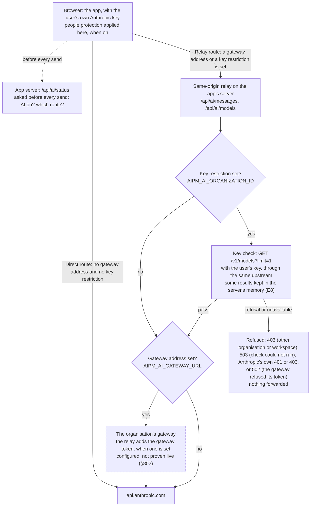

# Appendix: the facts behind the briefs

## How to read this appendix

The seven briefs keep to one page each. They carry a label and an evidence id (E1, E2, …) on each factual
sentence; this appendix says where each one comes from. It has four parts:

- the evidence labels, which say how far each claim has been checked;
- a diagram of the two routes an AI request can take;
- the evidence table, one row per id, naming its file and symbol, test, generated block or measured figure;
- the generated tables. Everything between a pair of `PACK:` markers is written by `npm run compliance:generate`
  from the app's own code and texts, and `npm run compliance:check` fails when a table no longer matches.

The prose describes the code at commit 57335a5ba. The figures were measured on 2026-11-14 against the demo
project at commit e63693393 and not measured again. Between the two, apart from the briefs' own tooling, the key
check's pass expiry and its description changed, which alters no measured request or cost, and the app changed in
five ways the figures predate: insights about one person no longer reach the AI while people protection is on
(E67), the activity entry of an applied work breakdown names the tasks it created (E68), Plan with AI shows what
its request left out (E60), the relay and the dictation route refuse more calls and limit each caller (E69,
E70), which can refuse a call but changes none that passes, and the AI disclosure changed, so each user accepts
it again. The first two change what a request carries: under people protection a request no longer holds an
insight about one person (E67), and the activity text the chat can search names up to 20 of the created tasks
(E68). Open gaps are cited by their number in the project's register of open follow-ups
(`docs/open-followups.md`), for example §802; the table under "Open gaps" lists every one the briefs cite.

## Evidence labels

| Label | What it means |
|---|---|
| *measured* | Observed in paid runs against the demo project on 2026-11-14, with the app at commit e63693393. The aggregates are in `docs/briefs/figures.json`. A small sample, not a guarantee for other data. |
| *tested (unit)* | An automated unit test in the repository checks it; the test is named in the table. Unit tests use fakes for the network, the model and the database. |
| *tested (live database)* | An automated test checks it against a real Turso (libSQL) database; the table says what the test does not cover. |
| *read in code* | Someone read the code and it does this. These briefs cite no test or run for the claim as stated. |
| *estimated* | Worked out from measured figures and stated assumptions; the assumptions are given beside it. |
| *not proven* | Nobody has shown it either way. The register entry says what it would take. |

"Read in code" is weaker than "tested": a later change can break it without any check failing.

## Two routes to the model

Each user brings their own Anthropic API key. Where a request goes depends on two server settings of the
deployment: a gateway address (`AIPM_AI_GATEWAY_URL`) and a key restriction to the organisation's Anthropic
keys (`AIPM_AI_ORGANIZATION_ID`, optionally `AIPM_AI_WORKSPACE_IDS`). With neither, the browser calls Anthropic
itself (the direct route). With either, the browser calls the app's own server, which relays the request
(E4, E5). People protection, when it is on, is applied in the browser before either route (E15).

What the diagram shows, with the evidence for each step:

- Before every send, the browser asks the app's server whether AI is still on and which route applies, and
  sends nothing if the answer is missing, says AI is off, reports an invalid setting or names another route
  (E3).
- Direct route: the browser posts to api.anthropic.com. This is the only case in which the browser may connect
  to Anthropic at all (E4, E34).
- Relay route: the browser posts to `/api/ai/messages` on the app's own origin. The relay sends the request on
  to the gateway when a gateway address is set, otherwise straight to api.anthropic.com. With neither set the
  relay answers 404; any invalid setting refuses every call (E5).
- With a key restriction set, nothing is forwarded until the user's key has passed the key check, which asks
  Anthropic, through the same upstream, which organisation and workspace the key belongs to (E7). Some of its
  results are kept in the server's memory, a pass for at most 15 minutes (E8, E9). A gateway without a key
  restriction runs no key check.
- The gateway is any https address the operator sets; the app adds its token when one is set, and has never
  been run against a real gateway (E11, E12, E13).

## Evidence table

Test titles are quoted exactly as they appear in the test file. `_relay.ts`, `_key-check.ts` and their tests are
in `src/app/api/ai/`.

| Id | Claim | Label | Source |
|---|---|---|---|
| E1 | For each AI feature: what it sends, which consent it needs, and what changes while people protection is on. | *read in code* | blocks `ai-paths` and `ai-paths-people`, generated from `AI_DATA_PATHS` in `src/app/ai-disclosure.ts` |
| E2 | Every AI request carries the user's own Anthropic API key. The relay forwards that key, adds no key of its own, and refuses a call that brings none (400). | *tested (unit)* | `relay` and `forwardHeaders` in `_relay.ts`; tests `models without a key → 400 missing-api-key without calling send` and `a call without a key of its own is still refused with 400` in `_relay.test.ts` |
| E3 | Before every send the browser asks the app's server (`/api/ai/status`) whether AI is on and which route applies. If AI is off, the setting is invalid, the route has changed or no valid answer comes, nothing is sent. | *tested (unit)* | `confirmAiDeployment` in `src/app/ai-transport.ts`; tests `page state direct, status answers relay: route-changed, and Anthropic is never called` and `an answer that says AI is off is off even without the people lock` in `src/app/ai-transport.test.ts` |
| E4 | Direct route: with no gateway address and no key restriction, the browser sends AI requests straight to api.anthropic.com. Relay route: with either set, the browser sends them to the app's own same-origin relay and not to Anthropic. | *tested (unit)* | `postAiMessages` and `usesRelay` in `src/app/ai-transport.ts`; tests `direct: checks the status, then posts to Anthropic with today's four headers`, `gateway: posts to the same-origin relay without the browser-access header` and `relay: posts to the same-origin relay, never to Anthropic, without the browser-access header` in `src/app/ai-transport.test.ts` |
| E5 | The relay sends to the gateway when `AIPM_AI_GATEWAY_URL` is set, otherwise to api.anthropic.com when keys are restricted to an organisation; with neither it answers 404. Any invalid setting refuses every call with 503. | *tested (unit)* | `upstreamFor` in `_relay.ts`; tests `direct deployment → 404, no relay`, `a Messages call goes to api.anthropic.com with the four forwarded headers and no gateway token`, `a gateway wins over the restriction: the check and the call both go to it with its token, like the real request` and `an invalid restriction → 503 ai-gateway-invalid, nothing sent` in `_relay.test.ts` |
| E6 | The relay refuses cross-site browser calls, forwards only four Anthropic headers (plus the gateway token when one is set) and no cookies, and logs no key, token, body or URL. It does not authenticate its callers (see E13). | *tested (unit)* | `relay`, `isSameOrigin` and `forwardHeaders` in `_relay.ts`; tests `Sec-Fetch-Site: cross-site → 403 not-same-origin`, `forwards exactly the four Anthropic headers plus the gateway token` and `no console or diagnostics output carries the key, token, body or URL` in `_relay.test.ts` |
| E7 | Key check: when `AIPM_AI_ORGANIZATION_ID` is set, the relay first sends a one-item model-list request (`GET /v1/models?limit=1`) with the user's key through the same upstream as the real request, and reads the organisation (and, with `AIPM_AI_WORKSPACE_IDS`, the workspace) from Anthropic's answer headers. A key of another organisation or workspace is refused with 403, and a check that cannot run answers 503. Anthropic's own 401 or 403 to the check is passed back unchanged, and a gateway refusing its token is answered with 502. In every one of these cases nothing is forwarded. | *tested (unit)* | `createKeyChecker` in `_key-check.ts` and `refusalFor` in `_relay.ts`; tests `sends GET <base>/v1/models?limit=1 with the caller's key and version; a matching org passes`, `through a gateway, a 401 that is not Anthropic-shaped is the gateway's refusal (502 ai-gateway-rejected)` and the group `createKeyChecker — Anthropic's own 403 is passed through, not cached` in `_key-check.test.ts`; tests `another organisation → 403 ai-key-wrong-organization; no Messages call, no body read upstream` and `the check unavailable → 503 ai-key-check-unavailable; no Messages call` in `_relay.test.ts` |
| E8 | The key check keeps its results in the server's memory only, under a keyed hash of the key. A pass is kept for 15 minutes, a refusal (another organisation or workspace) for 5 minutes and Anthropic's own 401 for 60 seconds. Each time counts from when the check was answered, not from the key's last use, and runs out when either the wall clock or the process's own clock says so. A restart, a change of the restriction, or eviction beyond 1,000 keys (least recently used first) drops a result sooner. A check that could not run, Anthropic's 403 and a gateway's refusal are never kept. That the hash is keyed, and that a restart drops the results, is read in code, not tested. | *tested (unit)* | `createKeyChecker`, `rememberable`, `KEY_CHECK_DEFAULT_PASS_TTL_MS`, `KEY_CHECK_DEFAULT_REFUSAL_TTL_MS`, `KEY_CHECK_DEFAULT_REJECTED_TTL_MS` and `KEY_CHECK_DEFAULT_MAX_ENTRIES` in `_key-check.ts`; tests `a different signature (the restriction changed) clears the cache`, `eviction keeps size() <= maxEntries, oldest first` and the group `createKeyChecker — least-recently-used eviction`, `the default pass lifetime is fifteen minutes`, `a pass used often is still re-checked after the pass TTL`, `the wall clock jumping forward past the TTL expires a pass whose monotonic age is small`, `the monotonic clock running while the wall clock steps back also expires a pass`, `a pass outlives the refusal lifetime`, `the default refusal lifetime is five minutes`, `remembers the 401 for 60 seconds, then sends a second pre-flight`, `a gateway's own 401 (not Anthropic-shaped) is not remembered`, `the default cap is 1000 entries` and the group `createKeyChecker — Anthropic's own 403 is passed through, not cached` in `_key-check.test.ts` |
| E9 | Because a pass is kept (E8), a key that no longer passes, for example one moved to another workspace, keeps passing the check on that server for up to 15 minutes after it was last checked. Once the pass has run out, the next request is checked again and refused. | *tested (unit)* | `createKeyChecker` in `_key-check.ts`; tests `a cached pass is re-checked after the pass TTL` and `a re-check that now refuses replaces the pass` in `_key-check.test.ts`, and `a passed key is not checked again on the next call` in `_relay.test.ts` |
| E10 | The key check added 724 ms to the first relayed chat request with a new key and 344 ms to the first relayed inline edit, one run each. The extra time once a pass is kept was not measured. | *measured* | `figures.json relayKeyCheck.runs`; `figures.json relayKeyCheck.warmExtraMs` (empty) |
| E11 | The gateway is whatever https address the operator sets in `AIPM_AI_GATEWAY_URL`. When `AIPM_AI_GATEWAY_TOKEN` is set, the relay adds it to every forwarded call as the `cf-aig-authorization` header (Cloudflare AI Gateway's, the gateway the operating guide describes). The address and the token are not sent to the browser. | *read in code* | `parseAiGatewayConfig` and `aiDeploymentStateFrom` in `src/app/ai-gateway-config.ts`; `forwardHeaders` in `_relay.ts`; `docs/RUNBOOK.md` |
| E12 | The gateway route has never been run against a real gateway; its tests use a fake upstream and a local TLS server. A live proof against a real gateway is written but has never been run. | *not proven* | register §802; `src/app/api/ai/_relay.https.test.ts`; `src/app/api/ai/_relay.live.test.ts`, run only by hand through `.github/workflows/ai-live.yml` |
| E13 | The app's server routes do not authenticate callers, and the relay adds the gateway token to every call it forwards. A deployment that routes AI through a gateway must therefore put the app's server behind its own access control; the runbook makes that a requirement. | *read in code* | `forwardHeaders` in `_relay.ts`; `docs/RUNBOOK.md` "Routing AI through a gateway" |
| E14 | People protection replaces, before a request is sent, the names of people the project knows with placeholders such as `[Person 1]`, with or without umlauts or a possessive ending. A name of several words is replaced however it is capitalised. A single word, that is a one-word name or one word of a longer name, is replaced only where the text writes it capitalised or in capitals, unless the project itself stores it in lower case; one word of a longer name also needs at least 3 letters and must not be a common word on the app's stop list. It also replaces every e-mail address; every IBAN written as two capital letters, two digits and then 11 to 30 capital letters or digits, either run together or in groups of four separated by single spaces, whose mod-97 checksum is valid (the length bounds are read in code; no test pins them); a known person's phone number written with any separators, and any other phone number that starts with + or 0 (also inside a bracket), has at least 7 digits, uses only spaces, hyphens, dots, slashes and brackets as separators and does not look like a date. Placeholders in the answer are turned back into the original text on the device. | *tested (unit)* | `redactJsonBody` and `restoreJsonText` in `src/app/ai-people-redact.ts`; tests `diacritics, case, ue-transliteration and possessive all map to one placeholder`, `a one-word entry stored in lower case is redacted in any case; a capitalised one stays case-gated`, `the case gate still holds for lone tokens of a multi-word name`, `emails, phones and IBANs get their own placeholders and counts`, `a known phone is matched by its digits even without a leading + or 0`, `phone-shaped: these ARE phones`, `dates, times, integers, money, versions and ids are NOT phones`, `an IBAN-shaped string with a bad checksum is left alone, phone pattern included` and `restore(redact(t)) === t when every match is a full known spelling` in `src/app/ai-people-redact.test.ts` |
| E15 | Protection is applied in the app's browser code, before a request leaves the device; neither the relay nor any other server route applies it. It holds for this app as shipped: a modified copy of the app, or another client using the same key, can send without it. | *read in code* | `redactForSend` and `postAiMessages` in `src/app/ai-transport.ts`; `relay` in `_relay.ts`; test `calls fetch with an Anthropic URL only in the transport` in `src/app/ai-transport-sites.test.ts` |
| E16 | With protection on, no person of the test fixture reaches a request body on any AI path that sends; with protection off, the same paths do send people, so the test can see them. The exception is the new project proposal: a new project has no known people, so the fixture holds none to send and its names cannot be protected (E20, E35). | *tested (unit)* | groups `with protection on, no fixture person reaches a request body` and `anti-vacuity: with protection off, the same drivers send people` in `src/app/ai-people-protection.wire.test.ts` |
| E17 | With protection on, an AI answer that acts on a person (an assignee, a resource, a stakeholder) applies nothing person-related; the rest of the change applies. | *tested (unit)* | test `protection on: the assignee, the resource and the stakeholder are untouched; the rest of the task write applies` in `src/app/ai-people-protection.wire.test.ts` |
| E18 | With protection on, the allocation plan proposal and the RACI suggestion are hidden, and dictation is switched off. | *tested (unit)* | `figures.json hiddenWhenProtected`; block `ai-paths`; the `is not offered` cases of the group `with protection on, no fixture person reaches a request body` in `src/app/ai-people-protection.wire.test.ts` |
| E19 | A deployment can switch AI off (`ai` in `AIPM_DISABLED_INTEGRATIONS`; the relay then refuses every call) or force people protection on in every project (`ai-people`), whatever a project has stored. The forced protection is applied by the app in the browser (E15). | *tested (unit)* | block `deployment-switches`; test `switched off → 503 integration-disabled` in `_relay.test.ts`; group `the deployment lock` in `src/app/ai-people-protection.wire.test.ts` |
| E20 | With protection on, the measured request bodies held 0 names and 0 e-mail addresses of the demo project's people, apart from 1 name in the new project proposal, the documented exception (a new project has no known people yet, so names in its brief are sent). | *measured* | `figures.json behaviour.protectedNameHitsOn`, `figures.json behaviour.emailHitsOn`, `figures.json behaviour.documentedExceptionHitsOn` |
| E21 | Positive control: with protection off, the same check found the demo project's people names 72 times, so it can see them. | *measured* | `figures.json behaviour.positiveControlHitsOff` |
| E22 | All 96 measured requests (47 with protection off, 41 with it on, 8 through the relay) reported the inference_geo value `global`. | *measured* | `figures.json behaviour.inferenceGeo`, `figures.json behaviour.requests` |
| E23 | The relay rows ran with the organisation key check on: the relay answers 404 when neither a gateway nor a key restriction is set, and no gateway was used (§802), so a key restriction was set, and the key check's extra time was recorded for both rows. | *read in code* | `upstreamFor` in `_relay.ts`; register §802; `figures.json paths[protection=relay]`; `figures.json relayKeyCheck.runs` |
| E24 | Cost per call on the measured model claude-sonnet-5, at list prices fetched on 2026-11-14: the chat $0.0668 with protection on and $0.0711 with it off; the other measured features $0.0034 to $0.0314. A row marked "unverified" is one whose requests did not show the protection state. | *measured* | block `figures`; `figures.json paths[].usdPerCall`; `figures.json rates` |
| E25 | For a team of five, the monthly AI cost comes to about $25 (light use), $67 (typical) or $165 (heavy), that is about $5, $13 or $33 per user; the calls per user per day are assumptions. The estimate covers model spend only, not hosting, administration or training. | *estimated* | block `team-month` |
| E26 | The time the AI features save has not been measured. | *not proven* | register §811 |
| E27 | Whether Optimize work breakdown with AI gives the same result on repeated runs has not been measured. | *not proven* | register §812 |
| E28 | Saved chats are kept only when the project uses a Turso database, encrypted so that only their writer and the operator holding the recovery key can read them, except chats saved by an earlier version of the app, before chats became private, which others in the project can read until they expire (E57); while the recovery key is unset or unusable, no chat is saved. | *read in code* | `chatTursoMode` in `src/app/workspace-section.tsx`; `src/app/chat-crypto.ts`; blocks `ai-paths` and `deployment-switches` |
| E29 | A saved chat is deleted once the retention period (30 days unless the operator sets 1 to 3650) has passed since its last change: by the app in the browser, and by the server once at start and every 24 hours where the server's deletion is configured. An invalid setting pauses deletion for age. | *read in code* | `DEFAULT_CHAT_RETENTION_DAYS` and `MAX_CHAT_RETENTION_DAYS` in `src/app/ai-chat-retention-config.ts`; `CHAT_SWEEP_INTERVAL_MS` in `src/app/api/ai/_chat-sweep.ts`; `src/app/use-chat-retention-sweep.ts`; block `deployment-switches` |
| E30 | On a real libSQL database, the erasure and retention statements remove exactly the expected rows: one chat, all chats of one person across projects, everything over the cap of 50 chats per person, expired chats and a deleted project's chats; and the per-person lookup behind finding and erasing a person's chats returns the expected rows. Not covered: the screens, the two deletion sweeps run with real credentials, the database provider's backups and what the model vendor keeps (§813). The test runs on pull requests to main and pushes to main only while the repository's `TURSO_THROWAWAY_*` secrets are set, and is skipped otherwise (for example on a fork's pull request or Dependabot's); a waiting run can be replaced by a newer one, and it is not a required check. | *tested (live database)* | `.github/workflows/live-turso.yml`; tests `deleting one thread removes only that owner's row`, `delete all my chats removes every thread of one owner across projects`, `prune keeps the newest 50 threads per owner`, `retention expiry deletes threads older than the cutoff`, `the project hard-delete sweep removes the project's chat threads` and `an owner's threads are selectable for find and erase` in `e2e/chat-threads-erasure-live.spec.ts`; register §813 |
| E31 | Interactive AI runs only while the AI master switch is on and the user has accepted the current AI disclosure on this device. The acceptance is asked again when the disclosure text changes, when the route changes and when the key restriction is switched on or off. | *tested (unit)* | `isInteractiveAiAllowed`, `isConsentCurrent` and `AI_DISCLOSURE_VERSION` in `src/app/ai-consent.ts`; tests `throws while AI is switched off, the consent kept (AI-01)`, `is false for another disclosure version`, `a direct or gateway record is stale under relay; a new consent records relay and is current` and `a gateway consent given without the key restriction is stale once the restriction is on, and a new one is current` in `src/app/ai-consent.test.ts` |
| E32 | Background AI (the scheduled job analysis, the automatic insight recommendations, the scheduled digest) also needs a separate background acceptance, given once rather than run by run (§795). The weekly hard cap pauses background AI only. | *tested (unit)* | `assertBackgroundConsentLive` and `AiConsentLevel` in `src/app/ai-consent.ts`; tests `a withdrawn background consent leaves the interactive level live` and `blocks the background level with AiWeeklyCapReachedError and leaves the interactive level live` in `src/app/ai-consent.test.ts`; register §795 |
| E33 | The model the figures were measured with was claude-sonnet-5. | *measured* | `figures.json model` |
| E34 | The hosts the browser may connect to, and the services the app's server sends to, with what each receives and when. | *read in code* | blocks `browser-hosts` and `server-destinations` |
| E35 | People protection knows only the people the project knows: a name that is not among them is sent as written. A new project proposal has no known people, so the names in its brief and files are sent. | *read in code* | `redactionSessionFor` in `src/app/ai-people-redact.ts`; `aiPrivacyForNewProject` in `src/app/ai-privacy.ts`; block `ai-paths` |
| E36 | People protection was on for the relay rows. That was a run condition of the measurement; `figures.json` does not record it. | *not proven* | `figures.json paths[protection=relay]` |
| E37 | The median time to an answer per measured feature ranged from 2.0 s (the digest summary) to 18.3 s (the chat with people protection on) on the direct route, and was 24.1 s for the chat through the relay; each row rests on 2 to 6 calls. | *measured* | block `figures`; `figures.json paths[].medianLatencyMs` |
| E38 | The app counts each user's AI usage per feature in that user's browser only. Its token limits are each user's own settings: the session and weekly caps only notify, and the optional weekly hard cap pauses background AI only. No setting in the app, and no deployment switch, stops interactive AI at a spend limit. | *read in code* | `AiUsageProvider` in `src/app/ai-usage-context.tsx`; `sessionTokenCap`, `weeklyTokenCap` and `weeklyHardCap` in `src/app/settings-types.ts`; `AiWeeklyCapReachedError` in `src/app/ai-consent.ts`; block `deployment-switches` |
| E39 | Six paths have no recorded cost or observed behaviour from a measured run: the refusal of images and PDFs while people protection is on, dictation and voice commands, hours from other projects in Plan with AI, a key the relay refuses or cannot verify, a project with its Resources function switched off, and the weekly hard cap on background AI. | *not proven* | register §814 |
| E40 | Only two AI calls set a time limit of their own: the digest summary asked for on request (20 s) and the browser-side key test run at start-up and when a key is saved (15 s), which is not the organisation key check (E7). On the relay route the server adds a 15-minute idle timeout: an upstream answer that stays silent for 15 minutes is cut off. A rate-limit or overload answer is shown to the user as such and is not retried. | *read in code* | `AI_TIMEOUT_MS` in `src/app/use-digest.ts`; `AI_KEY_CHECK_TIMEOUT_MS` in `src/app/use-ai-key-check.ts`; `RELAY_TIMEOUT_MS` in `_relay.ts`; `classifyAiError` in `src/app/ai-errors.ts`; register §798 |
| E41 | People protection is on in every project unless the project explicitly allows people; while the deployment forces it (`ai-people`), it stays on whatever a project stores. | *tested (unit)* | `isPeopleProtected`, `isPeopleAiAllowedRaw` and `isPeopleProtectionForced` in `src/app/ai-people-protection.ts`; tests `is true by default`, `is false once the project allows it` and `stays true when the deployment forces protection, whatever is stored` in `src/app/ai-people-protection.test.ts` |
| E42 | `AIPM_DISABLED_INTEGRATIONS` accepts only jira, confluence, timelog, ecb, stt, ai and ai-people. None of these switches off a single AI feature, such as the new project proposal: `ai` switches all AI off, and `ai-people` forces people protection on. That none of them switches off a single AI feature is read in code. | *tested (unit)* | `INTEGRATION_IDS` and `parseDisabledIntegrations` in `src/app/integration-switches.ts`; tests `names the seven integrations and the setting` and `ignores unknown names and empty items` in `src/app/integration-switches.test.ts`; block `deployment-switches` |
| E43 | The deployment's lock leaves each project's stored choice in place. Lifting the lock returns each project to its own stored setting: protected unless that project had allowed people. | *read in code* | `isPeopleProtected` in `src/app/ai-people-protection.ts`; `src/app/settings-sections/ai-people-protection-control.tsx` |
| E44 | Project data is kept where the user or the deployment chooses: in the browser's own database (IndexedDB), in a JSON, CSV or Markdown file on the device, in a JSON or CSV file on a SharePoint site, or in a Turso database reached with its own address and token. The app's server keeps no project data of its own; it runs wherever the organisation deploys it, and in the desktop app on the user's device. Where the server-side chat deletion is configured, the server holds a Turso address and token and deletes saved chats past their retention (E29). | *read in code* | `createBackend` in `src/app/storage.ts`; `startChatSweepSchedule` and `sweepCredentialsFrom` in `src/app/api/ai/_chat-sweep.ts`; `spawnServer` in `desktop/src/server-child.ts` |
| E45 | Each user chooses the model in their own AI settings, from the models Anthropic lists for their key; without a choice it is Claude Sonnet 5. When that list cannot be fetched, the picker offers only the model already chosen, and Settings → AI shows a hint. No deployment switch sets or narrows the model. Only the fallback to the chosen model is tested; the rest is read in code. | *tested (unit)* | `CHAT_MODELS`, `defaultAiConfig` and `sanitizeAiConfig` in `src/app/settings-types.ts`; `useChatModels` in `src/app/use-chat-models.ts`; `buildModelOptions` in `src/app/chat-models.ts`, test `registryAsBase:false — returns ONLY the current selection when live is empty (no pre-fill)` in `src/app/chat-models.test.ts`; `src/app/settings-sections/ai-section.tsx`; block `deployment-switches` |
| E46 | Each user's Anthropic key is stored in their browser only encrypted, under a device key the page cannot export or under a passphrase the user sets, and is blanked from the stored settings; a changed ciphertext does not open. The algorithm, AES-256-GCM, is read in code, not tested. Loaded for use, the key is held in the page's memory in plain text; where the browser offers no IndexedDB, it is kept only there. | *tested (unit)* | `sealDevice` and `sealPassphrase` in `src/app/secrets.ts`; `writeSettings` and `hydrateSecretsInto` in `src/app/use-settings.ts`; tests `round-trips a secret through the device key`, `round-trips a secret through a passphrase` and `openDevice rejects tampered ciphertext with SecretUnlockError` in `src/app/secrets.test.ts`, `never persists apiKey, turso authToken, or jira apiToken into aipm-cockpit:settings` in `src/app/use-settings.secrets.test.ts` and `hydrates when IndexedDB is unavailable, falling back to the in-memory plaintext secret` in `src/app/use-settings.hydration.test.ts` |
| E47 | In the app's browser code, the chat holds the changes the model proposes on a review card when they include a destructive call, a calendar write that mails attendees, a tool that always goes to review, a date write that lands on someone's absence, or more than one entity write across the user's send. While an attached file or e-mail is in the conversation, every call that is not a pure read goes to the review card, even alone, except the work breakdown optimisation (`optimize_wbs`), which opens its own preview instead; a saved chat keeps no attachment, so a reopened one does not count, and text pasted into a message does not count either. Outside these cases a single entity write applies at once (§794); that the activity log shows it as the AI's is a separate claim, read in code (E55). | *tested (unit)* | `shouldStage` in `src/app/chat-proposal.ts`; `openSendRecord` and `stagesWhenUntrusted` in `src/app/chat-send-record.ts`; tests `a lone write with nothing applied before it does not stage`, `a write after one already applied in this send stages`, `a lone create stages in an untrusted send` and `stages a lone event write that would send invitations` in `src/app/chat-proposal.test.ts`; tests `a document block makes the send untrusted`, `plain text history is trusted` and `every live tool that is not a read stages, optimize_wbs aside` in `src/app/chat-send-record.test.ts`; register §794 |
| E48 | Outside text the chat reads through its tools starts the review hold when it carries a mark of its origin: a task synced from Jira (read-only in the app, its name and description taken from the Jira issue) or an activity entry a sync wrote. After such a read, every later change in the conversation waits on the card, as while a file is attached (E47); a change the model sent in the same turn as the read follows the ordinary rules of E47. Text pasted into a message does not start the hold (E47), and neither does outside text with no such mark: rows created from an imported file or mail, absence notes pulled from Outlook, a task whose Jira link was removed, the app's own project summaries (`get_app_state`), earlier chats found by `search_chats`, and text the app puts into the prompt itself. The two marks, the hold for the rest of the conversation and the scan of earlier sends are tested; the same-turn rule and the list of unmarked sources are read in code. | *tested (unit)* | `resultCarriesExternalText`, `markUntrustedByResults` and `openSendRecord` in `src/app/chat-send-record.ts`, called in `src/app/chat-panel.tsx`; `issueToTaskFields` in `src/app/jira-api.ts`; tests `a tool result that carried a Jira-linked task, from an earlier send, makes the send untrusted`, `a tool result with no Jira-linked row keeps the send trusted`, `a result holding a row with a Jira key carries external text`, `the field name quoted inside a text value is not a Jira-linked row`, `a search_history result with an entry an integration wrote carries external text`, `a real list_tasks result for a Jira-linked task carries external text` in `src/app/chat-send-record.test.ts`; tests `a read that returned a Jira-linked task stages a lone create in a later turn of the send` and `a Jira-linked task read in an earlier send stages a lone create` in `src/app/chat-panel.test.tsx` |
| E49 | The new project proposal, made from a typed brief, attached files and e-mails, SharePoint files or Confluence pages, fills in the project wizard's form, its functions and its starter content. Nothing is created until the user completes the wizard, where the starter content can be left out. | *read in code* | `runIngest` in `src/app/create-project-wizard.tsx` |
| E50 | Each desktop release is published with a CycloneDX software bill of materials (SBOM) beside the installer and, while the repository is public, with GitHub build-provenance and SBOM attestations. Every pull request also runs an SBOM check on the web build. That the SBOM is published beside the installer is read in code. | *tested (unit)* | jobs `build` and `publish` in `.github/workflows/release.yml`; `sbomName` and `checkSbom` in `scripts/release-publish-lib.mjs`; job `sbom` in `.github/workflows/ci.yml`; tests `attests only on a public repository` and `checks the SBOM scan in its own job on a mapped standalone build, needing nothing and uploading nothing` in `scripts/ci-workflow.test.mjs` |
| E51 | The Windows installer is not code-signed: the release workflow's signing steps run only when the repository setting `SIGNPATH_ENABLED` is on, and the app's executable is signed only when `SIGNPATH_SIGN_APP_EXE` is on as well. That it is still off is not in the code: it rests on the open register entry §487, which records it. So every install shows an unknown-publisher warning. With signing on, the uninstaller would still be unsigned; that part is read in code. | *tested (unit)* | jobs `sign-app` and `sign-installer` in `.github/workflows/release.yml`; tests `submits to SignPath only through the pinned action, in the two token jobs, behind the switch`, `every finalize step that needs signing switched on carries the switch, and the rest run on every release` and `the app's signed tree reaches repackage by artifact, and the setup is repackaged before it is signed` in `scripts/ci-workflow.test.mjs`; registers §487 and §793 |
| E52 | The deployment's switches and its key restriction act on requests made through this deployment of the app. The server holds no Anthropic credential of its own, so it cannot revoke or limit a user's key, which keeps working from any other client. | *read in code* | `forwardHeaders` in `_relay.ts`; block `deployment-switches` |
| E53 | The browser hosts are the Content Security Policy the app's server sends with the pages it serves, and the browser enforces it for those pages. api.anthropic.com is in it only on the direct route with AI not switched off; on the relay route, or with AI off, it is left out. | *tested (unit)* | `proxy` and `CSP_CONNECT_HOSTS` in `src/proxy.ts`; tests `drops api.anthropic.com when the ai switch is off, and nothing else changes`, `drops api.anthropic.com on the relay route, without naming the ids` and `CSP_CONNECT_HOSTS lists api.anthropic.com only under ai-direct` in `src/proxy.test.ts` |
| E54 | Requests to Jira, Confluence, Timelog, the exchange-rate route, the AI relay and the dictation route are limited per caller, keyed on an address header the caller can set and counted in one server process's memory (§562). | *read in code* | `rateLimit` in `src/app/api/jira/_rate-limit.ts`; register §562 |
| E55 | The app names the AI on its screens: the chat is the "AI Assistant", the row edit and other entry points read "Ask Claude", the analysis of next actions carries the note "AI-generated — review before acting.", the project wizard offers the option "Include AI-generated starter content", and the activity log shows the changes the chat makes with the actor "AI assistant". Text the AI writes into tasks, documents, reports and exports carries no machine-readable marking (§801). An activity entry does not link to the chat message that caused it (§799). | *read in code* | `tabChat`, `aiAskClaude`, `inlineAiEdit`, `actionAiDisclaimer`, `aiCreateIncludeContent` and `activityActorAi` in `src/app/i18n.ts`; `src/app/ask-claude-menu.tsx`, `src/app/actions-panel.tsx`, `src/app/create-project-wizard.tsx` and `src/app/activity-log-panel.tsx`; `ActivityActor` and `ActivityEntry` in `src/app/activity-log.ts`; registers §801 and §799 |
| E56 | Outside the chat, the AI features that propose changes apply nothing until a person does. The allocation plan proposal (people's planned hours per period, and moves of open tasks between people) and the RACI suggestion (a role per person and milestone) show each change with its current and proposed value; they, the work breakdown proposal and the duplicate check let each item be deselected before the person confirms. The row edit, the forecast import, the weight suggestion and the insight recommendations change the project only on Apply, Accept or confirm; the weight suggestion offers Accept for each weight beside Accept all. The scheduled job analysis and the digest summaries produce text and change no project record. With people protection off, the chat's tools can set a task's assignee and a RAID item's owner. Tasks created by an applied work breakdown cannot be undone (§796). | *read in code* | `src/app/alloc-plan-modal.tsx`, `src/app/raci-suggest-modal.tsx`, `src/app/wbs-plan-modal.tsx`, `src/app/task-dedup-modal.tsx` and `src/app/forecast-import-modal.tsx`; `inlineAiEditApply`, `weightSuggestAccept` and `weightSuggestAcceptAll` in `src/app/i18n.ts`; `src/app/settings-sections/next-actions-section.tsx`; `confirmInsightRecommendation` in `src/app/use-insight-recommendations.ts`; `runScheduledJob` in `src/app/scheduled-job-run.ts`; `PERSON_FIELDS_BY_TOOL` in `src/app/ai-person-fields.ts`; register §796 |
| E57 | Where saved chats exist (E28), a user can delete all their own chats in every project of the database ("Delete all my chats"); their own chats from before the upgrade to private chats belong to no one and stay until they expire, unless deleted one at a time or through the search. The search ("Find chats mentioning a person") looks through the user's own chats in every project of the database for a name or e-mail address, and also through this project's older shared chats saved before chats became private, which can hold other people's conversations; the user can delete the matches, those older shared chats included. Colleagues' own private chats are not searched. The operator can search and delete across the whole database, and delete expired chats, with `npm run chats:erase` and the recovery private key. | *read in code* | `chatDeleteAllButton`, `chatDeleteAllMessage`, `chatFindButton` and `chatFindHint` in `src/app/i18n.ts`; `src/app/chat-erase-dialog.tsx`; `scripts/chat-erasure.mjs` and `scripts/chat-erasure-lib.mjs`; `chats:erase` in `package.json` |
| E58 | The app sets no `inference_geo` parameter on its AI requests. | *read in code* | no use of `inference_geo` in `src/`; `postAiMessages` in `src/app/ai-transport.ts` |
| E59 | Hiding a project's Resources function does not keep its data from the AI. While people protection is off, the chat's tools that read and change people, absences and allocations stay available. With protection on or off, five features still send who is away in the coming weeks: the steering committee report draft, Analyze next actions, the scheduled job analysis, the insight recommendations and the work breakdown proposal (§810). | *read in code* | `toolsFor` in `src/app/chat-api.ts`; `buildAwaySummary` called in `src/app/project-digest.ts`, `src/app/use-meeting-report-actions.ts`, `src/app/insights/recommend-context.ts` and `src/app/wbs-plan/wbs-plan.ts`, none of which checks `isModuleEnabled`; register §810 |
| E60 | The allocation plan proposal sees another project's hours only while the open project is on a Turso database shared with other projects; otherwise, or when they could not be loaded, its request says so. A person in another project counts as the same person only when a user confirmed the match or the two share a usable e-mail address; equal first and last names with an address missing on at least one side are only a suggestion, whose hours there count once the user confirms it. From another project it counts the person's planned hours, spread onto this plan's periods, and the number and remaining hours of their open tasks there, not the tasks themselves; projects that protect their people are left out, and projects that could not be read are named. Of the open project it describes at most 120 people, 26 periods, 150 open tasks and 40 milestones. The rest is left out of the request, which tells the model how many were left out: the people and periods after the first 120 and 26, the open tasks ranked lowest (by relevance to the request, then by due date) and the milestones after the first 40 (open ones first, by date). Plan with AI shows the same counts in a notice, before the request is sent ("the AI will not see the whole plan") and with the proposal ("the AI did not see the whole plan"), naming only the kinds that were cut; the other notice the proposal can show is about a proposal too large to display. The notes about other projects, the cut of people and periods and the notice are tested; the person matching, the hours counted and which tasks and milestones are cut are read in code. | *tested (unit)* | `buildAllocContext`, `allocContextOmissions` and `ALLOC_CONTEXT_MAX_RESOURCES`, `ALLOC_CONTEXT_MAX_PERIODS` in `src/app/alloc-plan/alloc-plan.ts`; tests `words a load failure differently from a plain not-loaded`, `says other projects cannot be seen in this storage mode, in one line`, `truncates past ALLOC_CONTEXT_MAX_RESOURCES and reports how many were dropped` and `truncates past ALLOC_CONTEXT_MAX_PERIODS and reports how many were dropped` in `src/app/alloc-plan/alloc-plan.test.ts`; test `counts what each cap left out, the same numbers the request tells the model` in `src/app/alloc-plan/alloc-context-omissions.test.ts`; tests `before the request says the AI will not see it, after says it did not` and `names only the kinds that were cut` in `src/app/alloc-plan-modal.test.tsx`; test `unavailable: one ELSEWHERE line and Run is not blocked` in `src/app/use-alloc-plan.test.tsx`; `allocPlanTruncated`, `allocPlanOmittedInput` and `allocPlanOmitted` in `src/app/i18n.ts`; `ALLOC_CONTEXT_MAX_TASKS` and `ALLOC_CONTEXT_MAX_MILESTONES` in `src/app/alloc-plan/alloc-project-digest.ts`; `matchPeople` in `src/app/cross-project/person-match.ts`; `elsewhereFor` in `src/app/cross-project/elsewhere-hours.ts`; `src/app/use-cross-project-people.ts`; `src/app/alloc-elsewhere-suggestions.tsx` |
| E61 | The app sets no `temperature` or `top_p` on its AI requests: nothing in the app makes the same request give the same answer. | *read in code* | no use of `temperature` or `top_p` in `src/app` outside tests |
| E62 | The steering committee report draft is held per meeting under "AI draft – take sections into the report"; nothing enters the report until the user takes a section ("Take") or all of them ("Take all"). A save that contains AI-drafted text is logged with the AI as its actor ("AI drafted the report for the meeting on …"). The report text itself carries no marking that the AI wrote it (§801). | *read in code* | `ReportProposal` in `src/app/use-meeting-report-actions.ts`; `src/app/meeting-report-proposal.tsx`; `reportProposalHeading`, `reportProposalTake`, `reportProposalTakeAll` and `activityAiReportDraft` in `src/app/i18n.ts`; register §801 |
| E63 | The chat's list of absences gives every absence the type "absent", without its stored type or note. The Timelog insight for time booked on an absence day says that a named person booked time on a number of days they were absent "(vacation, sick or training)", without saying which of the three. | *tested (unit)* | `toAbsenceSummary` in `src/app/chat-tool-summaries.ts`; `buildInsightsPromptBlock` in `src/app/insights/insight-prompt.ts`; group `no withheld value reaches the model (guard)` in `src/app/ai-withheld-guard.test.ts`; test `` renders the ${type} fact line with each number in its own slot `` (its `timelogAbsenceDay` case) in `src/app/insights/insight-prompt.test.ts` |
| E64 | The Timelog insights reach the AI only while Timelog is on. With `timelog` in `AIPM_DISABLED_INTEGRATIONS`, or the Timelog function hidden in the project, the app stops the Timelog checks, and the chat's insight lines (which the row edit also gets), the insights the chat's `get_app_state` tool returns and both insight recommendations leave every Timelog insight out, one acted on earlier included. People protection is E67. Apart from insights, the chat's tools can record an absence with a type, such as sick, when the user asks, so a type the user writes reaches the model as written. | *read in code* | `isModuleEnabled` and `isModuleSwitchedOff` in `src/app/feature-modules.ts`; `buildTurnContext` in `src/app/chat-api.ts`; `buildInsightsPromptBlock` in `src/app/insights/insight-prompt.ts`, whose filter the test `drops both TimeLog rows, the acted outcome included, while Timelog is off` in `src/app/insights/insight-prompt.test.ts` checks without the switch; `insightReachesAi` in `src/app/insights/insight-prompt.ts`; the `get_app_state` case of `runTool` in `src/app/chat-tools.ts`; `src/app/use-insight-recommendations.ts`; `src/app/use-insight-lifecycle.ts`; `create_absence` in `src/app/chat-tool-defs.ts` |
| E65 | The AI relay and its key check write no log line of their own, so the app's server keeps no record of who sent which AI request; the only console output under the AI routes is the saved-chat deletion's status (not configured, paused, how many deleted, failed), apart from a warning, once per server process for each reason, that the gateway, key-restriction or chat setting is invalid (the reason only). Usage per user is counted only in each user's browser (E38). The warnings are tested; that the relay and the key check write nothing else is read in code. | *tested (unit)* | `relay` in `_relay.ts`; `createKeyChecker` in `_key-check.ts`; `src/app/api/ai/_chat-sweep.ts`; `src/app/ai-gateway-config.ts`, `src/app/ai-key-restriction-config.ts` and `src/app/ai-chat-retention-config.ts`; tests `warns once per reason per process, naming only the reason code` in `src/app/ai-gateway-config.test.ts`, `logs an invalid setting once per reason, by code only` in `src/app/ai-key-restriction-config.test.ts` and `warns once per process per problem and never prints the value` in `src/app/ai-chat-retention-config.test.ts` |
| E66 | Applying a work breakdown proposal writes one activity-log entry with the AI as its actor; what it names is E68. The tasks it creates carry no mark that the AI proposed them. Its changes to existing tasks can be undone; the tasks it creates cannot (§796). | *read in code* | `useWbsPlan` in `src/app/use-wbs-plan.tsx`; `applyWbsProposal` in `src/app/wbs-plan/wbs-plan.ts`; `activityAiWbsPlan` in `src/app/i18n.ts`; register §796 |
| E67 | With people protection on, no insight about one person (one whose figures name a person, as every Timelog insight does) is added to a request to the AI: the chat's insight lines, which the row edit also gets, the insights the chat's `get_app_state` tool returns, the insight recommendation on request and the automatic recommendations all leave it out. The automatic run checks again before each request, so protection switched on during a run holds back such an insight after the request in flight. Where the button to generate a recommendation would be, such an insight shows a note instead ("No AI recommendation for an insight about one person while people protection is on."). A recommendation request made under protection also leaves out the job title, department and company of a person the insight is linked to. With protection off, each of these paths can send such an insight, subject to the Timelog switch (E64). The recommendation paths, `get_app_state`, the note and the shared rule are tested; that the chat's insight lines and the row edit apply the same rule is read in code. The chat sends the whole conversation again with each message, so what a tool returned before protection was switched on is sent again as it was (read in code). The disclosure text a user accepts says for the chat, the row edit and both recommendation paths that an insight about one person is left out, and a test checks in both languages that each of these texts mentions one; that the chat's text also says earlier messages are sent again as they were is read in `aiProtectedChat` in `src/app/i18n.ts`. | *tested (unit)* | test `%s: the protected text says an insight about one person is not sent` in `src/app/ai-disclosure.test.ts`; `insightReachesAi` and `isPersonScopedInsight` in `src/app/insights/insight-prompt.ts`; `buildTurnContext` and `buildSystemPrompt` in `src/app/chat-api.ts`; `callInlineEdit` in `src/app/inline-ai-edit-call.ts`; the `get_app_state` case of `runTool` in `src/app/chat-tools.ts`; `src/app/use-insight-recommendations.ts`; `useInsightRecommendRunner` in `src/app/use-insight-recommend-runner.ts`; `buildRecommendContext` in `src/app/insights/recommend-context.ts`; `insightRecommendationPeopleProtected` in `src/app/i18n.ts`; test `drops an insight about one person only under people protection` in `src/app/insights/insight-prompt.test.ts`; test `protected: no insight about one person` in `src/app/chat-tools.test.ts`; tests `protected: an insight about one person (#%s) is not sent`, `protected: only the project-level insight is sent, and no request carries a person's profile or number` and `protection switched on during the first call holds back the person's insight after it` in `src/app/use-insight-recommendations.people-scope.test.tsx`; test `an insight about one person shows the note, not Generate` in `src/app/insight-recommendation-controls.people.test.tsx`; test `drops the resources entity when protected` in `src/app/insights/recommend-context.test.ts` |
| E68 | The activity-log entry of an applied work breakdown gives the number of changes, then the number and title of each task the breakdown created, each title on one line and cut at 120 characters; entries written before name no tasks. The Activity panel and the internal activity-log download in Settings list every created task; the text the model reads when the chat searches the history names the first 20 and how many more. | *tested (unit)* | `wbsPlanActivityArgs` and `WBS_ACTIVITY_TITLE_MAX` in `src/app/activity-log.ts`; `WBS_DETAIL_MAX_TASKS` in `src/app/activity-message.ts`; `renderActivityEntry` in `src/app/activity-prompt.ts`; tests `stores the applied count, then each created task's id and title`, `caps a long title and puts the whole title on one line`, `reads the created tasks back, and none from a count-only entry written before` and `the panel row names all 25, while the model path names 20 and how many more` in `src/app/activity-wbs-plan.test.ts`; test `button → input → propose → preview → apply writes a split: piece 1 keeps its id, piece 2 gets a fresh id` in `src/app/use-wbs-plan.test.tsx`; test `names every task a work-breakdown apply created, past the 20 the model sees` in `src/app/activity-audit.test.ts`; test `names 20 tasks of a work-breakdown entry, then how many more` in `src/app/activity-prompt.test.ts` |
| E69 | The relay refuses a call that sends neither `Sec-Fetch-Site` nor `Origin` with 403. It accepts at most 120 calls a minute from one caller, and the dictation route 60, unless the operator sets another whole number from 1 to 100000 (`AIPM_AI_RELAY_MAX_REQUESTS`, `AIPM_STT_MAX_REQUESTS`); a value that is set but unusable keeps the default and is logged once per server process, naming the setting but not its value; a call over the limit is answered with 429 and nothing is sent on. For the relay, refused cross-site and key-less calls do not count, and with the key restriction on, a call over the limit never reaches the key check; for dictation, key-less calls do not count. Both checks rest on headers a caller can set: either origin header can be forged, and the limit is keyed on the first `x-forwarded-for` entry, else on `x-real-ip`, and counted per server process, so all calls that carry neither header share one count per route (read in code; E54, §562). | *tested (unit)* | `getClientIp` in `src/app/api/jira/_rate-limit.ts`; `readRequestLimit` and `MAX_REQUEST_LIMIT` in `src/app/api/_shared/request-limit-config.ts`; tests `unset or blank → the route's default, not invalid`, `a whole number in range (%j) is the limit`, `%j is invalid and keeps the default` and `an invalid setting is logged once per process, naming the setting and never its value` in `src/app/api/_shared/request-limit-config.test.ts`; tests `AIPM_AI_RELAY_MAX_REQUESTS sets the relay's per-caller limit` and `an invalid AIPM_AI_RELAY_MAX_REQUESTS keeps the default limit` in `_relay.test.ts`; tests `AIPM_STT_MAX_REQUESTS sets dictation's per-caller limit` and `an invalid AIPM_STT_MAX_REQUESTS keeps the default limit` in `src/app/api/stt/route.test.ts`; `isSameOrigin` and `RELAY_MAX_REQUESTS` in `_relay.ts`; `STT_MAX_REQUESTS` in `src/app/api/stt/_helpers.ts`; tests `neither Sec-Fetch-Site nor Origin → 403 not-same-origin, nothing sent`, `a burst over RELAY_MAX_REQUESTS from one caller → 429, and the refused call sends nothing`, `refused cross-site and key-less calls do not count against the caller's limit` and `with the restriction on, a call over RELAY_MAX_REQUESTS never reaches the key check` in `_relay.test.ts`; `a burst over STT_MAX_REQUESTS from one caller → 429, and the refused call sends nothing upstream` and `key-less calls do not count against the caller's limit` in `src/app/api/stt/route.test.ts` |
| E70 | Before forwarding, the dictation route resolves the endpoint's host name and refuses with 400 when any address it resolves to is private; a name that does not resolve is answered with 502. Nothing is sent in either case. An address written as an IP is judged as written. Private covers loopback, the RFC 1918 and link-local ranges (the cloud metadata address among them), 0.0.0.0/8, the shared address space 100.64.0.0/10, `localhost`, the unspecified address `::`, IPv6 unique-local and link-local addresses, the whole NAT64 prefix 64:ff9b::/96, and mapped or compatible IPv6 forms of a private IPv4 address (such a form that cannot be decoded counts as private). DNS rebinding remains, because the connection resolves the name again (stated in `docs/security.md`, not tested). | *tested (unit)* | `parseSttRequest` in `src/app/api/stt/_helpers.ts`; tests `blocks a host name that resolves to %s, calling nothing upstream`, `a host name that does not resolve → 502, calling nothing upstream`, `blocks a private-IP baseUrl (SSRF)`, `a public IP literal is forwarded without a lookup` and `a host name that resolves into the shared address space 100.64.0.0/10 is blocked` in `src/app/api/stt/route.test.ts`; `isPrivateHost` in `src/app/api/_shared/proxy-ssrf.ts`; test `flags %s as private` in `src/app/api/_shared/proxy-ssrf.test.ts` |

## AI paths and people data

The AI features that concern people: the full list under "AI paths" without the two digest summaries. Besides the
user's operating guide and status figures (overall status, counts of overdue tasks and of open and high-severity
RAID items), the only project text they send is the names and dates of milestones due soon, so they carry a
person's name only where someone typed one into a milestone name (E1).

<!-- PACK:ai-paths-people:BEGIN -->
| Feature | Consent | What is sent | With people protection on |
|---|---|---|---|
| AI Assistant chat | Asked on each device before the first use, and again when the disclosure, the AI route or the key restriction changes | Your messages; the files and e-mails you attach (an e-mail with its body and its sender and recipient names and addresses); your operating guides; and the project data the assistant reads to answer: tasks with their descriptions and note logs, milestones, RAID items, changes, stakeholders, people in the resource directory, absences (only as “absent”, with the person and the dates), budget figures, calendar events, documents and project details, and, when it searches them, the activity history and your other chats in this project. With every message it also gets the number of your other chats in this project and the titles and last-activity times of up to three of the most recent ones (an unnamed chat is titled with the start of its first message; chats are kept only with a Turso database), and the project’s open insights: up to ten current ones and up to five you acted on with their measured result, one line each. An insight from Timelog names one person (or their Timelog user number when no one in the resource directory is linked) with their logged working time: on how many days a single entry or a day’s total went over a limit, they logged more than their defined hours, they logged time on a non-working day or on a day they were absent (vacation, sick or training), or time in a closed month was changed, with the worst hours, the limit where there is one, and for a closed month the net change. People’s names are included. List results carry no e-mail addresses: the assistant reads one address at a time, only when it needs it, though addresses can still appear in attachments, documents and logged edits. The whole conversation is sent again with every new message. Saved chats are encrypted so that only the person who wrote them and the operator holding the recovery key can read them, and each is deleted when the retention period has passed since its last change (30 days unless the operator sets another). Exceptions: chats saved by an earlier version of the app, which others in the project can read until they expire, and the AI gateway’s own logs where your organisation uses one. | The names, email addresses and phone numbers of people the project knows are replaced by placeholders before sending, and the assistant cannot assign, move or rate anyone. While protection is on, the assistant reads no insights about one person, such as a working-time insight from Timelog; earlier messages of the conversation are sent again as they were. Images and PDFs are refused while protection is on. Names the project does not know, typed into free text or contained in text attachments, may still be sent. |
| Inline AI edit on a row | Asked on each device before the first use, and again when the disclosure, the AI route or the key restriction changes | Your instruction, the one row you edit and a short project context (today’s date, task count, groups and labels, and the same open-insight lines the chat gets, so a Timelog insight can name a person with their logged working time), plus your operating guide for inline edits if you have one. The row includes names, dates and descriptions, and for a task its blocker log with the name of whoever logged each entry; for a person in the resource directory their name, job title, department, company, role, whether they are external, whether they are active, and their planned workload per period and whether it is planned in percent or hours. Never sent: e-mail addresses, note logs, a person’s phone number, location, birthday, notes and absence hours, a stakeholder’s notes, influence and interest, and an absence’s type and note. | The names, email addresses and phone numbers of people the project knows are replaced by placeholders before sending. Insights about one person, such as a working-time insight from Timelog, are not sent. Names the project does not know, typed into free text, may still be sent. |
| Steering committee report draft | Asked on each device before the first use, and again when the disclosure, the AI route or the key restriction changes | The meeting agenda you typed, your operating guide for this report if you have one, a status summary: overall status (RAG), task counts, overdue and due-soon counts, RAID and change counts, up to five change titles, and the names and dates of overdue, at-risk and due-soon milestones; and who is absent from today to 28 days ahead: each person’s name (with their number in the resource directory when they are in it) and the days they are away, not the type or reason of the absence. No e-mail addresses, and no other people’s names unless they are in a title or the agenda. | The names, email addresses and phone numbers of people the project knows are replaced by placeholders before sending. Names the project does not know, typed into free text or contained in attachments, may still be sent. |
| Forecast import from a spreadsheet | Asked on each device before the first use, and again when the disclosure, the AI route or the key restriction changes | The sheet you choose, with its name (for a CSV file, the file name without its extension), as a table of its non-empty cells (a sheet too large for one request is not sent), plus your operating guide for the import if you have one. Whatever the sheet holds is sent: usually people’s names and planned hours, and their e-mail addresses and hourly rates when the sheet has them. No other project data. | The names, email addresses and phone numbers of people the project knows are replaced by placeholders before sending. Names the project does not know, typed into free text or contained in attachments, may still be sent. |
| Insight recommendation, on request | Asked on each device before the first use, and again when the disclosure, the AI route or the key restriction changes | The project name, today’s date, the insight’s type, severity and figures, the titles of up to 30 tasks, the names of up to 30 people (active resources and assignees of open tasks), and the item the insight is about: a milestone with its description, a RAID item with its owner and mitigation, or a person’s job title, department and company. For a working-time insight from Timelog the figures are about one person: their name and Timelog user number, on how many days a single entry or a day’s total went over a limit, they logged more than their defined hours, they logged time on a non-working day or on a day they were absent (vacation, sick or training), or time in a closed month was changed, with the worst hours, the limit where there is one and, for a closed month, the net change, and the first and last dates concerned. Also who is absent from today to 28 days ahead: each person’s name (with their number in the resource directory when they are in it) and the days they are away, not the type or reason of the absence, and your operating guide for recommendations if you have one. No e-mail addresses and no resource notes. | No recommendation is made for an insight about one person, such as a working-time insight from Timelog, so its figures and the person’s job title, department and company are not sent, and the list of people is left out. For the other insights, the names, email addresses and phone numbers of people the project knows are replaced by placeholders before sending. Names the project does not know, typed into free text, may still be sent. |
| Analyze next actions with AI | Asked on each device before the first use, and again when the disclosure, the AI route or the key restriction changes | The project name, today’s date, the project mode and enabled modules, planned, actual and forecast budget, the next-actions queue (titles and reasons), open tasks (title, status, priority, assignee, due date), active RAID items (category, severity, status, owner, target date, date last changed), milestones, pending changes, stakeholder names with their title, organisation or category, and who is absent from today to 28 days ahead: each person’s name (with their number in the resource directory when they are in it) and the days they are away, not the type or reason of the absence; plus your operating guide for analyses if you have one. No descriptions, notes or e-mail addresses. | The names, email addresses and phone numbers of people the project knows are replaced by placeholders before sending. Names the project does not know, typed into free text or contained in attachments, may still be sent. |
| Allocation plan proposal | Asked on each device before the first use, and again when the disclosure, the AI route or the key restriction changes | Your request, your operating guide if you have one, the plan window and periods, the workday length and the plan currency, and for each person in the resource directory: their name (or their number in the resource directory if no name is set), role, whether they are external, whether their workload is planned in percent or in hours, their planned and available hours per period, and for an internal person with a role the internal hourly rate of that role. Absences are used to work out available hours and are not sent. Also up to 150 open tasks, each with its title, owner (a name where the owner is not one of the people listed), remaining estimate, start and due dates, status, whether it is synced from Jira, the open tasks it waits for, its milestones and its hours per period; up to 40 milestones with their name, date and whether they are achieved; and which of the listed people are responsible or accountable for each milestone. When the project shares a Turso database with other projects and a person here is matched to a person in another project that does not protect its people from the AI, it also sends that project's name, the hours booked for that person there per period, and their open-task count and remaining hours there (no task titles). The names of other projects that could not be read, or that were left out because they protect their people, are sent too. | Not available: the feature is hidden while protection is on. Where it is available, other projects that protect their people are left out of the hours counted from them. |
| RACI suggestion | Asked on each device before the first use, and again when the disclosure, the AI route or the key restriction changes | Stakeholder names, titles, organisations, categories, influence and interest; milestone names, dates and descriptions; the existing RACI assignments; and your operating guide if you have one. No e-mail addresses. | Not available: the feature is hidden while protection is on. |
| Duplicate task check | Asked on each device before the first use, and again when the disclosure, the AI route or the key restriction changes | For each task: its number, status, due date, title, assignee and the first 200 characters of its description, plus your operating guide if you have one. No e-mail addresses or note logs. | The names, email addresses and phone numbers of people the project knows are replaced by placeholders before sending. Names the project does not know, typed into free text or contained in attachments, may still be sent. |
| Work breakdown (WBS) proposal | Asked on each device before the first use, and again when the disclosure, the AI route or the key restriction changes | Your instruction, your operating guide if you have one, the project name and window, groups, milestones, for each task: name, group, status, start and due dates, estimate, dependencies, assignee and a shortened description; and who is absent in the project window (from today, or the project start if that is later, to the project end; the next 28 days from today when the project has no end date, or its end date is before today or before the project start): each person’s name (with their number in the resource directory when they are in it) and the days they are away, not the type or reason of the absence. No e-mail addresses or note logs. | The names, email addresses and phone numbers of people the project knows are replaced by placeholders before sending. Names the project does not know, typed into free text or contained in attachments, may still be sent. |
| Next-actions weight suggestion | Asked on each device before the first use, and again when the disclosure, the AI route or the key restriction changes | The project name, the titles of tasks, RAID items, milestones and changes, the next-actions queue, your current weights and learning counts, a trend summary, and stakeholder names, plus your operating guide for weight suggestions if you have one. No descriptions, notes or e-mail addresses. | The names, email addresses and phone numbers of people the project knows are replaced by placeholders before sending. Names the project does not know, typed into free text or contained in attachments, may still be sent. |
| New project proposal (project wizard) | Asked on each device before the first use, and again when the disclosure, the AI route or the key restriction changes | Only what you give the wizard: the brief you type, the files you attach (an e-mail with its body and its sender and recipient names and addresses), and the SharePoint files and Confluence pages you pick, plus your operating guide if you have one. No data from existing projects. | Email addresses, phone numbers and IBANs are always replaced by placeholders. Names cannot be: a new project has no known people yet, so names in your brief and in files you add to the wizard are sent. Images and scanned or PDF documents are sent too, unless your organisation forces protection; then they are refused. The AI’s proposal is applied without any people: no sponsor, project manager, stakeholders, resources, assignees or owners. |
| Speech-to-text dictation | Asked on each device before the first use, and again when the disclosure, the AI route or the key restriction changes | When you choose a speech-to-text service, the audio you record and that service’s API key go through this app’s own server route to the speech service you configured, not to Anthropic. Without this consent, while AI is switched off, or while that service’s address or key is missing or cannot be read on this device, dictation with that service is unavailable; it never switches to another engine on its own. Only when you choose browser dictation instead, or this deployment has switched speech-to-text off, does it use the browser’s built-in speech recognition, which in some browsers sends audio to the browser maker’s service. | Not available: the feature is switched off while protection is on. |
| Scheduled job analysis | Asked separately on each device, and only counts together with the interactive consent; asked again on the same changes | The job’s instruction and, for the project it covers, the same summary as “Analyze next actions with AI”: the project name, today’s date, the project mode and enabled modules, planned, actual and forecast budget, the next-actions queue (titles and reasons), open tasks (title, status, priority, assignee, due date), active RAID items (category, severity, status, owner, target date, date last changed), milestones, pending changes, stakeholder names with their title, organisation or category, and who is absent from today to 28 days ahead: each person’s name (with their number in the resource directory when they are in it) and the days they are away, not the type or reason of the absence; plus your operating guide for analyses if you have one. No descriptions, notes or e-mail addresses. | The names, email addresses and phone numbers of people the project knows are replaced by placeholders before sending. Names the project does not know, typed into free text or contained in attachments, may still be sent. |
| Automatic insight recommendations | Asked separately on each device, and only counts together with the interactive consent; asked again on the same changes | The project name, today’s date, the insight’s type, severity and figures, the titles of up to 30 tasks, the names of up to 30 people (active resources and assignees of open tasks), and the item the insight is about: a milestone with its description, a RAID item with its owner and mitigation, or a person’s job title, department and company. For a working-time insight from Timelog the figures are about one person: their name and Timelog user number, on how many days a single entry or a day’s total went over a limit, they logged more than their defined hours, they logged time on a non-working day or on a day they were absent (vacation, sick or training), or time in a closed month was changed, with the worst hours, the limit where there is one and, for a closed month, the net change, and the first and last dates concerned. Also who is absent from today to 28 days ahead: each person’s name (with their number in the resource directory when they are in it) and the days they are away, not the type or reason of the absence, and your operating guide for recommendations if you have one. No e-mail addresses and no resource notes. | No recommendation is made for an insight about one person, such as a working-time insight from Timelog, so its figures and the person’s job title, department and company are not sent, and the list of people is left out. For the other insights, the names, email addresses and phone numbers of people the project knows are replaced by placeholders before sending. Names the project does not know, typed into free text, may still be sent. |
<!-- PACK:ai-paths-people:END -->

## AI paths

Every AI feature of the app, with the text the app itself shows before a user accepts the AI disclosure (E1).

<!-- PACK:ai-paths:BEGIN -->
| Feature | Consent | What is sent | With people protection on |
|---|---|---|---|
| AI Assistant chat | Asked on each device before the first use, and again when the disclosure, the AI route or the key restriction changes | Your messages; the files and e-mails you attach (an e-mail with its body and its sender and recipient names and addresses); your operating guides; and the project data the assistant reads to answer: tasks with their descriptions and note logs, milestones, RAID items, changes, stakeholders, people in the resource directory, absences (only as “absent”, with the person and the dates), budget figures, calendar events, documents and project details, and, when it searches them, the activity history and your other chats in this project. With every message it also gets the number of your other chats in this project and the titles and last-activity times of up to three of the most recent ones (an unnamed chat is titled with the start of its first message; chats are kept only with a Turso database), and the project’s open insights: up to ten current ones and up to five you acted on with their measured result, one line each. An insight from Timelog names one person (or their Timelog user number when no one in the resource directory is linked) with their logged working time: on how many days a single entry or a day’s total went over a limit, they logged more than their defined hours, they logged time on a non-working day or on a day they were absent (vacation, sick or training), or time in a closed month was changed, with the worst hours, the limit where there is one, and for a closed month the net change. People’s names are included. List results carry no e-mail addresses: the assistant reads one address at a time, only when it needs it, though addresses can still appear in attachments, documents and logged edits. The whole conversation is sent again with every new message. Saved chats are encrypted so that only the person who wrote them and the operator holding the recovery key can read them, and each is deleted when the retention period has passed since its last change (30 days unless the operator sets another). Exceptions: chats saved by an earlier version of the app, which others in the project can read until they expire, and the AI gateway’s own logs where your organisation uses one. | The names, email addresses and phone numbers of people the project knows are replaced by placeholders before sending, and the assistant cannot assign, move or rate anyone. While protection is on, the assistant reads no insights about one person, such as a working-time insight from Timelog; earlier messages of the conversation are sent again as they were. Images and PDFs are refused while protection is on. Names the project does not know, typed into free text or contained in text attachments, may still be sent. |
| Inline AI edit on a row | Asked on each device before the first use, and again when the disclosure, the AI route or the key restriction changes | Your instruction, the one row you edit and a short project context (today’s date, task count, groups and labels, and the same open-insight lines the chat gets, so a Timelog insight can name a person with their logged working time), plus your operating guide for inline edits if you have one. The row includes names, dates and descriptions, and for a task its blocker log with the name of whoever logged each entry; for a person in the resource directory their name, job title, department, company, role, whether they are external, whether they are active, and their planned workload per period and whether it is planned in percent or hours. Never sent: e-mail addresses, note logs, a person’s phone number, location, birthday, notes and absence hours, a stakeholder’s notes, influence and interest, and an absence’s type and note. | The names, email addresses and phone numbers of people the project knows are replaced by placeholders before sending. Insights about one person, such as a working-time insight from Timelog, are not sent. Names the project does not know, typed into free text, may still be sent. |
| Steering committee report draft | Asked on each device before the first use, and again when the disclosure, the AI route or the key restriction changes | The meeting agenda you typed, your operating guide for this report if you have one, a status summary: overall status (RAG), task counts, overdue and due-soon counts, RAID and change counts, up to five change titles, and the names and dates of overdue, at-risk and due-soon milestones; and who is absent from today to 28 days ahead: each person’s name (with their number in the resource directory when they are in it) and the days they are away, not the type or reason of the absence. No e-mail addresses, and no other people’s names unless they are in a title or the agenda. | The names, email addresses and phone numbers of people the project knows are replaced by placeholders before sending. Names the project does not know, typed into free text or contained in attachments, may still be sent. |
| Digest summary, on request | Asked on each device before the first use, and again when the disclosure, the AI route or the key restriction changes | Overall status (RAG), the number of overdue tasks, the numbers of open and high-severity RAID items, and the names and dates of milestones due soon, plus your operating guide for the digest if you have one. No people’s names, notes or e-mail addresses, unless they are in a milestone name. | The names, email addresses and phone numbers of people the project knows are replaced by placeholders before sending. Names the project does not know, typed into free text or contained in attachments, may still be sent. |
| Forecast import from a spreadsheet | Asked on each device before the first use, and again when the disclosure, the AI route or the key restriction changes | The sheet you choose, with its name (for a CSV file, the file name without its extension), as a table of its non-empty cells (a sheet too large for one request is not sent), plus your operating guide for the import if you have one. Whatever the sheet holds is sent: usually people’s names and planned hours, and their e-mail addresses and hourly rates when the sheet has them. No other project data. | The names, email addresses and phone numbers of people the project knows are replaced by placeholders before sending. Names the project does not know, typed into free text or contained in attachments, may still be sent. |
| Insight recommendation, on request | Asked on each device before the first use, and again when the disclosure, the AI route or the key restriction changes | The project name, today’s date, the insight’s type, severity and figures, the titles of up to 30 tasks, the names of up to 30 people (active resources and assignees of open tasks), and the item the insight is about: a milestone with its description, a RAID item with its owner and mitigation, or a person’s job title, department and company. For a working-time insight from Timelog the figures are about one person: their name and Timelog user number, on how many days a single entry or a day’s total went over a limit, they logged more than their defined hours, they logged time on a non-working day or on a day they were absent (vacation, sick or training), or time in a closed month was changed, with the worst hours, the limit where there is one and, for a closed month, the net change, and the first and last dates concerned. Also who is absent from today to 28 days ahead: each person’s name (with their number in the resource directory when they are in it) and the days they are away, not the type or reason of the absence, and your operating guide for recommendations if you have one. No e-mail addresses and no resource notes. | No recommendation is made for an insight about one person, such as a working-time insight from Timelog, so its figures and the person’s job title, department and company are not sent, and the list of people is left out. For the other insights, the names, email addresses and phone numbers of people the project knows are replaced by placeholders before sending. Names the project does not know, typed into free text, may still be sent. |
| Analyze next actions with AI | Asked on each device before the first use, and again when the disclosure, the AI route or the key restriction changes | The project name, today’s date, the project mode and enabled modules, planned, actual and forecast budget, the next-actions queue (titles and reasons), open tasks (title, status, priority, assignee, due date), active RAID items (category, severity, status, owner, target date, date last changed), milestones, pending changes, stakeholder names with their title, organisation or category, and who is absent from today to 28 days ahead: each person’s name (with their number in the resource directory when they are in it) and the days they are away, not the type or reason of the absence; plus your operating guide for analyses if you have one. No descriptions, notes or e-mail addresses. | The names, email addresses and phone numbers of people the project knows are replaced by placeholders before sending. Names the project does not know, typed into free text or contained in attachments, may still be sent. |
| Allocation plan proposal | Asked on each device before the first use, and again when the disclosure, the AI route or the key restriction changes | Your request, your operating guide if you have one, the plan window and periods, the workday length and the plan currency, and for each person in the resource directory: their name (or their number in the resource directory if no name is set), role, whether they are external, whether their workload is planned in percent or in hours, their planned and available hours per period, and for an internal person with a role the internal hourly rate of that role. Absences are used to work out available hours and are not sent. Also up to 150 open tasks, each with its title, owner (a name where the owner is not one of the people listed), remaining estimate, start and due dates, status, whether it is synced from Jira, the open tasks it waits for, its milestones and its hours per period; up to 40 milestones with their name, date and whether they are achieved; and which of the listed people are responsible or accountable for each milestone. When the project shares a Turso database with other projects and a person here is matched to a person in another project that does not protect its people from the AI, it also sends that project's name, the hours booked for that person there per period, and their open-task count and remaining hours there (no task titles). The names of other projects that could not be read, or that were left out because they protect their people, are sent too. | Not available: the feature is hidden while protection is on. Where it is available, other projects that protect their people are left out of the hours counted from them. |
| RACI suggestion | Asked on each device before the first use, and again when the disclosure, the AI route or the key restriction changes | Stakeholder names, titles, organisations, categories, influence and interest; milestone names, dates and descriptions; the existing RACI assignments; and your operating guide if you have one. No e-mail addresses. | Not available: the feature is hidden while protection is on. |
| Duplicate task check | Asked on each device before the first use, and again when the disclosure, the AI route or the key restriction changes | For each task: its number, status, due date, title, assignee and the first 200 characters of its description, plus your operating guide if you have one. No e-mail addresses or note logs. | The names, email addresses and phone numbers of people the project knows are replaced by placeholders before sending. Names the project does not know, typed into free text or contained in attachments, may still be sent. |
| Work breakdown (WBS) proposal | Asked on each device before the first use, and again when the disclosure, the AI route or the key restriction changes | Your instruction, your operating guide if you have one, the project name and window, groups, milestones, for each task: name, group, status, start and due dates, estimate, dependencies, assignee and a shortened description; and who is absent in the project window (from today, or the project start if that is later, to the project end; the next 28 days from today when the project has no end date, or its end date is before today or before the project start): each person’s name (with their number in the resource directory when they are in it) and the days they are away, not the type or reason of the absence. No e-mail addresses or note logs. | The names, email addresses and phone numbers of people the project knows are replaced by placeholders before sending. Names the project does not know, typed into free text or contained in attachments, may still be sent. |
| Next-actions weight suggestion | Asked on each device before the first use, and again when the disclosure, the AI route or the key restriction changes | The project name, the titles of tasks, RAID items, milestones and changes, the next-actions queue, your current weights and learning counts, a trend summary, and stakeholder names, plus your operating guide for weight suggestions if you have one. No descriptions, notes or e-mail addresses. | The names, email addresses and phone numbers of people the project knows are replaced by placeholders before sending. Names the project does not know, typed into free text or contained in attachments, may still be sent. |
| New project proposal (project wizard) | Asked on each device before the first use, and again when the disclosure, the AI route or the key restriction changes | Only what you give the wizard: the brief you type, the files you attach (an e-mail with its body and its sender and recipient names and addresses), and the SharePoint files and Confluence pages you pick, plus your operating guide if you have one. No data from existing projects. | Email addresses, phone numbers and IBANs are always replaced by placeholders. Names cannot be: a new project has no known people yet, so names in your brief and in files you add to the wizard are sent. Images and scanned or PDF documents are sent too, unless your organisation forces protection; then they are refused. The AI’s proposal is applied without any people: no sponsor, project manager, stakeholders, resources, assignees or owners. |
| Speech-to-text dictation | Asked on each device before the first use, and again when the disclosure, the AI route or the key restriction changes | When you choose a speech-to-text service, the audio you record and that service’s API key go through this app’s own server route to the speech service you configured, not to Anthropic. Without this consent, while AI is switched off, or while that service’s address or key is missing or cannot be read on this device, dictation with that service is unavailable; it never switches to another engine on its own. Only when you choose browser dictation instead, or this deployment has switched speech-to-text off, does it use the browser’s built-in speech recognition, which in some browsers sends audio to the browser maker’s service. | Not available: the feature is switched off while protection is on. |
| Scheduled job analysis | Asked separately on each device, and only counts together with the interactive consent; asked again on the same changes | The job’s instruction and, for the project it covers, the same summary as “Analyze next actions with AI”: the project name, today’s date, the project mode and enabled modules, planned, actual and forecast budget, the next-actions queue (titles and reasons), open tasks (title, status, priority, assignee, due date), active RAID items (category, severity, status, owner, target date, date last changed), milestones, pending changes, stakeholder names with their title, organisation or category, and who is absent from today to 28 days ahead: each person’s name (with their number in the resource directory when they are in it) and the days they are away, not the type or reason of the absence; plus your operating guide for analyses if you have one. No descriptions, notes or e-mail addresses. | The names, email addresses and phone numbers of people the project knows are replaced by placeholders before sending. Names the project does not know, typed into free text or contained in attachments, may still be sent. |
| Automatic insight recommendations | Asked separately on each device, and only counts together with the interactive consent; asked again on the same changes | The project name, today’s date, the insight’s type, severity and figures, the titles of up to 30 tasks, the names of up to 30 people (active resources and assignees of open tasks), and the item the insight is about: a milestone with its description, a RAID item with its owner and mitigation, or a person’s job title, department and company. For a working-time insight from Timelog the figures are about one person: their name and Timelog user number, on how many days a single entry or a day’s total went over a limit, they logged more than their defined hours, they logged time on a non-working day or on a day they were absent (vacation, sick or training), or time in a closed month was changed, with the worst hours, the limit where there is one and, for a closed month, the net change, and the first and last dates concerned. Also who is absent from today to 28 days ahead: each person’s name (with their number in the resource directory when they are in it) and the days they are away, not the type or reason of the absence, and your operating guide for recommendations if you have one. No e-mail addresses and no resource notes. | No recommendation is made for an insight about one person, such as a working-time insight from Timelog, so its figures and the person’s job title, department and company are not sent, and the list of people is left out. For the other insights, the names, email addresses and phone numbers of people the project knows are replaced by placeholders before sending. Names the project does not know, typed into free text, may still be sent. |
| Digest summary, scheduled | Asked separately on each device, and only counts together with the interactive consent; asked again on the same changes | Overall status (RAG), the number of overdue tasks, the numbers of open and high-severity RAID items, and the names and dates of milestones due soon, plus your operating guide for the digest if you have one. No people’s names, notes or e-mail addresses, unless they are in a milestone name. | The names, email addresses and phone numbers of people the project knows are replaced by placeholders before sending. Names the project does not know, typed into free text or contained in attachments, may still be sent. |
<!-- PACK:ai-paths:END -->

## Server destinations

<!-- PACK:server-destinations:BEGIN -->
| Run by | Code that sends it | What is sent | What triggers it |
|---|---|---|---|
| Anthropic | src/app/api/ai/_relay.ts | The caller's own Anthropic API key and the AI request itself (the conversation, including any project content the assistant was given), forwarded to api.anthropic.com, plus the model-list request, and, when the server holds no recent result for that key, a one-item model-list request with the same key that checks which organisation the key belongs to; the server keeps a passed check in memory for up to 15 minutes, and a refusal for up to five minutes, so later requests with the same key are usually not checked again. | When the deployment restricts AI keys to an Anthropic organisation (AIPM_AI_ORGANIZATION_ID), sets no gateway address and a user sends an AI request; without that restriction the browser calls Anthropic itself, which the browser-side host list covers. |
| The deploying organisation | src/app/api/ai/_relay.ts | The same requests the Anthropic relay would send (the caller's Anthropic API key, the AI request itself and the model-list request), addressed to the deployment's gateway, with the gateway token added when one is set; when keys are restricted to an organisation, a request whose key the server holds no recent result for is preceded by a one-item model-list request with the same key that checks the key's organisation; the server keeps a passed check in memory for up to 15 minutes, and a refusal for up to five minutes, so later requests with the same key are usually not checked again. | When the deployment sets a gateway address (AIPM_AI_GATEWAY_URL) and a user sends an AI request. |
| Turso | src/app/api/ai/_chat-sweep.ts | Statements that create the saved-chats table if it is missing and delete saved chats older than the retention period, sent to the Turso database the server is configured with together with its Turso auth token; the statements carry the number of days and read no chat content. | Once when the server starts and every 24 hours after, while Turso credentials for the sweep (or the app's public Turso address) are set and the retention setting is valid. |
| Atlassian | src/app/api/jira | The user's Jira e-mail address and API token as basic authentication, and the request the user triggered (for example a search query, or the fields of an issue being created, updated or transitioned, and the lookups behind these such as projects, issue types and users), sent to the user's own Atlassian Cloud site (an address under atlassian.net). | When Jira is enabled in the project settings, the integration is not switched off for the deployment, and a user uses a Jira function such as search, import or sync. |
| Atlassian | src/app/api/confluence | The user's Atlassian e-mail address and API token as basic authentication and the id of the one Confluence page the user asked for, sent to the user's own Atlassian Cloud site (an address under atlassian.net). | When a user imports a Confluence page and the integration is not switched off for the deployment. |
| Timelog | src/app/api/timelog | The user's Timelog access token as a bearer token, the Timelog tenant name in the address, and the request the user triggered (a path, a query and, for writes, the time-registration data), sent to the user's own Timelog host (an address under timelog.com). | When Timelog is configured in the settings, the integration is not switched off for the deployment, and a user uses a Timelog function such as booking time or loading registrations. |
| A service the user enters | src/app/api/stt | The recorded audio of the dictation (as a webm file), the speech model name and the user's speech-to-text API key as a bearer token, sent over https to the endpoint address the user entered in the dictation settings, unless that address is a private IP address or its host name resolves to one. | When a user dictates with a speech-to-text endpoint configured, and neither the dictation integration, the AI integration nor the people-protection lock is switched off for the deployment, and the deployment's AI gateway setting is not invalid. |
| European Central Bank | src/app/api/ecb | A plain request for the European Central Bank's daily euro reference rates, carrying no workspace data and no credentials. | When the app loads or refreshes exchange rates and the ecb integration is not switched off for the deployment. |
| GitHub | desktop/src/updater.ts | Requests to github.com for the app's releases feed (releases.atom), the latest release tag and its update information file (latest.yml) and, when the user accepts an update, a download of the installer (and of its block map, when the release has one) from GitHub's release-asset hosts; the update checks and downloads carry the requester's IP address, the update library's User-Agent (electron-builder) and a fixed identifier (header x-user-staging-id) that is the same for every installation, and no workspace data; the library still stores a random per-installation identifier in the app's data folder, but it stays on the device and is not sent. | In a packaged desktop app 10 seconds after start and whenever the user chooses Check for updates, unless AIPM_DISABLE_UPDATE_CHECK is set to 1; the installer download starts only when the user accepts the update. |
<!-- PACK:server-destinations:END -->

## Browser hosts

<!-- PACK:browser-hosts:BEGIN -->
| Host | Directive | Condition |
|---|---|---|
| https://api.anthropic.com | Connections (connect-src) | Only when all three hold: the deployment sends AI requests directly to Anthropic (no AI gateway), it does not restrict AI to its organisation's keys, and the AI integration is not switched off |
| https://*.turso.io | Connections (connect-src) | Always allowed |
| https://graph.microsoft.com | Connections (connect-src) | Always allowed |
| https://*.sharepoint.com | Connections (connect-src) | Always allowed |
| https://*.files.1drv.com | Connections (connect-src) | Always allowed |
| https://login.microsoftonline.com | Connections (connect-src) | Always allowed |
| http://localhost:* | Connections (connect-src) | Always allowed |
| http://127.0.0.1:* | Connections (connect-src) | Always allowed |
| https://login.microsoftonline.com | Embedded frames (frame-src) | Always allowed |
<!-- PACK:browser-hosts:END -->

## Deployment switches

<!-- PACK:deployment-switches:BEGIN -->
| Variable | Also accepted as | Applies to | Allowed values | Effect |
|---|---|---|---|---|
| AIPM_AI_GATEWAY_URL | - | Server | - | Sends this deployment's AI requests to the given https gateway address instead of directly to Anthropic; an unusable value makes AI requests fail until it is fixed. |
| AIPM_AI_GATEWAY_TOKEN | - | Server | - | Token the server sends to the AI gateway with each request; it never reaches the browser, and without a gateway address it is an invalid setting. |
| AIPM_AI_ORGANIZATION_ID | - | Server | - | Restricts AI use to API keys of this Anthropic organisation: the server checks each key's organisation before forwarding a request and refuses other keys; a set variable whose name, in any letter case, starts with AIPM_AI_ and contains ORG or WORKSPACE but is not exactly this name or the workspace-ids name makes AI requests fail. |
| AIPM_AI_WORKSPACE_IDS | - | Server | - | With the organisation id, further restricts AI use to keys of the listed Anthropic workspaces (comma-separated); without the organisation id it is an invalid setting, and a set variable whose name, in any letter case, starts with AIPM_AI_ and contains ORG or WORKSPACE but is not exactly this name or the organisation-id name makes AI requests fail. |
| AIPM_DISABLED_INTEGRATIONS | - | Server | jira, confluence, timelog, ecb, stt, ai, ai-people | Comma-separated integrations this deployment switches off: the server refuses their requests and the app hides them, and the value ai-people forces people protection on in every project. |
| AIPM_AI_RELAY_MAX_REQUESTS | - | Server | - | AI calls the app's server relays for one caller per minute (a whole number from 1 to 100000; 120 when unset); an invalid value keeps 120. The count is per server process and keyed by the forwarding header, which a caller sets, so it guards against a runaway client and is not a quota. |
| AIPM_STT_MAX_REQUESTS | - | Server | - | Dictation requests the app's server forwards for one caller per minute (a whole number from 1 to 100000; 60 when unset); an invalid value keeps 60. Counted the same way as the AI relay's limit. |
| AIPM_AI_CHAT_RETENTION_DAYS | - | Server | - | Days a saved AI chat is kept before it is deleted for age, by the browser and by the server's daily deletion where that is configured (1 to 3650, 30 when unset); an invalid value pauses deletion for age until it is fixed. |
| AIPM_AI_CHAT_RECOVERY_PUBLIC_KEY | - | Server | - | Operator's RSA public key (base64, at least 3072 bits) that saved AI chats are also encrypted to for recovery; while it is unset or unusable, no chat is saved. |
| AIPM_CHAT_SWEEP_TURSO_URL | - | Server | - | Turso database address the server's daily deletion of expired AI chats connects to; when unset, the app's public Turso address is used instead, and a remote address without a sweep token means the daily deletion does not run. |
| AIPM_CHAT_SWEEP_TURSO_TOKEN | - | Server | - | Auth token used only together with the sweep database address (ignored when that is unset, as the public Turso pair is then used); a remote sweep address without it means the daily deletion does not run. |
| AIPM_DISABLE_UPDATE_CHECK | - | Desktop app | - | Set to 1, the desktop app makes no update checks and shows no update dialog. |
<!-- PACK:deployment-switches:END -->

## Open gaps

The open register entries the briefs cite. Each is an open item in `docs/open-followups.md`, with what it would
take to close it.

<!-- PACK:open-gaps:BEGIN -->
| Register entry | Title |
|---|---|
| §487 | The Windows installer is still unsigned: the signing pipeline exists but is switched off, so every install shows an unknown-publisher warning |
| §562 | The shared proxy rate limiter is bypassable by a client-supplied header, and its store is in-memory |
| §793 | The installer's uninstaller is not code-signed |
| §794 | A single AI chat write applies without the review card |
| §795 | Background AI runs are consented once, not approved run by run |
| §796 | Tasks created by Optimize work breakdown with AI cannot be undone |
| §798 | Most AI requests have no client time limit, and none is retried on a rate limit or overload |
| §799 | An activity entry written by the AI does not link to the chat message that caused it |
| §800 | The Content Security Policy allows whole host families by wildcard |
| §801 | Text the AI writes carries no machine-readable marking |
| §802 | The AI gateway route has never been run against a real gateway |
| §804 | Plan with AI always sends internal hourly rates; there is no option to leave them out |
| §810 | Hiding a project's Resources function keeps neither the chat's people tools nor the absence list from the AI |
| §811 | The time the AI features save is not measured |
| §812 | Whether Optimize work breakdown with AI repeats is not measured |
| §813 | Erasure and retention of saved chats are proven live only for the statements the erasure spec covers |
| §814 | Several AI paths have no recorded cost or observed behaviour from a measured run |
<!-- PACK:open-gaps:END -->

## Measured figures

Measured on 2026-11-14 against the demo project at commit e63693393 (E24). The rows marked "relay" went
through the same-origin relay; that the organisation key check was on follows from the code, not from the file
(E23). People protection was a run condition for those rows that `figures.json` does not record (E36). The
behaviour counts behind E20 to E22 are in the same file.

<!-- PACK:figures:BEGIN -->
| Feature | People protection | n (calls) | $/call | Cache-read share | Median latency |
|---|---|---|---|---|---|
| AI Assistant chat | off | 6 | 0.0711 | 66% | 12.7 s |
| Digest summary, on request | off | 3 (3 unverified) | 0.0034 | 0% | 2.0 s |
| Automatic insight recommendations | off | 2 | 0.0153 | 43% | 5.1 s |
| Scheduled job analysis | off | 3 | 0.0167 | 0% | 11.0 s |
| Inline AI edit on a row | off | 3 | 0.0150 | 60% | 3.8 s |
| Steering committee report draft | off | 3 (3 unverified) | 0.0185 | 0% | 14.9 s |
| Forecast import from a spreadsheet | off | 3 (3 unverified) | 0.0068 | 0% | 3.8 s |
| Insight recommendation, on request | off | 3 | 0.0229 | 0% | 9.4 s |
| Analyze next actions with AI | off | 3 | 0.0163 | 0% | 10.0 s |
| Allocation plan proposal | off | 3 (3 unverified) | 0.0148 | 0% | 6.1 s |
| RACI suggestion | off | 3 (3 unverified) | 0.0080 | 0% | 2.6 s |
| Duplicate task check | off | 3 (3 unverified) | 0.0108 | 0% | 3.8 s |
| Work breakdown (WBS) proposal | off | 3 (3 unverified) | 0.0314 | 0% | 16.3 s |
| New project proposal (project wizard) | off | 3 (3 unverified) | 0.0158 | 0% | 8.2 s |
| Next-actions weight suggestion | off | 3 | 0.0114 | 0% | 5.2 s |
| AI Assistant chat | on | 6 | 0.0668 | 67% | 18.3 s |
| Digest summary, on request | on | 3 (3 unverified) | 0.0035 | 0% | 2.1 s |
| Automatic insight recommendations | on | 2 | 0.0144 | 43% | 5.6 s |
| Scheduled job analysis | on | 3 | 0.0152 | 0% | 9.8 s |
| Inline AI edit on a row | on | 3 | 0.0120 | 58% | 3.7 s |
| Steering committee report draft | on | 3 | 0.0173 | 0% | 13.6 s |
| Forecast import from a spreadsheet | on | 3 | 0.0073 | 0% | 4.4 s |
| Insight recommendation, on request | on | 3 | 0.0180 | 0% | 6.1 s |
| Analyze next actions with AI | on | 3 | 0.0165 | 0% | 11.3 s |
| Duplicate task check | on | 3 | 0.0111 | 0% | 4.3 s |
| Work breakdown (WBS) proposal | on | 3 | 0.0271 | 0% | 13.6 s |
| New project proposal (project wizard) | on | 3 (3 unverified) | 0.0165 | 0% | 9.3 s |
| Next-actions weight suggestion | on | 3 | 0.0111 | 0% | 4.8 s |
| Allocation plan proposal | on | - | - | - | hidden while people protection is on |
| RACI suggestion | on | - | - | - | hidden while people protection is on |
| AI Assistant chat | relay | 5 | 0.0632 | 67% | 24.1 s |
| Inline AI edit on a row | relay | 3 | 0.0120 | 58% | 3.7 s |

Measured with commit e63693393 on 2026-11-14, model claude-sonnet-5, on the demo project. n is the number of measured calls per row; "unverified" means the request did not show the protection state. Cache-read share = cache-read tokens / (input + cache-write + cache-read tokens). $/call = the measured tokens at the list prices fetched on 2026-11-14.
<!-- PACK:figures:END -->

## Team-month estimate

An estimate built from the measured cost per call and assumed usage, not a measurement (E25). The arithmetic is
stated under the table.

<!-- PACK:team-month:BEGIN -->
| Feature group | $ per call | light (calls per user per day → $ per month) | typical (calls per user per day → $ per month) | heavy (calls per user per day → $ per month) |
|---|---|---|---|---|
| Chat | 0.0668 | 3.0 → $21.04 | 8.0 → $56.11 | 20.0 → $140.28 |
| Inline edit | 0.0120 | 2.0 → $2.52 | 5.0 → $6.30 | 12.0 → $15.12 |
| Analyses and background jobs | 0.0131 | 1.0 → $1.38 | 3.0 → $4.13 | 6.0 → $8.26 |
| Planning and documents | 0.0146 | 0.2 → $0.31 | 0.5 → $0.77 | 1.0 → $1.53 |
| Total, team of 5, $ per month |  | $25.25 | $67.31 | $165.19 |

*Estimated*, not measured. Monthly cost = calls per user per day × 21 working days × 5 users × $ per call, summed over the feature groups. $ per call is the unweighted mean of the measured values of the group's features, so a group's calls are split evenly across its features; it uses the people-protection-on value, or the off value where a feature has no protected row (features hidden under people protection run only with protection off, so they are priced at off). Background jobs are counted per user as a modelling choice. The calls per user per day are assumptions.
<!-- PACK:team-month:END -->
