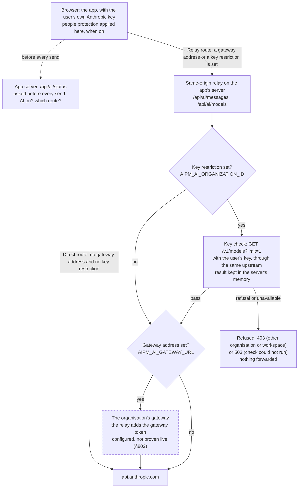

# Appendix: the facts behind the briefs

## How to read this appendix

The seven briefs keep to one page each. They carry a label and an evidence id (E1, E2, …) on each factual
sentence; this appendix says where each one comes from. It has four parts:

- the evidence labels, which say how far each claim has been checked;
- a diagram of the two routes an AI request can take;
- the evidence table, one row per id, naming its file and symbol, test, generated block or measured figure;
- the generated tables. Everything between a pair of `PACK:` markers is written by `npm run compliance:generate`
  from the app's own code and texts, and `npm run compliance:check` fails when a table no longer matches.

Every claim is about the code at commit e63693393. The figures were measured on 2026-11-14 against the demo
project at that commit. Open gaps are cited by their number in the project's register of open follow-ups
(`docs/open-followups.md`), for example §802; the table under "Open gaps" lists every one the briefs cite.

## Evidence labels

| Label | What it means |
|---|---|
| *measured* | Observed in paid runs against the demo project on 2026-11-14, with the app at commit e63693393. The aggregates are in `docs/briefs/figures.json`. A small sample, not a guarantee for other data. |
| *tested (unit)* | An automated unit test in the repository checks it; the test is named in the table. Unit tests use fakes for the network, the model and the database. |
| *tested (live database)* | An automated test checks it against a real Turso (libSQL) database; the table says what the test does not cover. |
| *read in code* | Someone read the code and it does this. No test or run checks the claim as stated. |
| *estimated* | Worked out from measured figures and stated assumptions; the assumptions are given beside it. |
| *not proven* | Nobody has shown it either way. The register entry says what it would take. |

"Read in code" is weaker than "tested": a later change can break it without any check failing.

## Two routes to the model

Each user brings their own Anthropic API key. Where a request goes depends on two server settings of the
deployment: a gateway address (`AIPM_AI_GATEWAY_URL`) and a key restriction to the organisation's Anthropic
keys (`AIPM_AI_ORGANIZATION_ID`, optionally `AIPM_AI_WORKSPACE_IDS`). With neither, the browser calls Anthropic
itself (the direct route). With either, the browser calls the app's own server, which relays the request
(E4, E5). People protection, when it is on, is applied in the browser before either route (E15).

What the diagram shows, with the evidence for each step:

- Before every send, the browser asks the app's server whether AI is still on and which route applies, and
  sends nothing if the answer is missing, says AI is off, reports an invalid setting or names another route
  (E3).
- Direct route: the browser posts to api.anthropic.com. This is the only case in which the browser may connect
  to Anthropic at all (E4, E34).
- Relay route: the browser posts to `/api/ai/messages` on the app's own origin. The relay sends the request on
  to the gateway when a gateway address is set, otherwise straight to api.anthropic.com. With neither set the
  relay answers 404; any invalid setting refuses every call (E5).
- With a key restriction set, nothing is forwarded until the user's key has passed the key check, which asks
  Anthropic, through the same upstream, which organisation and workspace the key belongs to (E7). Its results
  are kept in the server's memory (E8, E9). A gateway without a key restriction runs no key check.
- The gateway is any https address the operator sets; the app adds its token and has never been run against a
  real gateway (E11, E12, E13).

## Evidence table

Test titles are quoted exactly as they appear in the test file. `_relay.ts`, `_key-check.ts` and their tests are
in `src/app/api/ai/`.

| Id | Claim | Label | Source |
|---|---|---|---|
| E1 | For each AI feature: what it sends, which consent it needs, and what changes while people protection is on. | *read in code* | blocks `ai-paths` and `ai-paths-people`, generated from `AI_DATA_PATHS` in `src/app/ai-disclosure.ts` |
| E2 | Every AI request carries the user's own Anthropic API key. The relay forwards that key, adds no key of its own, and refuses a call that brings none (400). | *tested (unit)* | `relay` and `forwardHeaders` in `_relay.ts`; tests `models without a key → 400 missing-api-key without calling send` and `a call without a key of its own is still refused with 400` in `_relay.test.ts` |
| E3 | Before every send the browser asks the app's server (`/api/ai/status`) whether AI is on and which route applies. If AI is off, the setting is invalid, the route has changed or no valid answer comes, nothing is sent. | *tested (unit)* | `confirmAiDeployment` in `src/app/ai-transport.ts`; tests `page state direct, status answers relay: route-changed, and Anthropic is never called` and `an answer that says AI is off is off even without the people lock` in `src/app/ai-transport.test.ts` |
| E4 | Direct route: with no gateway address and no key restriction, the browser sends AI requests straight to api.anthropic.com. Relay route: with either set, the browser sends them to the app's own same-origin relay and not to Anthropic. | *tested (unit)* | `postAiMessages` and `usesRelay` in `src/app/ai-transport.ts`; tests `direct: checks the status, then posts to Anthropic with today's four headers`, `gateway: posts to the same-origin relay without the browser-access header` and `relay: posts to the same-origin relay, never to Anthropic, without the browser-access header` in `src/app/ai-transport.test.ts` |
| E5 | The relay sends to the gateway when `AIPM_AI_GATEWAY_URL` is set, otherwise to api.anthropic.com when keys are restricted to an organisation; with neither it answers 404. Any invalid setting refuses every call with 503. | *tested (unit)* | `upstreamFor` in `_relay.ts`; tests `direct deployment → 404, no relay`, `a Messages call goes to api.anthropic.com with the four forwarded headers and no gateway token`, `a gateway wins over the restriction: the check and the call both go to it with its token, like the real request` and `an invalid restriction → 503 ai-gateway-invalid, nothing sent` in `_relay.test.ts` |
| E6 | The relay refuses cross-site browser calls, forwards only four Anthropic headers (plus the gateway token when one is set) and no cookies, and logs no key, token, body or URL. It does not authenticate its callers (see E13). | *tested (unit)* | `relay`, `isSameOrigin` and `forwardHeaders` in `_relay.ts`; tests `Sec-Fetch-Site: cross-site → 403 not-same-origin`, `forwards exactly the four Anthropic headers plus the gateway token` and `no console or diagnostics output carries the key, token, body or URL` in `_relay.test.ts` |
| E7 | Key check: when `AIPM_AI_ORGANIZATION_ID` is set, the relay first sends a one-item model-list request (`GET /v1/models?limit=1`) with the user's key through the same upstream as the real request, and reads the organisation (and, with `AIPM_AI_WORKSPACE_IDS`, the workspace) from Anthropic's answer headers. A key of another organisation or workspace is refused with 403, and a check that cannot run answers 503; in both cases nothing is forwarded. | *tested (unit)* | `createKeyChecker` in `_key-check.ts` and `refusalFor` in `_relay.ts`; test `sends GET <base>/v1/models?limit=1 with the caller's key and version; a matching org passes` in `_key-check.test.ts`; tests `another organisation → 403 ai-key-wrong-organization; no Messages call, no body read upstream` and `the check unavailable → 503 ai-key-check-unavailable; no Messages call` in `_relay.test.ts` |
| E8 | The key check keeps its results in the server's memory only, under a keyed hash of the key. A pass is kept until the server restarts, the restriction changes or the entry is evicted (beyond 1,000 keys, least recently used first); a refusal (another organisation or workspace) for 5 minutes; Anthropic's own 401 for 60 seconds. A check that could not run, Anthropic's 403 and a gateway's refusal are never kept. | *tested (unit)* | `createKeyChecker`, `rememberable`, `KEY_CHECK_DEFAULT_REFUSAL_TTL_MS`, `KEY_CHECK_DEFAULT_REJECTED_TTL_MS` and `KEY_CHECK_DEFAULT_MAX_ENTRIES` in `_key-check.ts`; tests `a pass outlives the refusal lifetime`, `the default refusal lifetime is five minutes`, `remembers the 401 for 60 seconds, then sends a second pre-flight`, `a gateway's own 401 (not Anthropic-shaped) is not remembered`, `the default cap is 1000 entries` and the group `createKeyChecker — Anthropic's own 403 is passed through, not cached` in `_key-check.test.ts` |
| E9 | Because a pass is kept (E8), a key that has passed is not checked again on that server while its entry is kept. A key moved out of the organisation or workspace goes on passing the check until a restart, a change of the restriction or eviction. | *read in code* | `createKeyChecker` in `_key-check.ts`; test `a passed key is not checked again on the next call` in `_relay.test.ts` |
| E10 | The key check added 724 ms to the first relayed chat request with a new key and 344 ms to the first relayed inline edit, one run each. The extra time once a pass is kept was not measured. | *measured* | `figures.json relayKeyCheck.runs`; `figures.json relayKeyCheck.warmExtraMs` (empty) |
| E11 | The gateway is whatever https address the operator sets in `AIPM_AI_GATEWAY_URL`. The relay adds `AIPM_AI_GATEWAY_TOKEN` to every forwarded call as the `cf-aig-authorization` header (Cloudflare AI Gateway's, the gateway the operating guide describes). The address and the token are not sent to the browser. | *read in code* | `parseAiGatewayConfig` and `aiDeploymentStateFrom` in `src/app/ai-gateway-config.ts`; `forwardHeaders` in `_relay.ts`; `docs/RUNBOOK.md` |
| E12 | The gateway route has never been run against a real gateway; its tests use a fake upstream and a local TLS server. | *not proven* | register §802; `src/app/api/ai/_relay.https.test.ts` |
| E13 | The relay adds the gateway token for any caller that reaches the server: the app's server routes do not authenticate callers. | *read in code* | register §805; `forwardHeaders` in `_relay.ts` |
| E14 | People protection replaces, before a request is sent, the names of people the project knows with placeholders such as `[Person 1]`, and e-mail addresses, IBANs and phone numbers with placeholders by their pattern, known or not. Placeholders in the answer are turned back into the names on the device. A name the project does not know is sent as written. | *read in code* | `redactJsonBody` and `restoreJsonText` in `src/app/ai-people-redact.ts`, whose header comment states the matching rules; `aiPrivacyFor` in `src/app/ai-privacy.ts` |
| E15 | Protection is applied in the app's browser code, before a request leaves the device; neither the relay nor any other server route applies it. It holds for this app as shipped: a modified copy of the app, or another client using the same key, can send without it. | *read in code* | `redactForSend` and `postAiMessages` in `src/app/ai-transport.ts`; `relay` in `_relay.ts`; test `calls fetch with an Anthropic URL only in the transport` in `src/app/ai-transport-sites.test.ts` |
| E16 | With protection on, no person of the test fixture reaches a request body on any AI path that sends; with protection off, the same paths do send people, so the test can see them. | *tested (unit)* | groups `with protection on, no fixture person reaches a request body` and `anti-vacuity: with protection off, the same drivers send people` in `src/app/ai-people-protection.wire.test.ts` |
| E17 | With protection on, an AI answer that acts on a person (an assignee, a resource, a stakeholder) applies nothing person-related; the rest of the change applies. | *tested (unit)* | test `protection on: the assignee, the resource and the stakeholder are untouched; the rest of the task write applies` in `src/app/ai-people-protection.wire.test.ts` |
| E18 | With protection on, the allocation plan proposal and the RACI suggestion are hidden, and dictation is switched off. | *tested (unit)* | `figures.json hiddenWhenProtected`; block `ai-paths`; the `is not offered` cases of the group `with protection on, no fixture person reaches a request body` in `src/app/ai-people-protection.wire.test.ts` |
| E19 | A deployment can switch AI off (`ai` in `AIPM_DISABLED_INTEGRATIONS`; the relay then refuses every call) or force people protection on in every project (`ai-people`), whatever a project has stored. | *tested (unit)* | block `deployment-switches`; test `switched off → 503 integration-disabled` in `_relay.test.ts`; group `the deployment lock` in `src/app/ai-people-protection.wire.test.ts` |
| E20 | With protection on, the measured request bodies held 0 names and 0 e-mail addresses of the demo project's people, apart from 1 name in the new project proposal, the documented exception (a new project has no known people yet, so names in its brief are sent). | *measured* | `figures.json behaviour.protectedNameHitsOn`, `figures.json behaviour.emailHitsOn`, `figures.json behaviour.documentedExceptionHitsOn` |
| E21 | Positive control: with protection off, the same check found the demo project's people names 72 times, so it can see them. | *measured* | `figures.json behaviour.positiveControlHitsOff` |
| E22 | All 96 measured requests (47 with protection off, 41 with it on, 8 through the relay) reported the inference_geo value `global`. | *measured* | `figures.json behaviour.inferenceGeo`, `figures.json behaviour.requests` |
| E23 | The relay rows were run with people protection on (a run condition; `figures.json` does not record it). | *measured* | `figures.json paths[protection=relay]` |
| E24 | Cost per call on the measured model claude-sonnet-5, at list prices fetched on 2026-11-14: the chat $0.0668 with protection on and $0.0711 with it off; the other measured features $0.0034 to $0.0314. A row marked "unverified" is one whose requests did not show the protection state. | *measured* | block `figures`; `figures.json paths[].usdPerCall`; `figures.json rates` |
| E25 | For a team of five, the monthly AI cost comes to about $25 (light use), $67 (typical) or $165 (heavy); the calls per user per day are assumptions. | *estimated* | block `team-month` |
| E26 | The time the AI features save has not been measured. | *not proven* | register §811 |
| E27 | Whether Optimize work breakdown with AI gives the same result on repeated runs has not been measured. | *not proven* | register §812 |
| E28 | Saved chats are kept only when the project uses a Turso database, encrypted so that only their writer and the operator holding the recovery key can read them; while the recovery key is unset or unusable, no chat is saved. | *read in code* | `chatTursoMode` in `src/app/workspace-section.tsx`; `src/app/chat-crypto.ts`; blocks `ai-paths` and `deployment-switches` |
| E29 | A saved chat is deleted once the retention period (30 days unless the operator sets 1 to 3650) has passed since its last change: by the app in the browser, and by the server once at start and every 24 hours where the server's deletion is configured. An invalid setting pauses deletion for age. | *read in code* | `DEFAULT_CHAT_RETENTION_DAYS` and `MAX_CHAT_RETENTION_DAYS` in `src/app/ai-chat-retention-config.ts`; `CHAT_SWEEP_INTERVAL_MS` in `src/app/api/ai/_chat-sweep.ts`; `src/app/use-chat-retention-sweep.ts`; block `deployment-switches` |
| E30 | On a real libSQL database, the erasure and retention statements remove exactly the expected rows: one chat, all chats of one person across projects, the cap of 50 chats per person, expiry by age, a deleted project's chats, and the per-person lookup behind finding and erasing a person's chats. Not covered: the screens, the two deletion sweeps run with real credentials, the database provider's backups and what the model vendor keeps (§813). The test runs on every pull request and push to main, but is not a required check. | *tested (live database)* | tests `deleting one thread removes only that owner's row`, `delete all my chats removes every thread of one owner across projects`, `prune keeps the newest 50 threads per owner`, `retention expiry deletes threads older than the cutoff`, `the project hard-delete sweep removes the project's chat threads` and `an owner's threads are selectable for find and erase` in `e2e/chat-threads-erasure-live.spec.ts`; register §813 |
| E31 | Interactive AI runs only while the AI master switch is on and the user has accepted the current AI disclosure on this device. The acceptance is asked again when the disclosure text changes, when the route changes and when the key restriction is switched on or off. | *tested (unit)* | `isInteractiveAiAllowed`, `isConsentCurrent` and `AI_DISCLOSURE_VERSION` in `src/app/ai-consent.ts`; tests `throws while AI is switched off, the consent kept (AI-01)`, `is false for another disclosure version`, `a direct or gateway record is stale under relay; a new consent records relay and is current` and `a gateway consent given without the key restriction is stale once the restriction is on, and a new one is current` in `src/app/ai-consent.test.ts` |
| E32 | Background AI (the scheduled job analysis, the automatic insight recommendations, the scheduled digest) also needs a separate background acceptance, given once rather than run by run (§795). The weekly hard cap pauses background AI only. | *tested (unit)* | `assertBackgroundConsentLive` and `AiConsentLevel` in `src/app/ai-consent.ts`; tests `a withdrawn background consent leaves the interactive level live` and `blocks the background level with AiWeeklyCapReachedError and leaves the interactive level live` in `src/app/ai-consent.test.ts`; register §795 |
| E33 | The model the figures were measured with was claude-sonnet-5. | *measured* | `figures.json model` |
| E34 | The hosts the browser may connect to, and the services the app's server sends to, with what each receives and when. | *read in code* | blocks `browser-hosts` and `server-destinations` |

## AI paths and people data

The AI features that send data about people: every row of the next table except the two digest summaries, which
carry people's names only where someone typed one into a milestone name (E1).

<!-- PACK:ai-paths-people:BEGIN -->
| Feature | Consent | What is sent | With people protection on |
|---|---|---|---|
| AI Assistant chat | Asked on each device before the first use, and again when the disclosure, the AI route or the key restriction changes | Your messages; the files and e-mails you attach (an e-mail with its body and its sender and recipient names and addresses); your operating guides; and the project data the assistant reads to answer: tasks with their descriptions and note logs, milestones, RAID items, changes, stakeholders, people in the resource directory, absences (only as “absent”, with the person and the dates), budget figures, calendar events, documents and project details, and, when it searches them, the activity history and your other chats in this project. With every message it also gets the number of your other chats in this project and the titles and last-activity times of up to three of the most recent ones (an unnamed chat is titled with the start of its first message; chats are kept only with a Turso database), and the project’s open insights: up to ten current ones and up to five you acted on with their measured result, one line each. An insight from Timelog names one person (or their Timelog user number when no one in the resource directory is linked) with their logged working time: on how many days a single entry or a day’s total went over a limit, they logged more than their defined hours, they logged time on a non-working day or on a day they were absent (vacation, sick or training), or time in a closed month was changed, with the worst hours, the limit where there is one, and for a closed month the net change. People’s names are included. List results carry no e-mail addresses: the assistant reads one address at a time, only when it needs it, though addresses can still appear in attachments, documents and logged edits. The whole conversation is sent again with every new message. Saved chats are encrypted so that only the person who wrote them and the operator holding the recovery key can read them, and each is deleted when the retention period has passed since its last change (30 days unless the operator sets another). Exceptions: chats saved by an earlier version of the app, which others in the project can read until they expire, and the AI gateway’s own logs where your organisation uses one. | The names, email addresses and phone numbers of people the project knows are replaced by placeholders before sending, and the assistant cannot assign, move or rate anyone. Images and PDFs are refused while protection is on. Names the project does not know, typed into free text or contained in text attachments, may still be sent. |
| Inline AI edit on a row | Asked on each device before the first use, and again when the disclosure, the AI route or the key restriction changes | Your instruction, the one row you edit and a short project context (today’s date, task count, groups and labels, and the same open-insight lines the chat gets, so a Timelog insight can name a person with their logged working time), plus your operating guide for inline edits if you have one. The row includes names, dates and descriptions, and for a task its blocker log with the name of whoever logged each entry; for a person in the resource directory their name, job title, department, company, role, whether they are external, whether they are active, and their planned workload per period and whether it is planned in percent or hours. Never sent: e-mail addresses, note logs, a person’s phone number, location, birthday, notes and absence hours, a stakeholder’s notes, influence and interest, and an absence’s type and note. | The names, email addresses and phone numbers of people the project knows are replaced by placeholders before sending. Names the project does not know, typed into free text or contained in attachments, may still be sent. |
| Steering committee report draft | Asked on each device before the first use, and again when the disclosure, the AI route or the key restriction changes | The meeting agenda you typed, your operating guide for this report if you have one, a status summary: overall status (RAG), task counts, overdue and due-soon counts, RAID and change counts, up to five change titles, and the names and dates of overdue, at-risk and due-soon milestones; and who is absent from today to 28 days ahead: each person’s name (with their number in the resource directory when they are in it) and the days they are away, not the type or reason of the absence. No e-mail addresses, and no other people’s names unless they are in a title or the agenda. | The names, email addresses and phone numbers of people the project knows are replaced by placeholders before sending. Names the project does not know, typed into free text or contained in attachments, may still be sent. |
| Forecast import from a spreadsheet | Asked on each device before the first use, and again when the disclosure, the AI route or the key restriction changes | The sheet you choose, with its name (for a CSV file, the file name without its extension), as a table of its non-empty cells (a sheet too large for one request is not sent), plus your operating guide for the import if you have one. Whatever the sheet holds is sent: usually people’s names and planned hours, and their e-mail addresses and hourly rates when the sheet has them. No other project data. | The names, email addresses and phone numbers of people the project knows are replaced by placeholders before sending. Names the project does not know, typed into free text or contained in attachments, may still be sent. |
| Insight recommendation, on request | Asked on each device before the first use, and again when the disclosure, the AI route or the key restriction changes | The project name, today’s date, the insight’s type, severity and figures, the titles of up to 30 tasks, the names of up to 30 people (active resources and assignees of open tasks), and the item the insight is about: a milestone with its description, a RAID item with its owner and mitigation, or a person’s job title, department and company. For a working-time insight from Timelog the figures are about one person: their name and Timelog user number, on how many days a single entry or a day’s total went over a limit, they logged more than their defined hours, they logged time on a non-working day or on a day they were absent (vacation, sick or training), or time in a closed month was changed, with the worst hours, the limit where there is one and, for a closed month, the net change, and the first and last dates concerned. Also who is absent from today to 28 days ahead: each person’s name (with their number in the resource directory when they are in it) and the days they are away, not the type or reason of the absence, and your operating guide for recommendations if you have one. No e-mail addresses and no resource notes. | The names, email addresses and phone numbers of people the project knows are replaced by placeholders before sending. Names the project does not know, typed into free text or contained in attachments, may still be sent. |
| Analyze next actions with AI | Asked on each device before the first use, and again when the disclosure, the AI route or the key restriction changes | The project name, today’s date, the project mode and enabled modules, planned, actual and forecast budget, the next-actions queue (titles and reasons), open tasks (title, status, priority, assignee, due date), active RAID items (category, severity, status, owner, target date, date last changed), milestones, pending changes, stakeholder names with their title, organisation or category, and who is absent from today to 28 days ahead: each person’s name (with their number in the resource directory when they are in it) and the days they are away, not the type or reason of the absence; plus your operating guide for analyses if you have one. No descriptions, notes or e-mail addresses. | The names, email addresses and phone numbers of people the project knows are replaced by placeholders before sending. Names the project does not know, typed into free text or contained in attachments, may still be sent. |
| Allocation plan proposal | Asked on each device before the first use, and again when the disclosure, the AI route or the key restriction changes | Your request, your operating guide if you have one, the plan window and periods, the workday length and the plan currency, and for each person in the resource directory: their name (or their number in the resource directory if no name is set), role, whether they are external, whether their workload is planned in percent or in hours, their planned and available hours per period, and for an internal person with a role the internal hourly rate of that role. Absences are used to work out available hours and are not sent. Also up to 150 open tasks, each with its title, owner (a name where the owner is not one of the people listed), remaining estimate, start and due dates, status, whether it is synced from Jira, the open tasks it waits for, its milestones and its hours per period; up to 40 milestones with their name, date and whether they are achieved; and which of the listed people are responsible or accountable for each milestone. When the project shares a Turso database with other projects and a person here is matched to a person in another project that does not protect its people from the AI, it also sends that project's name, the hours booked for that person there per period, and their open-task count and remaining hours there (no task titles). The names of other projects that could not be read, or that were left out because they protect their people, are sent too. | Not available: the feature is hidden while protection is on. Where it is available, other projects that protect their people are left out of the hours counted from them. |
| RACI suggestion | Asked on each device before the first use, and again when the disclosure, the AI route or the key restriction changes | Stakeholder names, titles, organisations, categories, influence and interest; milestone names, dates and descriptions; the existing RACI assignments; and your operating guide if you have one. No e-mail addresses. | Not available: the feature is hidden while protection is on. |
| Duplicate task check | Asked on each device before the first use, and again when the disclosure, the AI route or the key restriction changes | For each task: its number, status, due date, title, assignee and the first 200 characters of its description, plus your operating guide if you have one. No e-mail addresses or note logs. | The names, email addresses and phone numbers of people the project knows are replaced by placeholders before sending. Names the project does not know, typed into free text or contained in attachments, may still be sent. |
| Work breakdown (WBS) proposal | Asked on each device before the first use, and again when the disclosure, the AI route or the key restriction changes | Your instruction, your operating guide if you have one, the project name and window, groups, milestones, for each task: name, group, status, start and due dates, estimate, dependencies, assignee and a shortened description; and who is absent in the project window (from today, or the project start if that is later, to the project end; the next 28 days from today when the project has no end date, or its end date is before today or before the project start): each person’s name (with their number in the resource directory when they are in it) and the days they are away, not the type or reason of the absence. No e-mail addresses or note logs. | The names, email addresses and phone numbers of people the project knows are replaced by placeholders before sending. Names the project does not know, typed into free text or contained in attachments, may still be sent. |
| Next-actions weight suggestion | Asked on each device before the first use, and again when the disclosure, the AI route or the key restriction changes | The project name, the titles of tasks, RAID items, milestones and changes, the next-actions queue, your current weights and learning counts, a trend summary, and stakeholder names, plus your operating guide for weight suggestions if you have one. No descriptions, notes or e-mail addresses. | The names, email addresses and phone numbers of people the project knows are replaced by placeholders before sending. Names the project does not know, typed into free text or contained in attachments, may still be sent. |
| New project proposal (project wizard) | Asked on each device before the first use, and again when the disclosure, the AI route or the key restriction changes | Only what you give the wizard: the brief you type, the files you attach (an e-mail with its body and its sender and recipient names and addresses), and the SharePoint files and Confluence pages you pick, plus your operating guide if you have one. No data from existing projects. | Email addresses, phone numbers and IBANs are always replaced by placeholders. Names cannot be: a new project has no known people yet, so names in your brief and in files you add to the wizard are sent. Images and scanned or PDF documents are sent too, unless your organisation forces protection; then they are refused. The AI’s proposal is applied without any people: no sponsor, project manager, stakeholders, resources, assignees or owners. |
| Speech-to-text dictation | Asked on each device before the first use, and again when the disclosure, the AI route or the key restriction changes | When you choose a speech-to-text service, the audio you record and that service’s API key go through this app’s own server route to the speech service you configured, not to Anthropic. Without this consent, while AI is switched off, or while that service’s address or key is missing or cannot be read on this device, dictation with that service is unavailable; it never switches to another engine on its own. Only when you choose browser dictation instead, or this deployment has switched speech-to-text off, does it use the browser’s built-in speech recognition, which in some browsers sends audio to the browser maker’s service. | Not available: the feature is switched off while protection is on. |
| Scheduled job analysis | Asked separately on each device, and only counts together with the interactive consent; asked again on the same changes | The job’s instruction and, for the project it covers, the same summary as “Analyze next actions with AI”: the project name, today’s date, the project mode and enabled modules, planned, actual and forecast budget, the next-actions queue (titles and reasons), open tasks (title, status, priority, assignee, due date), active RAID items (category, severity, status, owner, target date, date last changed), milestones, pending changes, stakeholder names with their title, organisation or category, and who is absent from today to 28 days ahead: each person’s name (with their number in the resource directory when they are in it) and the days they are away, not the type or reason of the absence; plus your operating guide for analyses if you have one. No descriptions, notes or e-mail addresses. | The names, email addresses and phone numbers of people the project knows are replaced by placeholders before sending. Names the project does not know, typed into free text or contained in attachments, may still be sent. |
| Automatic insight recommendations | Asked separately on each device, and only counts together with the interactive consent; asked again on the same changes | The project name, today’s date, the insight’s type, severity and figures, the titles of up to 30 tasks, the names of up to 30 people (active resources and assignees of open tasks), and the item the insight is about: a milestone with its description, a RAID item with its owner and mitigation, or a person’s job title, department and company. For a working-time insight from Timelog the figures are about one person: their name and Timelog user number, on how many days a single entry or a day’s total went over a limit, they logged more than their defined hours, they logged time on a non-working day or on a day they were absent (vacation, sick or training), or time in a closed month was changed, with the worst hours, the limit where there is one and, for a closed month, the net change, and the first and last dates concerned. Also who is absent from today to 28 days ahead: each person’s name (with their number in the resource directory when they are in it) and the days they are away, not the type or reason of the absence, and your operating guide for recommendations if you have one. No e-mail addresses and no resource notes. | The names, email addresses and phone numbers of people the project knows are replaced by placeholders before sending. Names the project does not know, typed into free text or contained in attachments, may still be sent. |
<!-- PACK:ai-paths-people:END -->

## AI paths

Every AI feature of the app, with the text the app itself shows before a user accepts the AI disclosure (E1).

<!-- PACK:ai-paths:BEGIN -->
| Feature | Consent | What is sent | With people protection on |
|---|---|---|---|
| AI Assistant chat | Asked on each device before the first use, and again when the disclosure, the AI route or the key restriction changes | Your messages; the files and e-mails you attach (an e-mail with its body and its sender and recipient names and addresses); your operating guides; and the project data the assistant reads to answer: tasks with their descriptions and note logs, milestones, RAID items, changes, stakeholders, people in the resource directory, absences (only as “absent”, with the person and the dates), budget figures, calendar events, documents and project details, and, when it searches them, the activity history and your other chats in this project. With every message it also gets the number of your other chats in this project and the titles and last-activity times of up to three of the most recent ones (an unnamed chat is titled with the start of its first message; chats are kept only with a Turso database), and the project’s open insights: up to ten current ones and up to five you acted on with their measured result, one line each. An insight from Timelog names one person (or their Timelog user number when no one in the resource directory is linked) with their logged working time: on how many days a single entry or a day’s total went over a limit, they logged more than their defined hours, they logged time on a non-working day or on a day they were absent (vacation, sick or training), or time in a closed month was changed, with the worst hours, the limit where there is one, and for a closed month the net change. People’s names are included. List results carry no e-mail addresses: the assistant reads one address at a time, only when it needs it, though addresses can still appear in attachments, documents and logged edits. The whole conversation is sent again with every new message. Saved chats are encrypted so that only the person who wrote them and the operator holding the recovery key can read them, and each is deleted when the retention period has passed since its last change (30 days unless the operator sets another). Exceptions: chats saved by an earlier version of the app, which others in the project can read until they expire, and the AI gateway’s own logs where your organisation uses one. | The names, email addresses and phone numbers of people the project knows are replaced by placeholders before sending, and the assistant cannot assign, move or rate anyone. Images and PDFs are refused while protection is on. Names the project does not know, typed into free text or contained in text attachments, may still be sent. |
| Inline AI edit on a row | Asked on each device before the first use, and again when the disclosure, the AI route or the key restriction changes | Your instruction, the one row you edit and a short project context (today’s date, task count, groups and labels, and the same open-insight lines the chat gets, so a Timelog insight can name a person with their logged working time), plus your operating guide for inline edits if you have one. The row includes names, dates and descriptions, and for a task its blocker log with the name of whoever logged each entry; for a person in the resource directory their name, job title, department, company, role, whether they are external, whether they are active, and their planned workload per period and whether it is planned in percent or hours. Never sent: e-mail addresses, note logs, a person’s phone number, location, birthday, notes and absence hours, a stakeholder’s notes, influence and interest, and an absence’s type and note. | The names, email addresses and phone numbers of people the project knows are replaced by placeholders before sending. Names the project does not know, typed into free text or contained in attachments, may still be sent. |
| Steering committee report draft | Asked on each device before the first use, and again when the disclosure, the AI route or the key restriction changes | The meeting agenda you typed, your operating guide for this report if you have one, a status summary: overall status (RAG), task counts, overdue and due-soon counts, RAID and change counts, up to five change titles, and the names and dates of overdue, at-risk and due-soon milestones; and who is absent from today to 28 days ahead: each person’s name (with their number in the resource directory when they are in it) and the days they are away, not the type or reason of the absence. No e-mail addresses, and no other people’s names unless they are in a title or the agenda. | The names, email addresses and phone numbers of people the project knows are replaced by placeholders before sending. Names the project does not know, typed into free text or contained in attachments, may still be sent. |
| Digest summary, on request | Asked on each device before the first use, and again when the disclosure, the AI route or the key restriction changes | Overall status (RAG), the number of overdue tasks, the numbers of open and high-severity RAID items, and the names and dates of milestones due soon, plus your operating guide for the digest if you have one. No people’s names, notes or e-mail addresses, unless they are in a milestone name. | The names, email addresses and phone numbers of people the project knows are replaced by placeholders before sending. Names the project does not know, typed into free text or contained in attachments, may still be sent. |
| Forecast import from a spreadsheet | Asked on each device before the first use, and again when the disclosure, the AI route or the key restriction changes | The sheet you choose, with its name (for a CSV file, the file name without its extension), as a table of its non-empty cells (a sheet too large for one request is not sent), plus your operating guide for the import if you have one. Whatever the sheet holds is sent: usually people’s names and planned hours, and their e-mail addresses and hourly rates when the sheet has them. No other project data. | The names, email addresses and phone numbers of people the project knows are replaced by placeholders before sending. Names the project does not know, typed into free text or contained in attachments, may still be sent. |
| Insight recommendation, on request | Asked on each device before the first use, and again when the disclosure, the AI route or the key restriction changes | The project name, today’s date, the insight’s type, severity and figures, the titles of up to 30 tasks, the names of up to 30 people (active resources and assignees of open tasks), and the item the insight is about: a milestone with its description, a RAID item with its owner and mitigation, or a person’s job title, department and company. For a working-time insight from Timelog the figures are about one person: their name and Timelog user number, on how many days a single entry or a day’s total went over a limit, they logged more than their defined hours, they logged time on a non-working day or on a day they were absent (vacation, sick or training), or time in a closed month was changed, with the worst hours, the limit where there is one and, for a closed month, the net change, and the first and last dates concerned. Also who is absent from today to 28 days ahead: each person’s name (with their number in the resource directory when they are in it) and the days they are away, not the type or reason of the absence, and your operating guide for recommendations if you have one. No e-mail addresses and no resource notes. | The names, email addresses and phone numbers of people the project knows are replaced by placeholders before sending. Names the project does not know, typed into free text or contained in attachments, may still be sent. |
| Analyze next actions with AI | Asked on each device before the first use, and again when the disclosure, the AI route or the key restriction changes | The project name, today’s date, the project mode and enabled modules, planned, actual and forecast budget, the next-actions queue (titles and reasons), open tasks (title, status, priority, assignee, due date), active RAID items (category, severity, status, owner, target date, date last changed), milestones, pending changes, stakeholder names with their title, organisation or category, and who is absent from today to 28 days ahead: each person’s name (with their number in the resource directory when they are in it) and the days they are away, not the type or reason of the absence; plus your operating guide for analyses if you have one. No descriptions, notes or e-mail addresses. | The names, email addresses and phone numbers of people the project knows are replaced by placeholders before sending. Names the project does not know, typed into free text or contained in attachments, may still be sent. |
| Allocation plan proposal | Asked on each device before the first use, and again when the disclosure, the AI route or the key restriction changes | Your request, your operating guide if you have one, the plan window and periods, the workday length and the plan currency, and for each person in the resource directory: their name (or their number in the resource directory if no name is set), role, whether they are external, whether their workload is planned in percent or in hours, their planned and available hours per period, and for an internal person with a role the internal hourly rate of that role. Absences are used to work out available hours and are not sent. Also up to 150 open tasks, each with its title, owner (a name where the owner is not one of the people listed), remaining estimate, start and due dates, status, whether it is synced from Jira, the open tasks it waits for, its milestones and its hours per period; up to 40 milestones with their name, date and whether they are achieved; and which of the listed people are responsible or accountable for each milestone. When the project shares a Turso database with other projects and a person here is matched to a person in another project that does not protect its people from the AI, it also sends that project's name, the hours booked for that person there per period, and their open-task count and remaining hours there (no task titles). The names of other projects that could not be read, or that were left out because they protect their people, are sent too. | Not available: the feature is hidden while protection is on. Where it is available, other projects that protect their people are left out of the hours counted from them. |
| RACI suggestion | Asked on each device before the first use, and again when the disclosure, the AI route or the key restriction changes | Stakeholder names, titles, organisations, categories, influence and interest; milestone names, dates and descriptions; the existing RACI assignments; and your operating guide if you have one. No e-mail addresses. | Not available: the feature is hidden while protection is on. |
| Duplicate task check | Asked on each device before the first use, and again when the disclosure, the AI route or the key restriction changes | For each task: its number, status, due date, title, assignee and the first 200 characters of its description, plus your operating guide if you have one. No e-mail addresses or note logs. | The names, email addresses and phone numbers of people the project knows are replaced by placeholders before sending. Names the project does not know, typed into free text or contained in attachments, may still be sent. |
| Work breakdown (WBS) proposal | Asked on each device before the first use, and again when the disclosure, the AI route or the key restriction changes | Your instruction, your operating guide if you have one, the project name and window, groups, milestones, for each task: name, group, status, start and due dates, estimate, dependencies, assignee and a shortened description; and who is absent in the project window (from today, or the project start if that is later, to the project end; the next 28 days from today when the project has no end date, or its end date is before today or before the project start): each person’s name (with their number in the resource directory when they are in it) and the days they are away, not the type or reason of the absence. No e-mail addresses or note logs. | The names, email addresses and phone numbers of people the project knows are replaced by placeholders before sending. Names the project does not know, typed into free text or contained in attachments, may still be sent. |
| Next-actions weight suggestion | Asked on each device before the first use, and again when the disclosure, the AI route or the key restriction changes | The project name, the titles of tasks, RAID items, milestones and changes, the next-actions queue, your current weights and learning counts, a trend summary, and stakeholder names, plus your operating guide for weight suggestions if you have one. No descriptions, notes or e-mail addresses. | The names, email addresses and phone numbers of people the project knows are replaced by placeholders before sending. Names the project does not know, typed into free text or contained in attachments, may still be sent. |
| New project proposal (project wizard) | Asked on each device before the first use, and again when the disclosure, the AI route or the key restriction changes | Only what you give the wizard: the brief you type, the files you attach (an e-mail with its body and its sender and recipient names and addresses), and the SharePoint files and Confluence pages you pick, plus your operating guide if you have one. No data from existing projects. | Email addresses, phone numbers and IBANs are always replaced by placeholders. Names cannot be: a new project has no known people yet, so names in your brief and in files you add to the wizard are sent. Images and scanned or PDF documents are sent too, unless your organisation forces protection; then they are refused. The AI’s proposal is applied without any people: no sponsor, project manager, stakeholders, resources, assignees or owners. |
| Speech-to-text dictation | Asked on each device before the first use, and again when the disclosure, the AI route or the key restriction changes | When you choose a speech-to-text service, the audio you record and that service’s API key go through this app’s own server route to the speech service you configured, not to Anthropic. Without this consent, while AI is switched off, or while that service’s address or key is missing or cannot be read on this device, dictation with that service is unavailable; it never switches to another engine on its own. Only when you choose browser dictation instead, or this deployment has switched speech-to-text off, does it use the browser’s built-in speech recognition, which in some browsers sends audio to the browser maker’s service. | Not available: the feature is switched off while protection is on. |
| Scheduled job analysis | Asked separately on each device, and only counts together with the interactive consent; asked again on the same changes | The job’s instruction and, for the project it covers, the same summary as “Analyze next actions with AI”: the project name, today’s date, the project mode and enabled modules, planned, actual and forecast budget, the next-actions queue (titles and reasons), open tasks (title, status, priority, assignee, due date), active RAID items (category, severity, status, owner, target date, date last changed), milestones, pending changes, stakeholder names with their title, organisation or category, and who is absent from today to 28 days ahead: each person’s name (with their number in the resource directory when they are in it) and the days they are away, not the type or reason of the absence; plus your operating guide for analyses if you have one. No descriptions, notes or e-mail addresses. | The names, email addresses and phone numbers of people the project knows are replaced by placeholders before sending. Names the project does not know, typed into free text or contained in attachments, may still be sent. |
| Automatic insight recommendations | Asked separately on each device, and only counts together with the interactive consent; asked again on the same changes | The project name, today’s date, the insight’s type, severity and figures, the titles of up to 30 tasks, the names of up to 30 people (active resources and assignees of open tasks), and the item the insight is about: a milestone with its description, a RAID item with its owner and mitigation, or a person’s job title, department and company. For a working-time insight from Timelog the figures are about one person: their name and Timelog user number, on how many days a single entry or a day’s total went over a limit, they logged more than their defined hours, they logged time on a non-working day or on a day they were absent (vacation, sick or training), or time in a closed month was changed, with the worst hours, the limit where there is one and, for a closed month, the net change, and the first and last dates concerned. Also who is absent from today to 28 days ahead: each person’s name (with their number in the resource directory when they are in it) and the days they are away, not the type or reason of the absence, and your operating guide for recommendations if you have one. No e-mail addresses and no resource notes. | The names, email addresses and phone numbers of people the project knows are replaced by placeholders before sending. Names the project does not know, typed into free text or contained in attachments, may still be sent. |
| Digest summary, scheduled | Asked separately on each device, and only counts together with the interactive consent; asked again on the same changes | Overall status (RAG), the number of overdue tasks, the numbers of open and high-severity RAID items, and the names and dates of milestones due soon, plus your operating guide for the digest if you have one. No people’s names, notes or e-mail addresses, unless they are in a milestone name. | The names, email addresses and phone numbers of people the project knows are replaced by placeholders before sending. Names the project does not know, typed into free text or contained in attachments, may still be sent. |
<!-- PACK:ai-paths:END -->

## Server destinations

<!-- PACK:server-destinations:BEGIN -->
| Run by | Code that sends it | What is sent | What triggers it |
|---|---|---|---|
| Anthropic | src/app/api/ai/_relay.ts | The caller's own Anthropic API key and the AI request itself (the conversation, including any project content the assistant was given), forwarded to api.anthropic.com, plus the model-list request, and, when the server holds no recent result for that key, a one-item model-list request with the same key that checks which organisation the key belongs to; the server keeps a passed check in memory, and a refusal for up to five minutes, so later requests with the same key are usually not checked again. | When the deployment restricts AI keys to an Anthropic organisation (AIPM_AI_ORGANIZATION_ID), sets no gateway address and a user sends an AI request; without that restriction the browser calls Anthropic itself, which the browser-side host list covers. |
| The deploying organisation | src/app/api/ai/_relay.ts | The same requests the Anthropic relay would send (the caller's Anthropic API key, the AI request itself and the model-list request), addressed to the deployment's gateway, with the gateway token added when one is set; when keys are restricted to an organisation, a request whose key the server holds no recent result for is preceded by a one-item model-list request with the same key that checks the key's organisation; the server keeps a passed check in memory, and a refusal for up to five minutes, so later requests with the same key are usually not checked again. | When the deployment sets a gateway address (AIPM_AI_GATEWAY_URL) and a user sends an AI request. |
| Turso | src/app/api/ai/_chat-sweep.ts | Statements that create the saved-chats table if it is missing and delete saved chats older than the retention period, sent to the Turso database the server is configured with together with its Turso auth token; the statements carry the number of days and read no chat content. | Once when the server starts and every 24 hours after, while Turso credentials for the sweep (or the app's public Turso address) are set and the retention setting is valid. |
| Atlassian | src/app/api/jira | The user's Jira e-mail address and API token as basic authentication, and the request the user triggered (for example a search query, or the fields of an issue being created, updated or transitioned, and the lookups behind these such as projects, issue types and users), sent to the user's own Atlassian Cloud site (an address under atlassian.net). | When Jira is enabled in the project settings, the integration is not switched off for the deployment, and a user uses a Jira function such as search, import or sync. |
| Atlassian | src/app/api/confluence | The user's Atlassian e-mail address and API token as basic authentication and the id of the one Confluence page the user asked for, sent to the user's own Atlassian Cloud site (an address under atlassian.net). | When a user imports a Confluence page and the integration is not switched off for the deployment. |
| Timelog | src/app/api/timelog | The user's Timelog access token as a bearer token, the Timelog tenant name in the address, and the request the user triggered (a path, a query and, for writes, the time-registration data), sent to the user's own Timelog host (an address under timelog.com). | When Timelog is configured in the settings, the integration is not switched off for the deployment, and a user uses a Timelog function such as booking time or loading registrations. |
| A service the user enters | src/app/api/stt | The recorded audio of the dictation (as a webm file), the speech model name and the user's speech-to-text API key as a bearer token, sent over https to the endpoint address the user entered in the dictation settings, unless that address is a private IP address. | When a user dictates with a speech-to-text endpoint configured, and neither the dictation integration, the AI integration nor the people-protection lock is switched off for the deployment, and the deployment's AI gateway setting is not invalid. |
| European Central Bank | src/app/api/ecb | A plain request for the European Central Bank's daily euro reference rates, carrying no workspace data and no credentials. | When the app loads or refreshes exchange rates and the ecb integration is not switched off for the deployment. |
| GitHub | desktop/src/updater.ts | Requests to github.com for the app's releases feed (releases.atom), the latest release tag and its update information file (latest.yml) and, when the user accepts an update, a download of the installer (and of its block map, when the release has one) from GitHub's release-asset hosts; the update checks and downloads carry the requester's IP address, the update library's User-Agent (electron-builder) and a fixed identifier (header x-user-staging-id) that is the same for every installation, and no workspace data; the library still stores a random per-installation identifier in the app's data folder, but it stays on the device and is not sent. | In a packaged desktop app 10 seconds after start and whenever the user chooses Check for updates, unless AIPM_DISABLE_UPDATE_CHECK is set to 1; the installer download starts only when the user accepts the update. |
<!-- PACK:server-destinations:END -->

## Browser hosts

<!-- PACK:browser-hosts:BEGIN -->
| Host | Directive | Condition |
|---|---|---|
| https://api.anthropic.com | Connections (connect-src) | Only when all three hold: the deployment sends AI requests directly to Anthropic (no AI gateway), it does not restrict AI to its organisation's keys, and the AI integration is not switched off |
| https://*.turso.io | Connections (connect-src) | Always allowed |
| https://graph.microsoft.com | Connections (connect-src) | Always allowed |
| https://*.sharepoint.com | Connections (connect-src) | Always allowed |
| https://*.files.1drv.com | Connections (connect-src) | Always allowed |
| https://login.microsoftonline.com | Connections (connect-src) | Always allowed |
| http://localhost:* | Connections (connect-src) | Always allowed |
| http://127.0.0.1:* | Connections (connect-src) | Always allowed |
| https://login.microsoftonline.com | Embedded frames (frame-src) | Always allowed |
<!-- PACK:browser-hosts:END -->

## Deployment switches

<!-- PACK:deployment-switches:BEGIN -->
| Variable | Also accepted as | Applies to | Allowed values | Effect |
|---|---|---|---|---|
| AIPM_AI_GATEWAY_URL | - | Server | - | Sends this deployment's AI requests to the given https gateway address instead of directly to Anthropic; an unusable value makes AI requests fail until it is fixed. |
| AIPM_AI_GATEWAY_TOKEN | - | Server | - | Token the server sends to the AI gateway with each request; it never reaches the browser, and without a gateway address it is an invalid setting. |
| AIPM_AI_ORGANIZATION_ID | - | Server | - | Restricts AI use to API keys of this Anthropic organisation: the server checks each key's organisation before forwarding a request and refuses other keys; a set variable whose name, in any letter case, starts with AIPM_AI_ and contains ORG or WORKSPACE but is not exactly this name or the workspace-ids name makes AI requests fail. |
| AIPM_AI_WORKSPACE_IDS | - | Server | - | With the organisation id, further restricts AI use to keys of the listed Anthropic workspaces (comma-separated); without the organisation id it is an invalid setting, and a set variable whose name, in any letter case, starts with AIPM_AI_ and contains ORG or WORKSPACE but is not exactly this name or the organisation-id name makes AI requests fail. |
| AIPM_DISABLED_INTEGRATIONS | - | Server | jira, confluence, timelog, ecb, stt, ai, ai-people | Comma-separated integrations this deployment switches off: the server refuses their requests and the app hides them, and the value ai-people forces people protection on in every project. |
| AIPM_AI_CHAT_RETENTION_DAYS | - | Server | - | Days a saved AI chat is kept before it is deleted for age, by the browser and by the server's daily deletion where that is configured (1 to 3650, 30 when unset); an invalid value pauses deletion for age until it is fixed. |
| AIPM_AI_CHAT_RECOVERY_PUBLIC_KEY | - | Server | - | Operator's RSA public key (base64, at least 3072 bits) that saved AI chats are also encrypted to for recovery; while it is unset or unusable, no chat is saved. |
| AIPM_CHAT_SWEEP_TURSO_URL | - | Server | - | Turso database address the server's daily deletion of expired AI chats connects to; when unset, the app's public Turso address is used instead, and a remote address without a sweep token means the daily deletion does not run. |
| AIPM_CHAT_SWEEP_TURSO_TOKEN | - | Server | - | Auth token used only together with the sweep database address (ignored when that is unset, as the public Turso pair is then used); a remote sweep address without it means the daily deletion does not run. |
| AIPM_DISABLE_UPDATE_CHECK | - | Desktop app | - | Set to 1, the desktop app makes no update checks and shows no update dialog. |
<!-- PACK:deployment-switches:END -->

## Open gaps

The open register entries the briefs cite. Each is an open item in `docs/open-followups.md`, with what it would
take to close it.

<!-- PACK:open-gaps:BEGIN -->
| Register entry | Title |
|---|---|
| §487 | The Windows installer is still unsigned: the signing pipeline exists but is switched off, so every install shows an unknown-publisher warning |
| §562 | The shared proxy rate limiter is bypassable by a client-supplied header, and its store is in-memory |
| §793 | The installer's uninstaller is not code-signed |
| §794 | A single AI chat write applies without the review card |
| §795 | Background AI runs are consented once, not approved run by run |
| §796 | Tasks created by Plan with AI's work breakdown cannot be undone |
| §797 | External text that the chat's tools read does not trigger the review hold |
| §798 | Most AI requests have no client time limit, and none is retried on a rate limit or overload |
| §799 | An activity entry written by the AI does not link to the chat message that caused it |
| §800 | The Content Security Policy allows whole host families by wildcard |
| §801 | Text the AI writes carries no machine-readable marking |
| §802 | The AI gateway route has never been run against a real gateway |
| §803 | Dictation's private-address check does not resolve host names |
| §804 | Plan with AI always sends internal hourly rates; there is no option to leave them out |
| §805 | The AI relay attaches the deployment's gateway token for any caller that reaches the server |
| §806 | The AI relay and dictation routes have no request limit |
| §810 | Hiding a project's Resources function keeps neither the chat's people tools nor the absence list from the AI |
| §811 | The time the AI features save is not measured |
| §812 | Whether Optimize work breakdown with AI repeats is not measured |
| §813 | Erasure and retention of saved chats are proven live only for the statements the erasure spec covers |
| §814 | Several AI paths have no recorded cost or observed behaviour from a measured run |
<!-- PACK:open-gaps:END -->

## Measured figures

Measured on 2026-11-14 against the demo project at commit e63693393 (E24). The rows marked "on (relay)" went
through the same-origin relay with the key check and were run with people protection on; `figures.json` does
not record that condition (E23). The behaviour counts behind E20 to E22 are in the same file.

<!-- PACK:figures:BEGIN -->
| Feature | People protection | n (calls) | $/call | Cache-read share | Median latency |
|---|---|---|---|---|---|
| AI Assistant chat | off | 6 | 0.0711 | 66% | 12.7 s |
| Digest summary, on request | off | 3 (3 unverified) | 0.0034 | 0% | 2.0 s |
| Automatic insight recommendations | off | 2 | 0.0153 | 43% | 5.1 s |
| Scheduled job analysis | off | 3 | 0.0167 | 0% | 11.0 s |
| Inline AI edit on a row | off | 3 | 0.0150 | 60% | 3.8 s |
| Steering committee report draft | off | 3 (3 unverified) | 0.0185 | 0% | 14.9 s |
| Forecast import from a spreadsheet | off | 3 (3 unverified) | 0.0068 | 0% | 3.8 s |
| Insight recommendation, on request | off | 3 | 0.0229 | 0% | 9.4 s |
| Analyze next actions with AI | off | 3 | 0.0163 | 0% | 10.0 s |
| Allocation plan proposal | off | 3 (3 unverified) | 0.0148 | 0% | 6.1 s |
| RACI suggestion | off | 3 (3 unverified) | 0.0080 | 0% | 2.6 s |
| Duplicate task check | off | 3 (3 unverified) | 0.0108 | 0% | 3.8 s |
| Work breakdown (WBS) proposal | off | 3 (3 unverified) | 0.0314 | 0% | 16.3 s |
| New project proposal (project wizard) | off | 3 (3 unverified) | 0.0158 | 0% | 8.2 s |
| Next-actions weight suggestion | off | 3 | 0.0114 | 0% | 5.2 s |
| AI Assistant chat | on | 6 | 0.0668 | 67% | 18.3 s |
| Digest summary, on request | on | 3 (3 unverified) | 0.0035 | 0% | 2.1 s |
| Automatic insight recommendations | on | 2 | 0.0144 | 43% | 5.6 s |
| Scheduled job analysis | on | 3 | 0.0152 | 0% | 9.8 s |
| Inline AI edit on a row | on | 3 | 0.0120 | 58% | 3.7 s |
| Steering committee report draft | on | 3 | 0.0173 | 0% | 13.6 s |
| Forecast import from a spreadsheet | on | 3 | 0.0073 | 0% | 4.4 s |
| Insight recommendation, on request | on | 3 | 0.0180 | 0% | 6.1 s |
| Analyze next actions with AI | on | 3 | 0.0165 | 0% | 11.3 s |
| Duplicate task check | on | 3 | 0.0111 | 0% | 4.3 s |
| Work breakdown (WBS) proposal | on | 3 | 0.0271 | 0% | 13.6 s |
| New project proposal (project wizard) | on | 3 (3 unverified) | 0.0165 | 0% | 9.3 s |
| Next-actions weight suggestion | on | 3 | 0.0111 | 0% | 4.8 s |
| Allocation plan proposal | on | - | - | - | hidden while people protection is on |
| RACI suggestion | on | - | - | - | hidden while people protection is on |
| AI Assistant chat | on (relay) | 5 | 0.0632 | 67% | 24.1 s |
| Inline AI edit on a row | on (relay) | 3 | 0.0120 | 58% | 3.7 s |

Measured with commit e63693393 on 2026-11-14, model claude-sonnet-5, on the demo project. n is the number of measured calls per row; "unverified" means the request did not show the protection state. Cache-read share = cache-read tokens / (input + cache-write + cache-read tokens). $/call = the measured tokens at the list prices fetched on 2026-11-14.
<!-- PACK:figures:END -->

## Team-month estimate

An estimate built from the measured cost per call and assumed usage, not a measurement (E25). The arithmetic is
stated under the table.

<!-- PACK:team-month:BEGIN -->
| Feature group | $ per call | light (calls per user per day → $ per month) | typical (calls per user per day → $ per month) | heavy (calls per user per day → $ per month) |
|---|---|---|---|---|
| Chat | 0.0668 | 3.0 → $21.04 | 8.0 → $56.11 | 20.0 → $140.28 |
| Inline edit | 0.0120 | 2.0 → $2.52 | 5.0 → $6.30 | 12.0 → $15.12 |
| Analyses and background jobs | 0.0131 | 1.0 → $1.38 | 3.0 → $4.13 | 6.0 → $8.26 |
| Planning and documents | 0.0146 | 0.2 → $0.31 | 0.5 → $0.77 | 1.0 → $1.53 |
| Total, team of 5, $ per month |  | $25.25 | $67.31 | $165.19 |

*Estimated*, not measured. Monthly cost = calls per user per day × 21 working days × 5 users × $ per call, summed over the feature groups. $ per call is the unweighted mean of the measured values of the group's features, so a group's calls are split evenly across its features; it uses the people-protection-on value, or the off value where a feature has no protected row (features hidden under people protection run only with protection off, so they are priced at off). Background jobs are counted per user as a modelling choice. The calls per user per day are assumptions.
<!-- PACK:team-month:END -->
